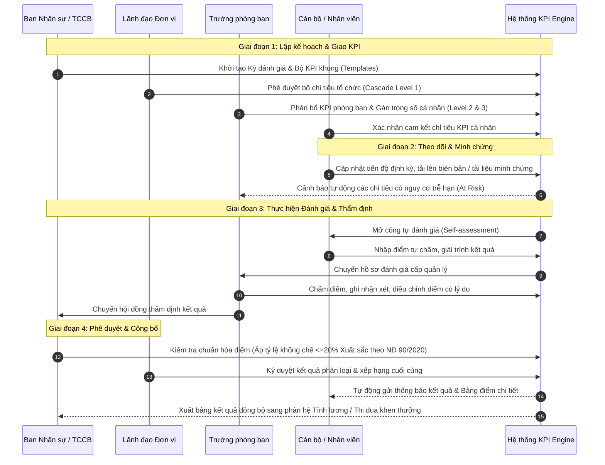

# TÀI LIỆU ĐẶC TẢ YÊU CẦU PHẦN MỀM (SRS)
## HỆ THỐNG QUẢN LÝ VÀ ĐÁNH GIÁ KPI CHO DOANH NGHIỆP VÀ CÁN BỘ CÔNG CHỨC
**Mã tài liệu:** SRS-KPI-V1.0  
**Giai đoạn:** Phiên 1 / 10 - Khảo sát & Phân tích Nghiệp vụ (System Requirements Analysis)  
**Tác giả:** Chuyên gia Phân tích Hệ thống (Senior System Analyst)  
**Đối tượng áp dụng:** Doanh nghiệp Nhà nước / Tư nhân & Cơ quan hành chính sự nghiệp  

---

## MỤC LỤC
1. [Giới thiệu & Bối cảnh bài toán](#1-giới-thiệu--bối-cảnh-bài-toán)
2. [Các bên liên quan & Chân dung người dùng (Stakeholders & Personas)](#2-các-bên-liên-quan--chân-dung-người-dùng)
3. [Phân tích quy trình nghiệp vụ AS-IS và TO-BE](#3-phân-tích-quy-trình-nghiệp-vụ-as-is-và-to-be)
4. [Yêu cầu chức năng chi tiết (Functional Requirements)](#4-yêu-cầu-chức-năng-chi-tiết-functional-requirements)
   - 4.1. Phân hệ Quản trị hệ thống (FR-ADM)
   - 4.2. Phân hệ Quản trị Danh mục dùng chung (FR-CAT)
   - 4.3. Phân hệ Thiết lập & Giao chỉ tiêu KPI (FR-SET)
   - 4.4. Phân hệ Thực thi & Đánh giá KPI (FR-EVA)
   - 4.5. Phân hệ Phân loại Cán bộ Công chức theo Nghị định (FR-PUB)
   - 4.6. Phân hệ Báo cáo, Phân tích & Dashboard (FR-REP)
   - 4.7. Phân hệ Tương tác & Thông báo (FR-NOT)
5. [Yêu cầu phi chức năng (Non-Functional Requirements - NFR)](#5-yêu-cầu-phi-chức-năng-non-functional-requirements)
6. [Hệ thống Ràng buộc Nghiệp vụ (Business Rules - BR)](#6-hệ-thống-ràng-buộc-nghiệp-vụ-business-rules)
7. [Ma trận Phân quyền & Trách nhiệm (RACI Matrix)](#7-ma-trận-phân-quyền--trách-nhiệm-raci-matrix)

---

## 1. GIỚI THIỆU & BỐI CẢNH BÀI TOÁN

### 1.1. Bối cảnh
Trong quản trị hiện đại, đo lường hiệu suất làm việc (Performance Management) qua chỉ số KPI (Key Performance Indicator) là điều kiện cốt lõi để thúc đẩy năng suất lao động:
- **Khối Doanh nghiệp (Private & State-Owned Enterprises):** Áp dụng mô hình BSC (Balanced Scorecard) với 4 viễn cảnh (Tài chính, Khách hàng, Quy trình nội bộ, Học hỏi & Phát triển) hoặc OKRs kết hợp KPIs. Trọng tâm là định lượng doanh thu, chi phí, tiến độ, năng suất và gắn với cơ chế đãi ngộ (Lương hiệu quả 3P, Thưởng KPI).
- **Khối Cơ quan Hành chính - Cán bộ Công chức (Public Sector):** Bắt buộc tuân thủ khung pháp lý nhà nước, cụ thể là **Nghị định số 90/2020/NĐ-CP** và **Nghị định số 48/2023/NĐ-CP** của Chính phủ về đánh giá, xếp loại chất lượng cán bộ, công chức, viên chức. Đánh giá phân loại theo 4 mức:
  1. Hoàn thành xuất sắc nhiệm vụ (khống chế không quá 20% số lượng công chức hoàn thành tốt nhiệm vụ trong cùng cơ quan).
  2. Hoàn thành tốt nhiệm vụ.
  3. Hoàn thành nhiệm vụ.
  4. Không hoàn thành nhiệm vụ.
  
Hệ thống phần mềm được thiết kế theo hướng **kiến trúc động (flexible engine)**, cho phép áp dụng đồng thời hoặc chuyển đổi linh hoạt theo mô hình Doanh nghiệp hoặc Cơ quan Nhà nước.

### 1.2. Mục tiêu hệ thống
- Tự động hóa toàn trình quy trình từ lập kế hoạch, phân bổ KPI, theo dõi tiến độ, tự đánh giá, thẩm định đa cấp đến ra quyết định xếp loại.
- Triệt tiêu hoàn toàn thủ tục giấy tờ, báo cáo Excel rời rạc, giảm 70% thời gian tổng hợp kỳ đánh giá.
- Minh bạch hóa kết quả, đảm bảo tính khách quan với bằng chứng (evidence-based evaluation).
- Cung cấp Dashboard số liệu thời gian thực (Real-time Analytics) cho Lãnh đạo các cấp.

---

## 2. CÁC BÊN LIÊN QUAN & CHÂN DUNG NGƯỜI DÙNG

| Nhóm Actor | Chức danh đại diện | Nhiệm vụ chính trong hệ thống | Mức độ tương tác |
|---|---|---|---|
| **Lãnh đạo cấp cao (Director/Executive)** | Tổng giám đốc, Thủ trưởng cơ quan, Chủ tịch UBND | Xem dashboard tổng thể, phê duyệt kế hoạch KPI toàn cơ quan, phê duyệt phân loại xếp loại cuối cùng, ký số kết quả | Định kỳ / Phê duyệt cấp cao |
| **Quản lý cấp trung (Manager/Supervisor)** | Trưởng/Phó phòng ban, Đội trưởng, Giám đốc khối | Phân bổ KPI xuống nhân viên, theo dõi tiến độ hàng tuần/tháng, đánh giá sơ bộ, nhận xét và chấm điểm nhân viên thuộc quyền | Thường xuyên hàng kỳ |
| **Nhân viên / Cán bộ công chức (Staff/Civil Servant)** | Chuyên viên, nhân viên kinh doanh, công chức ngạch cán sự/chuyên viên | Tiếp nhận chỉ tiêu, cập nhật tiến độ định kỳ, tự đánh giá (Self-assessment), đính kèm minh chứng, khiếu nại/phản hồi | Hàng tuần / Hàng tháng / Kỳ |
| **Bộ phận Nhân sự / Tổ chức cán bộ (HR/Officer Admin)** | Trưởng phòng HR, Chuyên viên quản lý hiệu suất | Quản lý danh mục KPI, thiết lập kỳ đánh giá, giám sát tiến độ hoàn thành, kiểm tra tỷ lệ khống chế xuất sắc 20%, xuất báo cáo lương thưởng | Toàn quyền nghiệp vụ KPI |
| **Quản trị hệ thống (System Administrator)** | Quản trị IT, Kỹ sư vận hành | Quản trị tài khoản, phân quyền RBAC, cấu hình tích hợp SSO/AD, sao lưu dự phòng, kiểm toán Audit log | Quản trị kỹ thuật |

---

## 3. PHÂN TÍCH QUY TRÌNH NGHIỆP VỤ AS-IS VÀ TO-BE

### 3.1. Quy trình hiện tại (AS-IS) - Nhược điểm & Điểm nghẽn
- **Giao chỉ tiêu:** Phân bổ thủ công qua file Excel hoặc văn bản giấy ký tay. Dễ thất lạc, khó đối soát liên phòng ban.
- **Theo dõi tiến độ:** Thiếu cơ chế cập nhật realtime; đến cuối kỳ mới dồn dập chuẩn bị báo cáo đối phó.
- **Đánh giá:** Tính cảm tính, nể nang ("dĩ hòa vi quý"), thiếu bằng chứng cụ thể. Việc bình xét công chức mất hàng tuần họp hội đồng.
- **Tổng hợp dữ liệu:** Cán bộ HR mất 2-3 tuần để tổng hợp hàng trăm file Excel, dễ xảy ra sai sót công thức, nhầm lẫn kết quả.

### 3.2. Quy trình đề xuất trên hệ thống (TO-BE)

---

## 4. YÊU CẦU CHỨC NĂNG CHI TIẾT (FUNCTIONAL REQUIREMENTS)

### 4.1. Phân hệ Quản trị hệ thống (FR-ADM)

| Mã YC | Tên chức năng | Mô tả chi tiết | Tác nhân chính | Mức độ ưu tiên |
|---|---|---|---|---|
| **FR-ADM-01** | Quản lý Đa tổ chức / Đơn vị | Quản lý danh sách công ty thành viên, cơ quan, sở ban ngành theo mô hình phân cấp cây (Tree structure). Hỗ trợ cấu hình logo, thông tin pháp nhân riêng. | Admin | Bắt buộc (Must) |
| **FR-ADM-02** | Quản lý Cơ cấu phòng ban | Thiết lập sơ đồ tổ chức, phòng, ban, trung tâm, tổ/đội. Định nghĩa mối quan hệ cấp trên - cấp dưới, hỗ trợ kiêm nhiệm. | Admin, HR | Bắt buộc (Must) |
| **FR-ADM-03** | Quản lý Hồ sơ người dùng | Quản lý thông tin cán bộ/nhân viên: Mã nhân sự, Họ tên, Email công vụ, Số điện thoại, Chức vụ, Ngạch bậc, Loại hợp đồng, Người quản lý trực tiếp. | Admin, HR | Bắt buộc (Must) |
| **FR-ADM-04** | Phân quyền vai trò (RBAC) | Cấu hình Role (Super Admin, Unit Director, Dept Manager, HR Officer, Staff/Civil Servant, Auditor). Cấp quyền theo ma trận Module x Action (Create, Read, Update, Delete, Approve, Export). | Admin | Bắt buộc (Must) |
| **FR-ADM-05** | Phân quyền phạm vi dữ liệu (Data Scope) | Hạn chế phạm vi nhìn thấy dữ liệu: Toàn cơ quan (Lãnh đạo, HR) - Nội bộ phòng ban (Trưởng phòng) - Chỉ cá nhân mình (Nhân viên). | Admin | Bắt buộc (Must) |
| **FR-ADM-06** | Quản lý Nhật ký kiểm toán (Audit Trail) | Ghi nhận chi tiết mọi hành vi quan trọng: Thời gian, Địa chỉ IP, Tài khoản thực hiện, Đối tượng thay đổi, Giá trị cũ (Old value), Giá trị mới (New value). Không được phép chỉnh sửa hoặc xóa log. | Admin, Auditor | Bắt buộc (Must) |
| **FR-ADM-07** | Cấu hình tham số hệ thống | Cấu hình máy chủ SMTP email, thời gian timeout phiên làm việc, định dạng ngày tháng, chính sách mật khẩu, giới hạn dung lượng tệp đính kèm (file upload limit: tối đa 25MB). | Admin | Nên có (Should) |

---

### 4.2. Phân hệ Quản trị Danh mục dùng chung (FR-CAT)

| Mã YC | Tên chức năng | Mô tả chi tiết | Tác nhân chính | Mức độ ưu tiên |
|---|---|---|---|---|
| **FR-CAT-01** | Danh mục Phân loại KPI | Quản lý các nhóm chỉ số: KPI Kết quả kinh doanh, KPI Quy trình hoạt động, KPI Học tập & Phát triển, KPI Đạo đức công vụ, KPI Nhiệm vụ đột xuất. | HR Admin | Bắt buộc (Must) |
| **FR-CAT-02** | Danh mục Kỳ đánh giá | Cấu hình linh hoạt các loại kỳ: Hàng tháng, Hàng quý, 6 tháng, Hàng năm. Thiết lập ngày mở kỳ, hạn chót nộp tự đánh giá, hạn chót phê duyệt của quản lý, ngày khóa sổ dữ liệu. | HR Admin | Bắt buộc (Must) |
| **FR-CAT-03** | Danh mục Thang điểm & Công thức | Hỗ trợ cấu hình nhiều loại thang điểm: Thang 100 điểm, Thang 10 điểm, Thang 5 điểm (Likert scale). Định nghĩa công thức tính tỷ lệ hoàn thành (Càng cao càng tốt, Càng thấp càng tốt, Trong khoảng tối ưu). | HR Admin | Bắt buộc (Must) |
| **FR-CAT-04** | Danh mục Mức xếp loại hiệu suất | Bảng ánh xạ điểm số sang mức xếp loại: A (Xuất sắc >= 90%), B (Tốt: 75% - <90%), C (Hoàn thành: 50% - <75%), D (Không hoàn thành: <50%). Cho phép tùy biến dải điểm theo quy chế nội bộ. | HR Admin | Bắt buộc (Must) |
| **FR-CAT-05** | Danh mục Đơn vị tính & Nguồn đo lường | Đơn vị: Triệu VNĐ, Tỷ lệ %, Khách hàng, Giờ, Tài liệu, Dự án. Nguồn kiểm chứng: ERP, CRM, Báo cáo thủ công, Biên bản nghiệm thu. | HR Admin | Bắt buộc (Must) |
| **FR-CAT-06** | Danh mục Chức danh & Ngạch bậc công chức | Quản lý danh mục ngạch công chức theo quy định Bộ Nội vụ: Chuyên viên cao cấp, Chuyên viên chính, Chuyên viên, Cán sự, Nhân viên; Khung tiêu chuẩn chức danh tương ứng. | HR Admin | Bắt buộc (Must) |

---

### 4.3. Phân hệ Thiết lập & Giao chỉ tiêu KPI (FR-SET)

| Mã YC | Tên chức năng | Mô tả chi tiết | Tác nhân chính | Mức độ ưu tiên |
|---|---|---|---|---|
| **FR-SET-01** | Xây dựng Thư viện KPI mẫu (Template) | Thiết lập kho KPI chuẩn theo từng vị trí chức danh công việc (Job Description) và từng phòng ban, giúp tái sử dụng cho các kỳ đánh giá tiếp theo. | HR Admin | Bắt buộc (Must) |
| **FR-SET-02** | Phân tầng chỉ tiêu (KPI Cascading) | Cho phép liên kết và phân rã mục tiêu: Chỉ tiêu cấp Đơn vị -> Chỉ tiêu cấp Phòng ban -> Chỉ tiêu cấp Cá nhân. Hiển thị sơ đồ cây phân rã mục tiêu (Goal Alignment Tree). | Lãnh đạo, Trưởng phòng | Bắt buộc (Must) |
| **FR-SET-03** | Giao KPI & Thiết lập Trọng số | Thiết lập danh sách KPI cho từng nhân viên/cán bộ. Mỗi KPI có: Tên chỉ tiêu, Đơn vị tính, Chỉ tiêu kế hoạch (Target), Ngưỡng tối thiểu (Min threshold), Trọng số (% Weight). | Trưởng phòng | Bắt buộc (Must) |
| **FR-SET-04** | Ràng buộc Tổng trọng số (Weight Validation) | Hệ thống tự động kiểm tra tổng trọng số của các KPI trong một bản giao phải đạt chính xác **100%**. Nếu khác 100%, hệ thống chặn hành động gửi phê duyệt. | Hệ thống | Bắt buộc (Must) |
| **FR-SET-05** | Quy trình Duyệt bản giao KPI | Cán bộ/Nhân viên kiểm tra, ký cam kết hoặc phản hồi chỉ tiêu; Trưởng phòng duyệt; Lãnh đạo cơ quan phê chuẩn. Sau khi duyệt, bản giao chuyển trạng thái "Đã khóa (Locked)". | Nhân viên, Quản lý, Lãnh đạo | Bắt buộc (Must) |
| **FR-SET-06** | Điều chỉnh KPI giữa kỳ (KPI Revision) | Trường hợp có biến động bất khả kháng hoặc đổi nhiệm vụ đột xuất: Cho phép tạo phiếu yêu cầu điều chỉnh mục tiêu, lưu lại lịch sử Versioning (V1, V2, V3...) kèm lý do giải trình. | Trưởng phòng, Lãnh đạo | Nên có (Should) |

---

### 4.4. Phân hệ Thực thi & Đánh giá KPI (FR-EVA)

| Mã YC | Tên chức năng | Mô tả chi tiết | Tác nhân chính | Mức độ ưu tiên |
|---|---|---|---|---|
| **FR-EVA-01** | Cập nhật số liệu thực hiện định kỳ | Người dùng nhập số liệu thực hiện (Actual Value) theo tuần/tháng. Hệ thống tự động tính tỷ lệ hoàn thành tạm tính (% Completion) và điểm quy đổi. | Nhân viên | Bắt buộc (Must) |
| **FR-EVA-02** | Quản lý Minh chứng đính kèm (Evidence Attachment) | Cho phép tải lên tệp minh chứng kết quả (PDF, Word, Excel, Hình ảnh) hoặc chèn URL liên kết đến tài liệu báo cáo kết quả công việc. | Nhân viên | Bắt buộc (Must) |
| **FR-EVA-03** | Phiếu tự đánh giá của nhân viên (Self-Assessment) | Khi đến hạn mở kỳ, nhân viên điền kết quả thực tế, điểm tự chấm, bản tự nhận xét ưu nhược điểm cá nhân và bấm "Gửi thẩm định". | Nhân viên | Bắt buộc (Must) |
| **FR-EVA-04** | Đánh giá của Quản lý trực tiếp (Manager Review) | Quản lý thẩm tra số liệu, xem minh chứng, chấm điểm chính thức cho nhân viên. Nếu điều chỉnh điểm so với tự chấm > 10%, bắt buộc phải nhập lý do giải trình. | Trưởng phòng | Bắt buộc (Must) |
| **FR-EVA-05** | Đánh giá 360 độ (Peer Review - Tùy chọn) | Hỗ trợ cấu hình đánh giá ngang hàng: Đồng nghiệp cùng cấp hoặc các phòng ban phối hợp tham gia chấm điểm chỉ số hành vi/thái độ phối hợp (Behavioral KPI). | Cán bộ nhân viên | Có thể có (Could) |
| **FR-EVA-06** | Quy trình Thẩm định đa cấp (Workflow Approval) | Định tuyến luồng duyệt theo cấu hình tổ chức: Nhân viên -> Quản lý trực tiếp -> Hội đồng lương/Tổ chức cán bộ -> Thủ trưởng đơn vị phê chuẩn cuối cùng. | Đa tác nhân | Bắt buộc (Must) |
| **FR-EVA-07** | Cơ chế Khiếu nại kết quả (Dispute / Appeal) | Nhân viên có quyền gửi yêu cầu giải trình lại kết quả trong vòng 03 ngày làm việc kể từ khi nhận điểm. Quản lý cấp trên tiến hành xem xét phản hồi. | Nhân viên, Quản lý | Nên có (Should) |

---

### 4.5. Phân hệ Phân loại Cán bộ Công chức theo Nghị định (FR-PUB)

> Phân hệ chuyên biệt dành cho Cơ quan Nhà nước và Doanh nghiệp Nhà nước áp dụng Nghị định 90/2020/NĐ-CP và Nghị định 48/2023/NĐ-CP.

| Mã YC | Tên chức năng | Mô tả chi tiết | Tác nhân chính | Mức độ ưu tiên |
|---|---|---|---|---|
| **FR-PUB-01** | Đánh giá Tiêu chí Đạo đức & Chính trị Tư tưởng | Phiếu đánh giá tích hợp các tiêu chí định tính chuẩn: Tư tưởng chính trị; Đạo đức, lối sống; Tác phong, lề lối làm việc; Ý thức tổ chức kỷ luật; Tinh thần trách nhiệm trong công vụ. | Cán bộ, Quản lý | Bắt buộc (Must) |
| **FR-PUB-02** | Đánh giá Kết quả thực hiện chức trách, nhiệm vụ | Đo lường tiến độ và chất lượng công việc được giao theo vị trí việc làm; Khối lượng công việc; Tính chủ động, sáng tạo trong cải cách hành chính. | Cán bộ, Lãnh đạo | Bắt buộc (Must) |
| **FR-PUB-03** | Tổ chức Phiếu lấy ý kiến nhận xét của Cấp ủy / Tập thể | Biểu mẫu ghi nhận ý kiến nhận xét của chi ủy, tổ chức đoàn thể và tập thể cơ quan nơi công tác trước khi Hội đồng họp phân loại. | Thư ký Hội đồng | Bắt buộc (Must) |
| **FR-PUB-04** | Kiểm soát Tỷ lệ khống chế Xuất sắc (<= 20%) | **Cảnh báo và Chặn cưỡng bức:** Số cán bộ công chức xếp loại "Hoàn thành xuất sắc nhiệm vụ" không được vượt quá **20%** tổng số cán bộ xếp loại "Hoàn thành tốt nhiệm vụ" trong toàn đơn vị theo quy định Chính phủ. | Hệ thống, HR Admin | Bắt buộc (Must) |
| **FR-PUB-05** | Xử lý Điểm hạ bậc kỷ luật tự động | Nếu cán bộ bị xử lý kỷ luật Đảng hoặc kỷ luật hành chính trong năm: Hệ thống tự động khóa không cho xếp loại "Hoàn thành tốt" hoặc "Xuất sắc", chuyển sang "Không hoàn thành nhiệm vụ" theo quy định. | Hệ thống | Bắt buộc (Must) |
| **FR-PUB-06** | Xuất Biên bản Đánh giá & Phiếu phân loại chuẩn | Tự động điền dữ liệu và xuất file mẫu Mẫu số 01, Mẫu số 02 ban hành kèm theo Nghị định 90/2020/NĐ-CP chuẩn định dạng Word/PDF để lưu hồ sơ cán bộ. | HR Admin | Bắt buộc (Must) |

---

### 4.6. Phân hệ Báo cáo, Phân tích & Dashboard (FR-REP)

| Mã YC | Tên chức năng | Mô tả chi tiết | Tác nhân chính | Mức độ ưu tiên |
|---|---|---|---|---|
| **FR-REP-01** | Executive Dashboard cho Lãnh đạo | Biểu đồ trực quan: Tỷ lệ hoàn thành mục tiêu toàn cơ quan, Biểu đồ phân bổ xếp loại (Phân phối chuẩn hình chuông Gauss), Tỷ lệ tiến độ nộp báo cáo theo phòng ban. | Lãnh đạo | Bắt buộc (Must) |
| **FR-REP-02** | Manager Dashboard cho Trưởng bộ phận | Bảng theo dõi sức khỏe hiệu suất phòng ban: Nhân viên xuất sắc nhất, Nhân viên chậm tiến độ, Chỉ tiêu phòng ban đang báo động đỏ (Overdue / Behind Target). | Trưởng phòng | Bắt buộc (Must) |
| **FR-REP-03** | Bảng xếp hạng Hiệu suất (Performance Ranking) | Bảng xếp thứ hạng cán bộ/nhân viên theo điểm số chuẩn hóa tổng hợp, hỗ trợ lọc theo phòng ban, ngạch bậc, chức danh. | Lãnh đạo, HR | Nên có (Should) |
| **FR-REP-04** | Báo cáo Phân tích Xu hướng (Trend Analysis) | So sánh biến động hiệu suất qua các quý/năm của từng phòng ban và cá nhân; Phát hiện sớm sự sụt giảm năng suất lao động. | HR, Lãnh đạo | Nên có (Should) |
| **FR-REP-05** | Xuất dữ liệu Báo cáo đa định dạng | Xuất dữ liệu linh hoạt ra định dạng: Excel (phục vụ tính lương thưởng), PDF (in ấn ký tá), CSV. Hỗ trợ tạo mẫu báo cáo thống kê theo yêu cầu cơ quan cấp trên. | HR Admin | Bắt buộc (Must) |

---

### 4.7. Phân hệ Tương tác & Thông báo (FR-NOT)

| Mã YC | Tên chức năng | Mô tả chi tiết | Tác nhân chính | Mức độ ưu tiên |
|---|---|---|---|---|
| **FR-NOT-01** | Thông báo trong ứng dụng (In-App Notification) | Hiển thị chuông thông báo thời gian thực (Real-time bell): Khi được giao KPI, khi có phiếu cần đánh giá, khi điểm số được phê duyệt, khi bị từ chối phê duyệt. | Toàn bộ Actor | Bắt buộc (Must) |
| **FR-NOT-02** | Nhắc nhở thời hạn tự động (Deadline Alerts) | Hệ thống tự động gửi email/thông báo nhắc việc trước 03 ngày, 01 ngày và vào ngày hết hạn nộp tự đánh giá hoặc hết hạn duyệt. | Hệ thống | Bắt buộc (Must) |
| **FR-NOT-03** | Gửi thông báo Email theo Mẫu (Email Templates) | Tự động sinh nội dung email chuyên nghiệp theo mẫu cấu hình sẵn, có đính kèm đường dẫn trực tiếp (Deep Link) đến màn hình xử lý công việc. | Hệ thống | Bắt buộc (Must) |

---

## 5. YÊU CẦU PHI CHỨC NĂNG (NON-FUNCTIONAL REQUIREMENTS)

### 5.1. Hiệu năng & Khả năng tải (Performance & Scalability - NFR-PERF)
- **NFR-PERF-01 (Concurrent Users):** Hệ thống đáp ứng tối thiểu **500 người dùng thao tác đồng thời (Concurrent Active Users)** trong các giai đoạn cao điểm cuối kỳ đánh giá mà không bị nghẽn hệ thống.
- **NFR-PERF-02 (Response Time):** Thời gian phản hồi trang đối với các thao tác thông thường (truy vấn danh sách, lưu form) **<= 1.5 giây**. Thời gian tạo báo cáo phức tạp hoặc trích xuất Excel toàn cơ quan **<= 5.0 giây**.
- **NFR-PERF-03 (Throughput):** Hỗ trợ throughput tối thiểu 200 requests/giây (TPS) ở cấu hình máy chủ tiêu chuẩn.
- **NFR-PERF-04 (High Availability):** Chỉ số sẵn sàng của hệ thống đạt **99.9% uptime** (không tính thời gian bảo trì định kỳ có thông báo trước).

### 5.2. Bảo mật & An toàn thông tin (Security & Compliance - NFR-SEC)
- **NFR-SEC-01 (Authentication & Authorization):** Xác thực tài khoản bằng JWT (JSON Web Token) kết hợp cơ chế Refresh Token xoay vòng (Token Rotation). Hỗ trợ xác thực đa yếu tố (2FA - OTP qua Email/Authenticator App) cho tài khoản Quản trị và Lãnh đạo.
- **NFR-SEC-02 (Data Encryption):**
  - Dữ liệu truyền tải trên đường truyền bắt buộc sử dụng giao thức bảo mật **TLS 1.3 / HTTPS**.
  - Dữ liệu mật khẩu lưu trữ trong CSDL phải được băm bằng thuật toán an toàn một chiều (Argon2id hoặc BCrypt với salt độ dài >= 12 rounds).
  - Dữ liệu nhạy cảm (Điểm số cá nhân, lương thưởng đính kèm) được mã hóa ở cấp CSDL (Transparent Data Encryption - TDE hoặc AES-256).
- **NFR-SEC-03 (Security Standards):** Phòng chống tuyệt đối các lỗ hổng theo chuẩn **OWASP Top 10** (SQL Injection, XSS, CSRF, Broken Object Level Authorization - BOLA, Insecure Deserialization).
- **NFR-SEC-04 (Audit Compliance):** Tất cả các thao tác thay đổi điểm số và phê duyệt kết quả bắt buộc phải ghi vết đầy đủ (Audit Log) không thể chỉnh sửa hoặc xóa bởi bất kỳ người dùng nào, kể cả Super Admin.

### 5.3. Khả năng Tích hợp & Mở rộng (Integration & Extensibility - NFR-INT)
- **NFR-INT-01 (Single Sign-On - SSO):** Hỗ trợ tích hợp SSO theo giao thức chuẩn công nghiệp: OAuth 2.0 / OpenID Connect, SAML 2.0, Microsoft Active Directory / LDAP và hệ thống định danh điện tử công vụ.
- **NFR-INT-02 (Open API):** Xây dựng hệ thống RESTful API chuẩn hóa, tài liệu hóa bằng Swagger/OpenAPI 3.0, phục vụ đồng bộ dữ liệu hai chiều với hệ thống Quản lý nhân sự (HRM), Chấm công và Quản lý văn bản (E-Office).

### 5.4. Tính khả dụng & Tương thích (Usability & Compatibility - NFR-USA)
- **NFR-USA-01 (Responsive Design):** Giao diện tương thích hoàn hảo trên mọi kích thước màn hình: Desktop (1920x1080, 1366x768), Tablet (iPad/Android) và Thiết bị di động (iOS/Android).
- **NFR-USA-02 (User Experience):** Tuân thủ triết lý thiết kế trực quan, người dùng phổ thông có thể thực hiện tự đánh giá KPI mà không cần quá 15 phút đào tạo hướng dẫn.
- **NFR-USA-03 (Cross-Browser):** Hỗ trợ tốt trên tất cả các trình duyệt phổ biến hiện đại: Google Chrome, Microsoft Edge, Mozilla Firefox, Safari.

---

## 6. HỆ THỐNG RÀNG BUỘC NGHIỆP VỤ (BUSINESS RULES)

| Mã BR | Tên quy tắc nghiệp vụ | Mô tả chi tiết & Công thức kiểm soát | Phân loại áp dụng |
|---|---|---|---|
| **BR-01** | Tổng trọng số chỉ tiêu | Tổng trọng số các KPI của một cá nhân trong một kỳ đánh giá bắt buộc phải bằng chính xác: $\sum \text{Weight}_i = 100\%$. Không cho phép lớn hơn hoặc nhỏ hơn. | Doanh nghiệp & Công chức |
| **BR-02** | Giới hạn trọng số đơn lẻ | Không có chỉ tiêu KPI nào có trọng số $< 5\%$ (tránh chỉ tiêu vụn vặt) hoặc $> 50\%$ (trừ trường hợp giao khoán dự án đặc biệt được phê chuẩn). | Khuyến nghị áp dụng |
| **BR-03** | Khóa dữ liệu bản giao (Lock on Submit) | Sau khi bản giao KPI được Lãnh đạo phê duyệt, toàn bộ mục tiêu, trọng số và chỉ tiêu kế hoạch bị đóng băng; không ai được phép tự ý sửa đổi trực tiếp. | Toàn hệ thống |
| **BR-04** | Trình tự đánh giá bắt buộc | Quản lý không thể tiến hành chấm điểm cho nhân viên nếu nhân viên đó chưa hoàn thành bước "Tự đánh giá", trừ trường hợp quá hạn bị "Cưỡng bức chuyển trạng thái". | Toàn hệ thống |
| **BR-05** | Bắt buộc giải trình điều chỉnh điểm | Khi Quản lý chấm điểm lệch quá $\pm 10\%$ so với mức nhân viên tự chấm, hệ thống bắt buộc Quản lý phải nhập trường "Lý do giải trình điều chỉnh" $\ge 50$ ký tự. | Toàn hệ thống |
| **BR-06** | Tỷ lệ khống chế Xuất sắc Nghị định 90 | Số cán bộ, công chức xếp loại "Hoàn thành xuất sắc nhiệm vụ" không được vượt quá **20%** số cán bộ, công chức được xếp loại "Hoàn thành tốt nhiệm vụ" thuộc cùng cơ quan/đơn vị:    $N_{\text{Xuất sắc}} \le 0.20 \times N_{\text{Hoàn thành tốt}}$. | Cán bộ Công chức |
| **BR-07** | Điểm liệt do kỷ luật | Cán bộ, công chức bị kỷ luật Đảng hoặc kỷ luật hành chính trong kỳ đánh giá thì tự động bị xếp loại **"Không hoàn thành nhiệm vụ"**, bất kể điểm số KPI định lượng đạt bao nhiêu. | Cán bộ Công chức |
| **BR-08** | Điều kiện xếp loại Xuất sắc | Để được xếp loại Xuất sắc, ngoài điểm KPI định lượng $\ge 90\%$, bắt buộc phải có ít nhất 01 sáng kiến, giải pháp cải tiến công vụ hoặc đề tài nghiên cứu được cấp có thẩm quyền công nhận. | Cán bộ Công chức |
| **BR-09** | Bắt buộc minh chứng cho kết quả tối đa | Đối với các chỉ tiêu có kết quả thực hiện đạt $\ge 120\%$ kế hoạch (vượt mức), bắt buộc phải có tài liệu tệp đính kèm làm căn cứ chứng minh. | Toàn hệ thống |
| **BR-10** | Công thức tính tỷ lệ hoàn thành (Càng cao càng tốt) | Tỷ lệ % hoàn thành = $\min\left(\frac{\text{Thực tế}}{\text{Kế hoạch}} \times 100\%, \text{Ngưỡng chặn trần MaxCap}\right)$. Mặc định MaxCap = $150\%$. | Doanh nghiệp |
| **BR-11** | Công thức tính tỷ lệ hoàn thành (Càng thấp càng tốt) | Áp dụng cho các chỉ số chi phí, tỷ lệ lỗi, sự cố:   Nếu $\text{Thực tế} \le \text{Kế hoạch} \implies \% = \left(2 - \frac{\text{Thực tế}}{\text{Kế hoạch}}\right) \times 100\%$. Nếu âm thì lấy 0. | Doanh nghiệp |
| **BR-12** | Đóng kỳ đánh giá tự động (Auto-Close) | Khi đến ngày giờ khóa sổ kỳ (Cut-off date), nếu nhân viên vẫn chưa gửi tự đánh giá, hệ thống tự động gán điểm tự đánh giá bằng **0** và đẩy thẳng phiếu lên cho Quản lý chấm. | Toàn hệ thống |
| **BR-13** | Xử lý kiêm nhiệm | Nhân viên giữ chức danh kiêm nhiệm sẽ có 02 bản giao KPI độc lập tương ứng với 02 phòng ban/vị trí. Trọng số tổng hợp cuối kỳ được tính theo tỷ lệ thỏa thuận (VD: Chính 70% - Kiêm nhiệm 30%). | Doanh nghiệp & Công chức |
| **BR-14** | Thời hạn khiếu nại kết quả | Quyền khiếu nại chỉ có hiệu lực trong vòng **03 ngày làm việc** (72 giờ làm việc) kể từ thời điểm hệ thống gửi thông báo kết quả chính thức cho nhân viên. | Toàn hệ thống |
| **BR-15** | Bất biến dữ liệu quá khứ (Data Immutability) | Dữ liệu các kỳ đánh giá đã được Lãnh đạo ký duyệt và đóng sổ kỳ sẽ chuyển sang chế độ "Chỉ đọc (Read-only)" vĩnh viễn, phục vụ thanh tra/kiểm toán. | Toàn hệ thống |
| **BR-16** | Nhân sự mới / Nghỉ thai sản | Nhân sự có thời gian công tác trong kỳ $< 3$ tháng không thuộc diện đánh giá xếp loại thi đua năm, nhưng vẫn đánh giá hoàn thành nhiệm vụ theo quy chế cơ quan. | Doanh nghiệp & Công chức |
| **BR-17** | Phân cấp thẩm quyền nâng ngạch bậc | Kết quả đánh giá 02 năm liên tiếp "Hoàn thành xuất sắc nhiệm vụ" là điều kiện tiên quyết để hệ thống gắn cờ gợi ý "Đủ điều kiện xét nâng bậc lương trước thời hạn". | Cán bộ Công chức |
| **BR-18** | Độc lập trong đánh giá 360 | Điểm đánh giá của đồng nghiệp (Peer Review) được ẩn danh người chấm (Anonymous) đối với người được đánh giá, chỉ có HR Admin được xem để tránh xung đột nội bộ. | Doanh nghiệp |
| **BR-19** | Ràng buộc phân quyền dữ liệu ngang | Trưởng phòng A tuyệt đối không được xem chi tiết phiếu đánh giá của cán bộ thuộc Phòng B, trừ khi được Lãnh đạo cấp cao ủy quyền thẩm định chéo. | Toàn hệ thống |
| **BR-20** | Tính điểm tổng hợp theo thang chuẩn 100 | Điểm KPI tổng hợp cuối cùng = $\sum_{i=1}^n (\text{Điểm KPI}_i \times \text{Trọng số}_i)$. Kết quả làm tròn đến 02 chữ số thập phân. | Toàn hệ thống |

---

## 7. MA TRẬN PHÂN QUYỀN & TRÁCH NHIỆM (RACI MATRIX)

| Quy trình / Nghiệp vụ | Lãnh đạo Đơn vị | Quản lý Phòng ban | Cán bộ / Nhân viên | Bộ phận Nhân sự (HR/TCCB) | Quản trị viên (Admin) |
|---|:---:|:---:|:---:|:---:|:---:|
| 1. Cấu hình cơ cấu tổ chức & người dùng | I | I | I | C | **R / A** |
| 2. Thiết lập danh mục & Thư viện KPI | A | C | I | **R** | I |
| 3. Khởi tạo Kỳ đánh giá mới | A | I | I | **R** | I |
| 4. Phân bổ mục tiêu xuống phòng ban | **A** | **R** | I | C | I |
| 5. Thiết lập chỉ tiêu & Trọng số cá nhân | I | **A** | **R** | C | I |
| 6. Phê duyệt bản cam kết KPI đầu kỳ | C | **A** | R | I | I |
| 7. Cập nhật tiến độ & Minh chứng định kỳ | I | C | **R** | I | I |
| 8. Lập phiếu Tự đánh giá (Self-assessment) | I | I | **R** | I | I |
| 9. Thẩm định & Chấm điểm nhân viên | I | **R** | I | C | I |
| 10. Kiểm tra khống chế tỷ lệ 20% (NĐ 90) | I | I | I | **R / A** | I |
| 11. Họp Hội đồng & Phê duyệt xếp loại | **A** | C | I | R | I |
| 12. Công bố kết quả & Tiếp nhận khiếu nại | I | C | **R** | A | I |
| 13. Xem Báo cáo Dashboard & Trích xuất lương | **R / A** | R | I | **R** | I |
