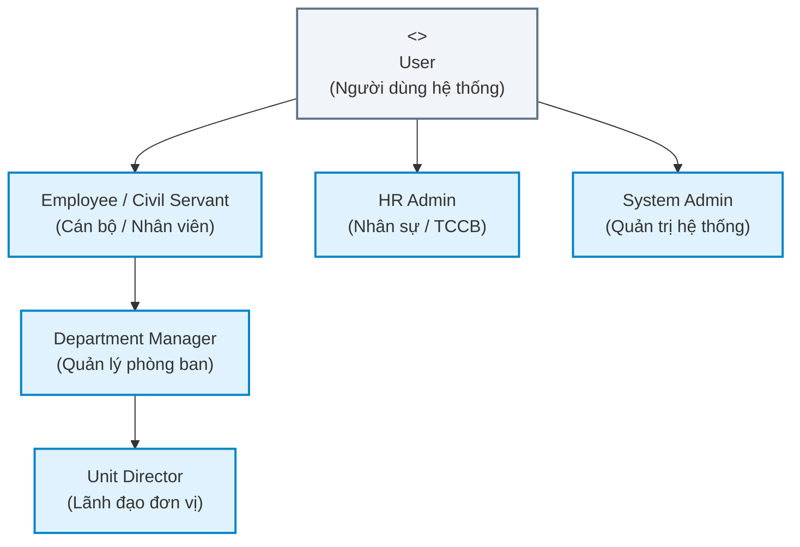
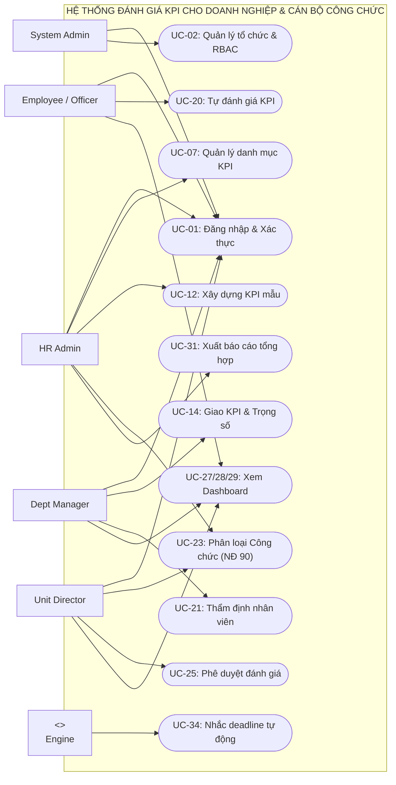
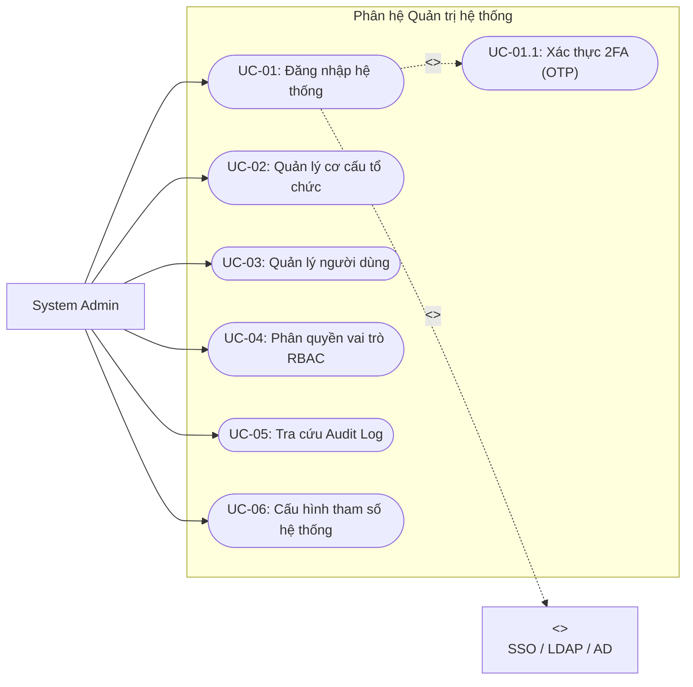
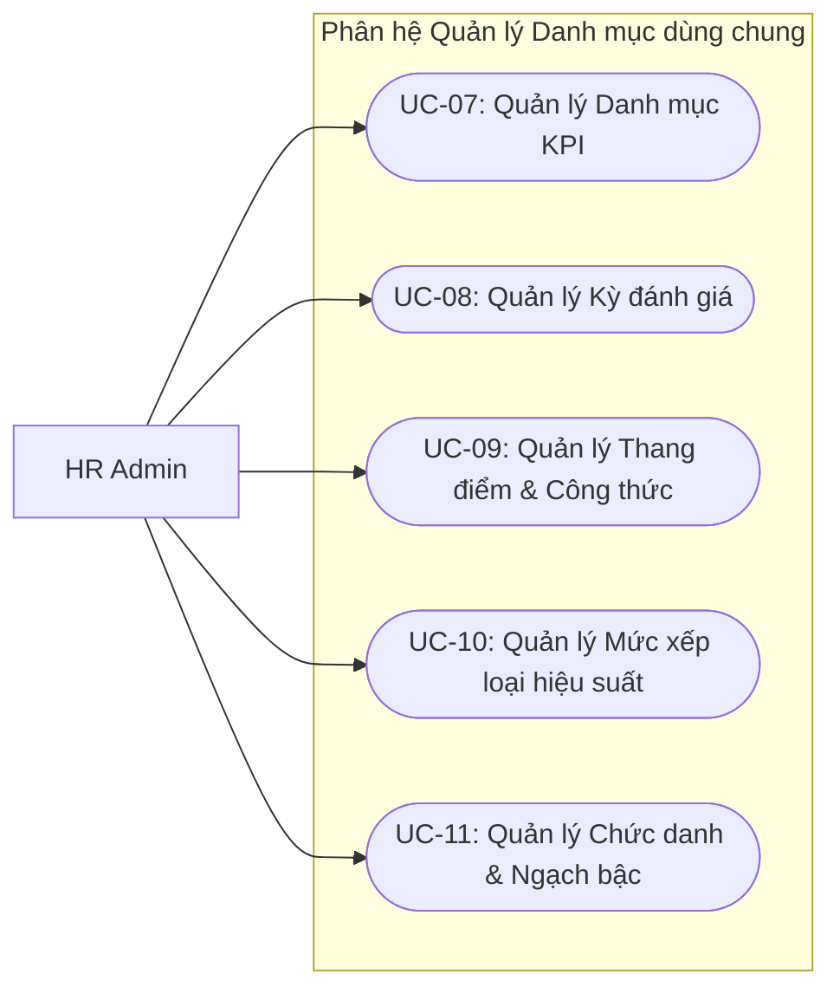
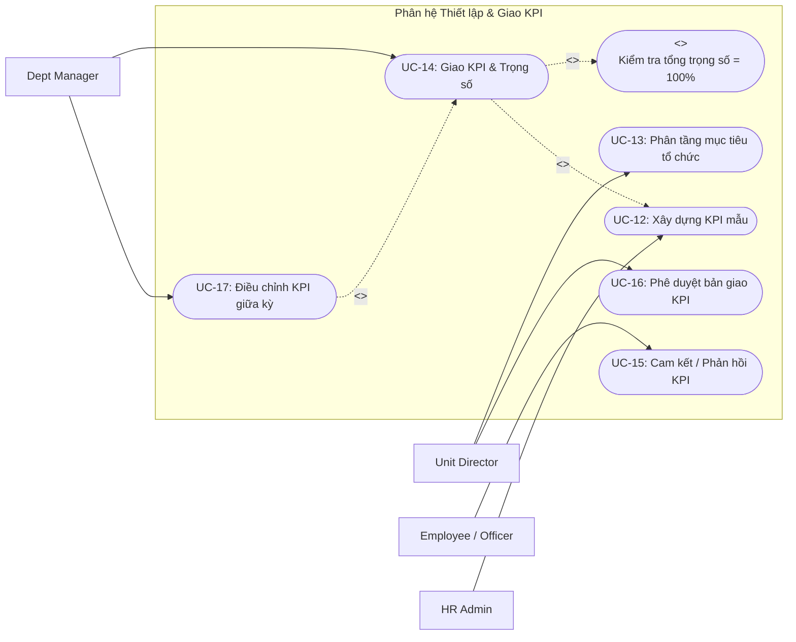
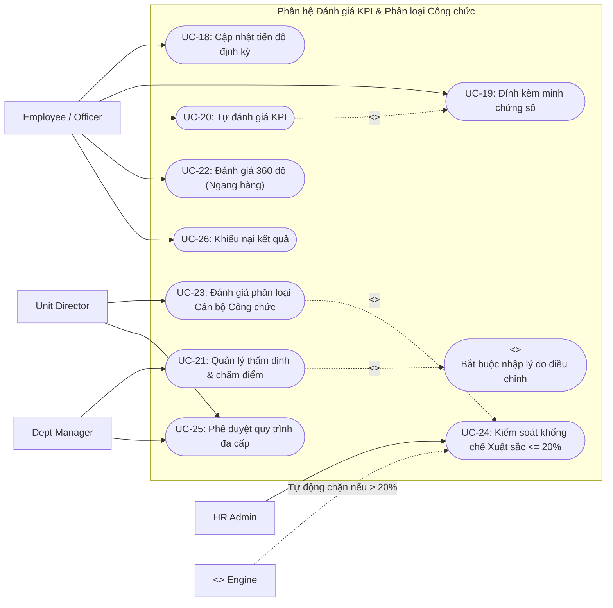
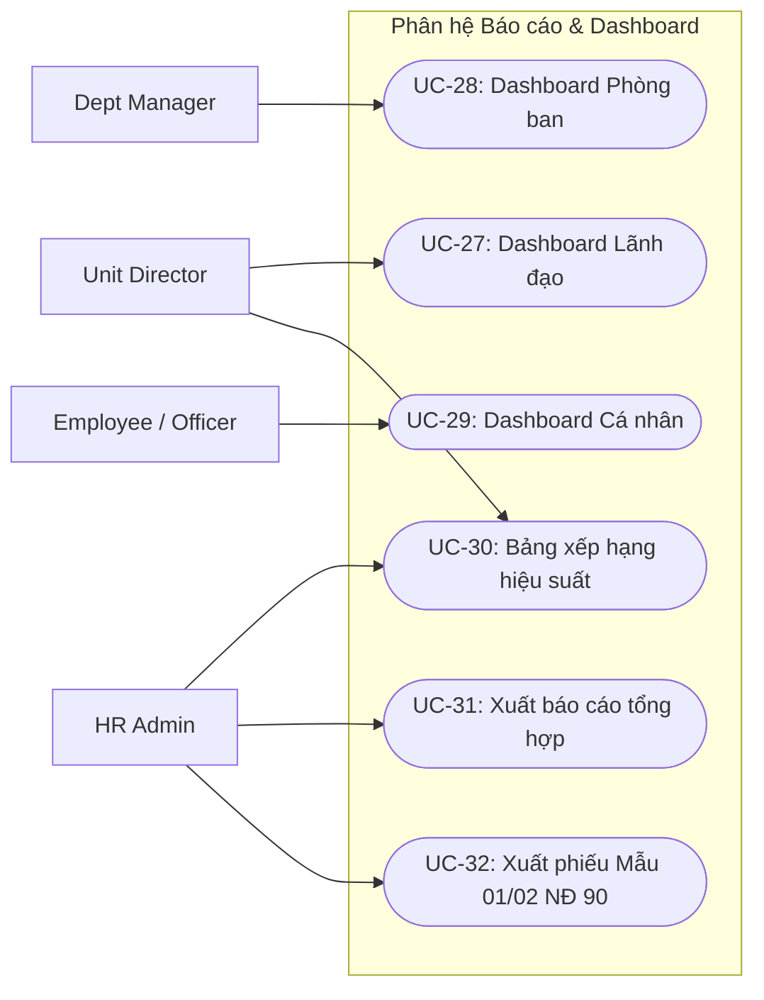
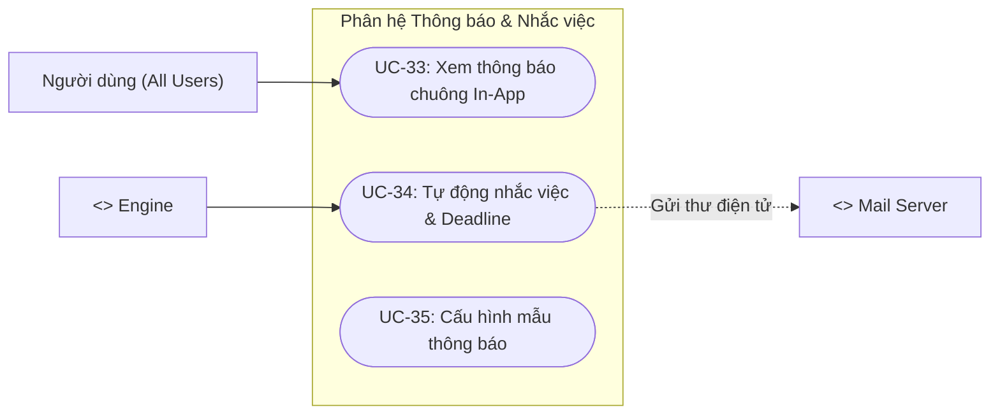

# TÀI LIỆU MÔ HÌNH HÓA USE CASE (USE CASE MODEL)
## HỆ THỐNG QUẢN LÝ VÀ ĐÁNH GIÁ KPI CHO DOANH NGHIỆP VÀ CÁN BỘ CÔNG CHỨC
**Mã tài liệu:** UCM-KPI-V1.0  
**Giai đoạn:** Phiên 2 / 10 - Mô hình hóa Ca sử dụng (Use Case Modeling)  
**Tác giả:** Chuyên gia Phân tích Hệ thống (Senior System Analyst)  
**Tài liệu tham chiếu:** [Tài liệu SRS Phiên 1 (SRS-KPI-V1.0)](file:///d:/KPI/docs/Session_01_SRS_Requirements.md)  

---

## MỤC LỤC
1. [Hệ thống Tác nhân (Actors Identification & Hierarchy)](#1-hệ-thống-tác-nhân-actors-identification--hierarchy)
2. [Danh mục Use Case toàn hệ thống](#2-danh-mục-use-case-toàn-hệ-thống)
3. [Hệ thống Biểu đồ Use Case (Use Case Diagrams)](#3-hệ-thống-biểu-đồ-use-case-use-case-diagrams)
   - 3.1. Biểu đồ Use Case tổng quan toàn hệ thống
   - 3.2. Biểu đồ Phân hệ Quản trị hệ thống
   - 3.3. Biểu đồ Phân hệ Quản lý Danh mục
   - 3.4. Biểu đồ Phân hệ Thiết lập & Giao KPI
   - 3.5. Biểu đồ Phân hệ Đánh giá KPI & Công chức
   - 3.6. Biểu đồ Phân hệ Báo cáo & Dashboard
   - 3.7. Biểu đồ Phân hệ Thông báo & Nhắc việc
4. [Đặc tả Use Case chi tiết (Fully Dressed Use Case Specifications)](#4-đặc-tả-use-case-chi-tiết-fully-dressed)
   - UC-01: Đăng nhập & Xác thực hệ thống
   - UC-02: Quản lý cơ cấu tổ chức & phòng ban
   - UC-03: Quản lý danh mục KPI dùng chung
   - UC-04: Xây dựng bộ KPI mẫu (Template)
   - UC-05: Giao KPI & Thiết lập trọng số
   - UC-06: Tự đánh giá KPI cá nhân & Đính kèm minh chứng
   - UC-07: Quản lý trực tiếp thẩm định & Đánh giá nhân viên
   - UC-08: Phê duyệt quy trình đánh giá đa cấp
   - UC-09: Xem Dashboard tổng quan & Xuất báo cáo
   - UC-10: Đánh giá phân loại cán bộ công chức theo Nghị định 90/2020/NĐ-CP
5. [Ma trận Phân quyền CRUD Actor - Use Case](#5-ma-trận-phân-quyền-crud-actor---use-case)

---

## 1. HỆ THỐNG TÁC NHÂN (ACTORS IDENTIFICATION & HIERARCHY)

### 1.1. Bảng phân tích chi tiết Tác nhân

| Nhóm | Tên Actor | Phân loại | Mục đích & Trách nhiệm trong hệ thống |
|---|---|---|---|
| **ACT-01** | **User (Người dùng hệ thống)** | Abstract / Base | Tác nhân cơ sở trừu tượng. Đại diện cho mọi tài khoản hợp lệ đã được xác thực vào hệ thống (đổi mật khẩu, xem hồ sơ cá nhân, nhận thông báo). |
| **ACT-02** | **Employee / Civil Servant (Cán bộ / Nhân viên)** | Primary Actor | Kế thừa từ `User`. Tiếp nhận chỉ tiêu KPI, cam kết mục tiêu, cập nhật tiến độ định kỳ, tải lên minh chứng số, lập phiếu tự đánh giá, gửi khiếu nại. |
| **ACT-03** | **Department Manager (Quản lý Phòng ban)** | Primary Actor | Kế thừa từ `Employee`. Quản lý nhân sự thuộc bộ phận; phân rã và giao KPI cho nhân viên; theo dõi tiến độ; chấm điểm thẩm định cấp 1; giải trình điều chỉnh điểm. |
| **ACT-04** | **Unit Director (Lãnh đạo Cơ quan / Doanh nghiệp)** | Primary Actor | Kế thừa từ `Department Manager`. Xem dashboard vĩ mô; phê duyệt kế hoạch KPI toàn cơ quan; chủ trì hội đồng phân loại; phê chuẩn kết quả đánh giá cuối cùng. |
| **ACT-05** | **HR Admin (Chuyên viên Nhân sự / Tổ chức cán bộ)** | Primary Actor | Kế thừa từ `User`. Quản trị danh mục KPI, thiết lập kỳ đánh giá, giám sát tiến độ thực thi toàn hệ thống, kiểm soát tỷ lệ khống chế xuất sắc 20%, trích xuất số liệu tiền lương. |
| **ACT-06** | **System Admin (Quản trị viên kỹ thuật)** | Primary Actor | Kế thừa từ `User`. Cấu hình kỹ thuật hệ thống, quản lý cơ cấu tổ chức, quản lý tài khoản, cấu hình ma trận phân quyền RBAC, kiểm toán nhật ký an toàn (Audit Log). |
| **ACT-07** | **System Engine (Hệ thống tự động)** | Secondary Actor | Tác nhân nền ngầm (Background Job/Cron). Tự động tính toán điểm tỷ lệ %, tự động khóa kỳ khi hết hạn (Auto-close), quét deadline và bắn thông báo/email định kỳ. |
| **ACT-08** | **External System (Hệ thống ngoại vi)** | Secondary / External | Tích hợp bên ngoài: Identity Provider (SSO, Active Directory, LDAP, VNeID), Hệ thống E-Office (ký số, văn bản), Hệ thống HRM/Tính lương. |

### 1.2. Biểu đồ Kế thừa Tác nhân (Actor Generalization Hierarchy)

---

## 2. DANH MỤC USE CASE TOÀN HỆ THỐNG

| STT | Mã Use Case | Tên Use Case | Phân hệ trực thuộc | Actor chính | Actor hỗ trợ |
|:---:|---|---|---|---|---|
| 1 | **UC-01** | Đăng nhập & Xác thực hệ thống | Quản trị hệ thống | User | External SSO |
| 2 | **UC-02** | Quản lý cơ cấu tổ chức & phòng ban | Quản trị hệ thống | System Admin | HR Admin |
| 3 | **UC-03** | Quản lý người dùng & hồ sơ cán bộ | Quản trị hệ thống | System Admin | HR Admin |
| 4 | **UC-04** | Phân quyền vai trò & phạm vi dữ liệu | Quản trị hệ thống | System Admin | - |
| 5 | **UC-05** | Giám sát & Tra cứu nhật ký kiểm toán | Quản trị hệ thống | System Admin | - |
| 6 | **UC-06** | Cấu hình tham số hệ thống & Email | Quản trị hệ thống | System Admin | - |
| 7 | **UC-07** | Quản lý danh mục KPI dùng chung | Quản lý danh mục | HR Admin | - |
| 8 | **UC-08** | Quản lý kỳ đánh giá | Quản lý danh mục | HR Admin | System Engine |
| 9 | **UC-09** | Quản lý thang điểm & công thức đo lường | Quản lý danh mục | HR Admin | - |
| 10 | **UC-10** | Quản lý mức xếp loại hiệu suất | Quản lý danh mục | HR Admin | - |
| 11 | **UC-11** | Quản lý chức danh & ngạch bậc công chức | Quản lý danh mục | HR Admin | - |
| 12 | **UC-12** | Xây dựng bộ KPI mẫu (Template) | Thiết lập KPI | HR Admin | Dept Manager |
| 13 | **UC-13** | Phân tầng mục tiêu tổ chức (Cascade KPI) | Thiết lập KPI | Unit Director | Dept Manager |
| 14 | **UC-14** | Giao KPI & Thiết lập trọng số | Thiết lập KPI | Dept Manager | Employee |
| 15 | **UC-15** | Cam kết & Phản hồi bản giao KPI | Thiết lập KPI | Employee | Dept Manager |
| 16 | **UC-16** | Phê duyệt kế hoạch KPI đầu kỳ | Thiết lập KPI | Unit Director | Dept Manager |
| 17 | **UC-17** | Điều chỉnh KPI giữa kỳ | Thiết lập KPI | Dept Manager | Unit Director |
| 18 | **UC-18** | Cập nhật số liệu thực hiện định kỳ | Đánh giá KPI | Employee | - |
| 19 | **UC-19** | Đính kèm & Quản lý minh chứng số | Đánh giá KPI | Employee | - |
| 20 | **UC-20** | Tự đánh giá KPI cá nhân | Đánh giá KPI | Employee | System Engine |
| 21 | **UC-21** | Thẩm định & Chấm điểm nhân viên | Đánh giá KPI | Dept Manager | System Engine |
| 22 | **UC-22** | Thực hiện đánh giá 360 độ (Ngang hàng) | Đánh giá KPI | Employee | HR Admin |
| 23 | **UC-23** | Đánh giá phân loại cán bộ công chức | Đánh giá KPI | Unit Director | HR Admin |
| 24 | **UC-24** | Kiểm soát tỷ lệ khống chế xuất sắc 20% | Đánh giá KPI | HR Admin | System Engine |
| 25 | **UC-25** | Phê duyệt quy trình đánh giá đa cấp | Đánh giá KPI | Unit Director | Dept Manager |
| 26 | **UC-26** | Gửi khiếu nại & Giải trình kết quả | Đánh giá KPI | Employee | Dept Manager |
| 27 | **UC-27** | Xem Dashboard lãnh đạo (Executive) | Báo cáo & Dashboard | Unit Director | - |
| 28 | **UC-28** | Xem Dashboard phòng ban (Manager) | Báo cáo & Dashboard | Dept Manager | - |
| 29 | **UC-29** | Xem Dashboard cá nhân (Employee) | Báo cáo & Dashboard | Employee | - |
| 30 | **UC-30** | Xem bảng xếp hạng hiệu suất (Ranking) | Báo cáo & Dashboard | HR Admin | Unit Director |
| 31 | **UC-31** | Xuất báo cáo tổng hợp theo kỳ | Báo cáo & Dashboard | HR Admin | - |
| 32 | **UC-32** | Xuất phiếu đánh giá phân loại Mẫu 01/02 | Báo cáo & Dashboard | HR Admin | Unit Director |
| 33 | **UC-33** | Xem & Đánh dấu đã đọc thông báo | Thông báo | User | - |
| 34 | **UC-34** | Gửi cảnh báo deadline tự động | Thông báo | System Engine | External Mail |
| 35 | **UC-35** | Cấu hình mẫu thông báo & Mẫu email | Thông báo | HR Admin | System Admin |

---

## 3. HỆ THỐNG BIỂU ĐỒ USE CASE (USE CASE DIAGRAMS)

### 3.1. Biểu đồ Use Case Tổng quan toàn hệ thống (Overview Diagram)

---

### 3.2. Biểu đồ Phân hệ Quản trị hệ thống

---

### 3.3. Biểu đồ Phân hệ Quản lý Danh mục

---

### 3.4. Biểu đồ Phân hệ Thiết lập & Giao KPI

---

### 3.5. Biểu đồ Phân hệ Đánh giá KPI & Phân loại Công chức

---

### 3.6. Biểu đồ Phân hệ Báo cáo & Dashboard

---

### 3.7. Biểu đồ Phân hệ Thông báo & Nhắc việc

---

## 4. ĐẶC TẢ USE CASE CHI TIẾT (FULLY DRESSED)

### UC-01: ĐĂNG NHẬP & XÁC THỰC HỆ THỐNG
*Xem chi tiết trong mục 4 của tài liệu.*

### UC-02: QUẢN LÝ CƠ CẤU TỔ CHỨC & PHÒNG BAN
*Xem chi tiết trong mục 4 của tài liệu.*

### UC-03: QUẢN LÝ DANH MỤC KPI DÙNG CHUNG
*Xem chi tiết trong mục 4 của tài liệu.*

### UC-04: TẠO BỘ KPI MẪU (KPI TEMPLATES)
*Xem chi tiết trong mục 4 của tài liệu.*

### UC-05: GIAO KPI CHO CÁ NHÂN / PHÒNG BAN
*Xem chi tiết trong mục 4 của tài liệu.*

### UC-06: NHÂN VIÊN TỰ ĐÁNH GIÁ KPI
*Xem chi tiết trong mục 4 của tài liệu.*

### UC-07: QUẢN LÝ ĐÁNH GIÁ KPI NHÂN VIÊN
*Xem chi tiết trong mục 4 của tài liệu.*

### UC-08: PHÊ DUYỆT KẾT QUẢ ĐÁNH GIÁ
*Xem chi tiết trong mục 4 của tài liệu.*

### UC-09: XEM DASHBOARD & BÁO CÁO
*Xem chi tiết trong mục 4 của tài liệu.*

### UC-10: ĐÁNH GIÁ PHÂN LOẠI CÁN BỘ CÔNG CHỨC THEO NGHỊ ĐỊNH 90
*Xem chi tiết trong mục 4 của tài liệu.*

---

## 5. MA TRẬN PHÂN QUYỀN CRUD ACTOR - USE CASE

| STT | Mã Use Case | Tên Use Case | System Admin | HR Admin | Unit Director | Dept Manager | Employee / Officer |
|:---:|---|---|:---:|:---:|:---:|:---:|:---:|
| 1 | **UC-01** | Đăng nhập & Xác thực hệ thống | R, E | R, E | R, E | R, E | R, E |
| 2 | **UC-02** | Quản lý cơ cấu tổ chức & phòng ban | C, R, U, D | R | R | R | - |
| 3 | **UC-03** | Quản lý người dùng & hồ sơ cán bộ | C, R, U, D | R, U | R | R | R (chỉ xem bản thân) |
| 4 | **UC-04** | Phân quyền vai trò (RBAC) | C, R, U, D | R | - | - | - |
| 5 | **UC-05** | Tra cứu nhật ký kiểm toán (Audit) | R | - | R | - | - |
| 6 | **UC-06** | Cấu hình tham số hệ thống | R, U | - | - | - | - |
| 7 | **UC-07** | Quản lý danh mục KPI dùng chung | R | C, R, U, D | R | R | R |
| 8 | **UC-08** | Quản lý kỳ đánh giá | R | C, R, U | R | R | R |
| 9 | **UC-09** | Quản lý thang điểm & công thức | R | C, R, U | R | R | - |
| 10 | **UC-10** | Quản lý mức xếp loại hiệu suất | R | C, R, U | R | R | - |
| 11 | **UC-11** | Quản lý ngạch bậc công chức | R | C, R, U | R | - | - |
| 12 | **UC-12** | Xây dựng bộ KPI mẫu (Template) | - | C, R, U, D | R | R | - |
| 13 | **UC-13** | Phân tầng mục tiêu tổ chức (Cascade) | - | R | C, R, U, A | R | R |
| 14 | **UC-14** | Giao KPI & Thiết lập trọng số | - | R | R | C, R, U, D | R (xem bản thân) |
| 15 | **UC-15** | Cam kết & Phản hồi bản giao KPI | - | - | - | R | U, E |
| 16 | **UC-16** | Phê duyệt kế hoạch KPI đầu kỳ | - | R | A | A (phòng ban) | - |
| 17 | **UC-17** | Điều chỉnh KPI giữa kỳ | - | R | A | C, R, U | - |
| 18 | **UC-18** | Cập nhật số liệu thực hiện định kỳ | - | - | R | R | C, R, U |
| 19 | **UC-19** | Đính kèm & Quản lý minh chứng số | - | - | R | R | C, R, U, D |
| 20 | **UC-20** | Tự đánh giá KPI cá nhân | - | - | R | R | C, R, U, E |
| 21 | **UC-21** | Thẩm định & Chấm điểm nhân viên | - | R | R | C, R, U, E | - |
| 22 | **UC-22** | Đánh giá 360 độ (Ngang hàng) | - | R (quản lý) | - | - | C, R, U (ẩn danh) |
| 23 | **UC-23** | Đánh giá phân loại Cán bộ Công chức | - | R, U | C, R, U, A | R | R (xem kết quả) |
| 24 | **UC-24** | Kiểm soát khống chế Xuất sắc 20% | - | R, E | R, E | - | - |
| 25 | **UC-25** | Phê duyệt quy trình đánh giá đa cấp | - | R | A | A | - |
| 26 | **UC-26** | Gửi khiếu nại & Giải trình kết quả | - | R | R | R, U | C, R |
| 27 | **UC-27** | Xem Dashboard Lãnh đạo | R | R | R | - | - |
| 28 | **UC-28** | Xem Dashboard Phòng ban | - | R | R | R | - |
| 29 | **UC-29** | Xem Dashboard Cá nhân | - | - | - | R | R |
| 30 | **UC-30** | Xem bảng xếp hạng hiệu suất (Ranking)| - | R | R | R (phòng ban) | - |
| 31 | **UC-31** | Xuất báo cáo tổng hợp theo kỳ | - | C, R, E | R, E | R, E | - |
| 32 | **UC-32** | Xuất phiếu đánh giá Mẫu 01/02 NĐ 90| - | C, R, E | R, E | - | R (phiếu cá nhân) |
| 33 | **UC-33** | Xem thông báo chuông In-App | R, U | R, U | R, U | R, U | R, U |
| 34 | **UC-34** | Tự động nhắc việc & Deadline | - | R | R | R | R |
| 35 | **UC-35** | Cấu hình mẫu thông báo & Email | C, R, U | C, R, U | - | - | - |
