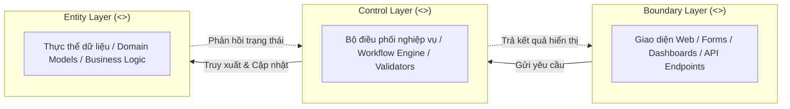
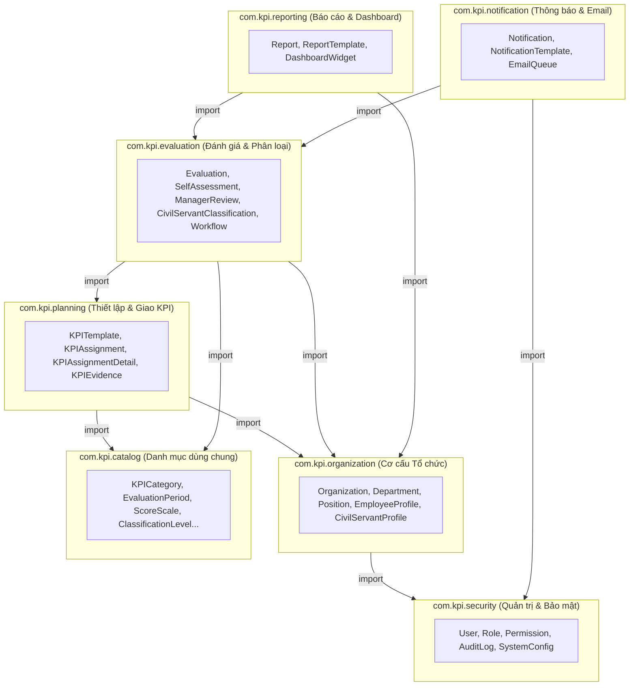
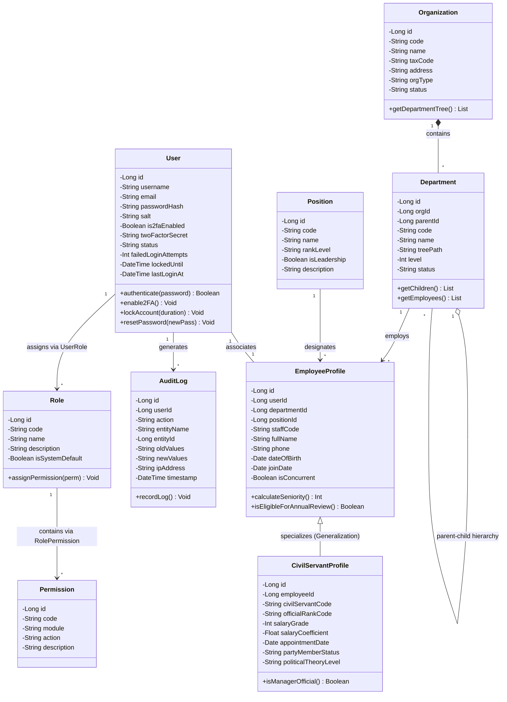
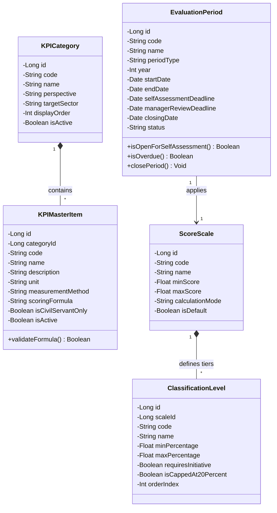
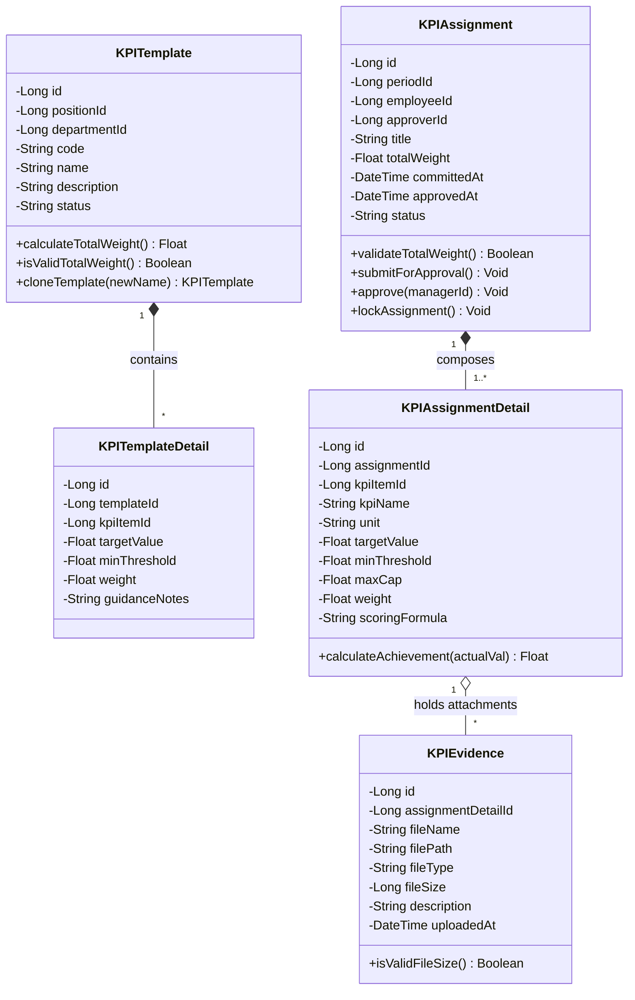
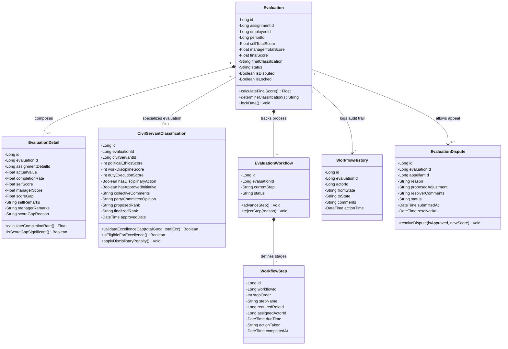
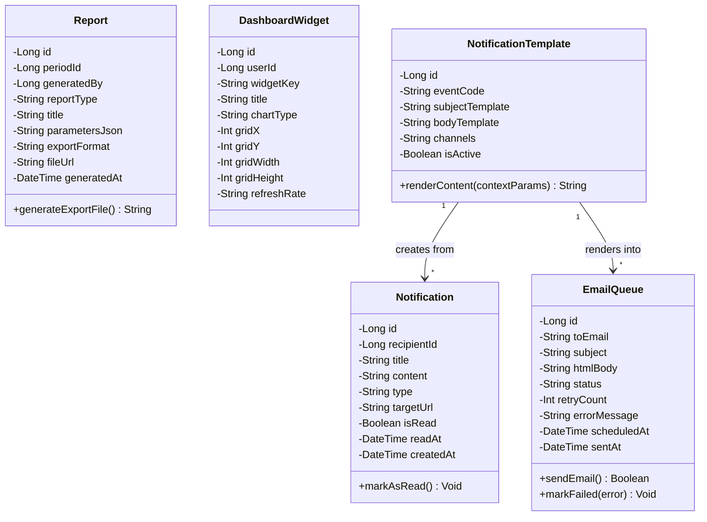

# TÀI LIỆU MÔ HÌNH LỚP PHÂN TÍCH (ANALYSIS CLASS MODEL)
## HỆ THỐNG QUẢN LÝ VÀ ĐÁNH GIÁ KPI CHO DOANH NGHIỆP VÀ CÁN BỘ CÔNG CHỨC
**Mã tài liệu:** ACM-KPI-V1.0  
**Giai đoạn:** Phiên 3 / 10 - Phân tích Lớp đối tượng (Object-Oriented Class Analysis)  
**Tác giả:** Chuyên gia Phân tích Hệ thống (Senior System Analyst)  
**Tài liệu tham chiếu:** [SRS Phiên 1 (SRS-KPI-V1.0)](file:///d:/KPI/docs/Session_01_SRS_Requirements.md) | [Use Case Model Phiên 2 (UCM-KPI-V1.0)](file:///d:/KPI/docs/Session_02_UseCase_Model.md)  

---

## MỤC LỤC
1. [Phân loại Lớp theo mô hình BCE (Boundary - Control - Entity)](#1-phân-loại-lớp-theo-mô-hình-bce)
   - 1.1. Lớp Biên (Boundary Classes - Giao diện & Tương tác)
   - 1.2. Lớp Điều khiển (Control Classes - Xử lý Nghiệp vụ & Workflow)
   - 1.3. Lớp Thực thể (Entity Classes - Mô hình Dữ liệu)
2. [Biểu đồ Gói Hệ thống (Package Diagram)](#2-biểu-đồ-gói-hệ-thống-package-diagram)
3. [Hệ thống Biểu đồ Lớp Chi tiết (Class Diagrams)](#3-hệ-thống-biểu-đồ-lớp-chi-tiết-class-diagrams)
   - 3.1. Phân hệ Quản trị & Cơ cấu Tổ chức (Admin & Organization)
   - 3.2. Phân hệ Danh mục dùng chung (Master Catalogs)
   - 3.3. Phân hệ Thiết lập & Giao chỉ tiêu KPI (KPI Planning & Templates)
   - 3.4. Phân hệ Thực thi, Đánh giá & Phân loại Công chức (Evaluation & Civil Servant)
   - 3.5. Phân hệ Báo cáo & Thông báo (Reporting & Notification)
4. [Bảng Đặc tả Chi tiết các Lớp Thực thể (Entity Classes Specification)](#4-bảng-đặc-tả-chi-tiết-các-lớp-thực-thể)
5. [Tổng kết & Ràng buộc Quan hệ Thực thể](#5-tổng-kết--ràng-buộc-quan-hệ-thực-thể)

---

## 1. PHÂN LOẠI LỚP THEO MÔ HÌNH BCE

Mô hình BCE (Boundary - Control - Entity) phân tách rõ ràng 3 tầng trách nhiệm của kiến trúc hướng đối tượng, đảm bảo nguyên lý độc lập giao diện và dễ dàng chuyển đổi sang mô hình MVC/Clean Architecture trong pha thiết kế phần mềm.

---

### 1.1. Lớp Biên (Boundary Classes - `<<boundary>>`)
Đảm nhiệm tiếp nhận tương tác từ người dùng (Actor) hoặc hệ thống ngoại vi, kiểm tra dữ liệu đầu vào (Client-side validation) và hiển thị kết quả.

| Nhóm chức năng | Tên Lớp Biên | Trách nhiệm chính | Use Case liên quan |
|---|---|---|---|
| **Quản trị & Xác thực** | `LoginFormView` | Tiếp nhận thông tin đăng nhập, điều phối xác thực 2FA OTP | UC-01 |
| | `OrganizationTreeView` | Hiển thị và tương tác kéo thả sơ đồ cây tổ chức, phòng ban | UC-02 |
| | `UserManagementView` | Màn hình danh sách người dùng, form tạo mới/phân quyền tài khoản | UC-03, UC-04 |
| | `AuditLogViewer` | Giao diện tra cứu, lọc và kết xuất nhật ký hệ thống | UC-05 |
| **Quản lý Danh mục** | `CatalogListView` | Hiển thị lưới dữ liệu danh mục dùng chung (Category, Scale, Unit...) | UC-07 $\to$ UC-11 |
| | `CatalogFormModal` | Form thêm mới / cập nhật chỉ số KPI và thang điểm | UC-07, UC-09 |
| **Thiết lập KPI** | `KPITemplateWizardView` | Wizard tạo bộ KPI mẫu theo chức danh việc làm | UC-04, UC-12 |
| | `GoalCascadeDiagramView` | Giao diện trực quan phân rã cây mục tiêu tổ chức $\to$ cá nhân | UC-13 |
| | `KPIAssignmentFormView` | Form giao KPI, cấu hình chỉ tiêu, gán trọng số và xác thực $\sum = 100\%$ | UC-05, UC-14 |
| **Đánh giá KPI** | `SelfAssessmentFormView` | Màn hình tự chấm điểm, giải trình và tải lên file minh chứng số | UC-06, UC-20 |
| | `ManagerReviewFormView` | Màn hình so sánh điểm tự chấm vs điểm quản lý, form nhập lý do lệch điểm | UC-07, UC-21 |
| | `CivilServantEvaluationView` | Màn hình đánh giá tư tưởng chính trị, đạo đức và kiểm soát khống chế 20% | UC-10, UC-23 |
| | `ApprovalWorkflowModal` | Cửa sổ ký số, phê duyệt hoặc trả về hồ sơ đánh giá | UC-08, UC-25 |
| | `DisputeSubmissionModal` | Form gửi đơn khiếu nại kết quả đánh giá | UC-26 |
| **Báo cáo & Dashboard** | `ExecutiveDashboardView` | Màn hình phân tích tổng thể dành cho Lãnh đạo cấp cao | UC-09, UC-27 |
| | `DepartmentDashboardView` | Màn hình theo dõi tiến độ hiệu suất phòng ban dành cho Quản lý | UC-28 |
| | `PersonalDashboardView` | Màn hình tiến độ cá nhân, điểm tích lũy và danh sách cảnh báo deadline | UC-29 |
| | `ReportExportModal` | Hộp thoại cấu hình và xuất file báo cáo (Excel, PDF, Mẫu 01/02) | UC-31, UC-32 |
| **Thông báo** | `InAppNotificationBellView` | Popup chuông thông báo thời gian thực và quản lý trạng thái đã đọc | UC-33 |

---

### 1.2. Lớp Điều khiển (Control Classes - `<<control>>`)
Đảm nhiệm thực thi các luồng quy trình nghiệp vụ (Business Workflow), kiểm tra các Ràng buộc nghiệp vụ (Business Rules) và điều phối tương tác giữa các thực thể.

| Tên Lớp Điều khiển | Trách nhiệm chính & Ràng buộc nghiệp vụ xử lý | Use Case liên quan |
|---|---|---|
| `AuthenticationController` | Xác thực người dùng, sinh/hủy phiên JWT, kiểm soát đăng nhập sai quá 5 lần (Ex-1 UC-01), phối hợp tích hợp SSO ngoại vi. | UC-01 |
| `OrganizationController` | Quản lý cấu trúc cây đệ quy phòng ban, ngăn chặn xóa phòng ban đang có nhân sự/dữ liệu KPI (Ex-1 UC-02). | UC-02 |
| `UserAccountController` | Quản lý tài khoản, đồng bộ thông tin cán bộ, mã hóa mật khẩu bằng Argon2id/BCrypt. | UC-03, UC-04 |
| `CatalogManagementController` | Điều phối các thao tác CRUD danh mục KPI, kiểm tra tính duy nhất của Mã chỉ số. | UC-07 $\to$ UC-11 |
| `KPITemplateController` | Xây dựng bộ mẫu theo vị trí, nhân bản mẫu cũ (Clone Template). | UC-04, UC-12 |
| `KPIAssignmentController` | Giao KPI cá nhân; gọi `WeightValidatorService` để cưỡng bức $\sum \text{Weight} = 100\%$ (**BR-01**) và biên độ $[5\%, 50\%]$ (**BR-02**); kiểm soát kiêm nhiệm (**BR-13**). | UC-05, UC-14 |
| `SelfAssessmentController` | Điều phối nộp tự đánh giá; tính tỷ lệ % hoàn thành tự động theo **BR-10, BR-11**; kích hoạt bắt buộc minh chứng khi đạt $\ge 120\%$ (**BR-09**). | UC-06, UC-20 |
| `ManagerReviewController` | Chấm điểm thẩm định cấp 1; bắt buộc nhập lý do giải trình $\ge 50$ ký tự khi điểm chênh lệch quá $10\%$ so với tự chấm (**BR-05**). | UC-07, UC-21 |
| `CivilServantClassificationService` | Tự động hạ bậc do kỷ luật (**BR-07**); kiểm tra điều kiện sáng kiến cải tiến (**BR-08**); **cưỡng bức chặn trần tỷ lệ Hoàn thành xuất sắc $\le 20\%$** (**BR-06**). | UC-10, UC-23, UC-24 |
| `EvaluationWorkflowEngine` | Quản lý máy trạng thái (State Machine) của phiếu đánh giá qua các cấp phê duyệt; đảm bảo bất biến dữ liệu quá khứ sau khi khóa sổ (**BR-03, BR-15**). | UC-08, UC-25 |
| `DashboardAnalyticsController` | Tính toán số liệu thống kê thời gian thực, tổng hợp điểm trung bình, xếp hạng phân phối hình chuông Gauss. | UC-09, UC-27 $\to$ 30 |
| `ReportGeneratorService` | Trích xuất báo cáo động ra file Excel định dạng bảng tính hoặc PDF phiếu đánh giá chuẩn Mẫu 01/02 Nghị định 90/2020/NĐ-CP. | UC-31, UC-32 |
| `NotificationDispatcherService` | Tự động kích hoạt thông báo chuông In-App và đẩy tác vụ gửi Email mẫu vào hàng đợi `EmailQueue` trước các mốc deadline. | UC-33 $\to$ UC-35 |
| `AutoClosePeriodJob` | Bộ quét tác vụ nền (Cron Job): tự động đóng sổ kỳ khi hết hạn (Cut-off date), tự gán điểm tự đánh giá bằng 0 nếu nhân viên chậm nộp (**BR-12**). | Secondary Engine |

---

### 1.3. Lớp Thực thể (Entity Classes - `<<entity>>`)
Các lớp đại diện cho các đối tượng thông tin bền vững (Persistent Data), chứa đựng trạng thái và các phương thức nghiệp vụ nội tại.

1. **Nhóm Quản trị & Bảo mật:** `User`, `Role`, `Permission`, `UserRole`, `RolePermission`, `AuditLog`, `SystemConfig`
2. **Nhóm Cơ cấu Tổ chức & Nhân sự:** `Organization`, `Department`, `Position`, `EmployeeProfile`, `CivilServantProfile`
3. **Nhóm Danh mục dùng chung:** `KPICategory`, `KPIGroup`, `KPIType`, `EvaluationPeriod`, `ScoreScale`, `ClassificationLevel`, `MeasurementUnit`, `MeasurementMethod`
4. **Nhóm Thiết lập & Kế hoạch KPI:** `KPITemplate`, `KPITemplateDetail`, `KPIAssignment`, `KPIAssignmentDetail`, `KPIEvidence`
5. **Nhóm Đánh giá, Phân loại & Phê duyệt:** `Evaluation`, `EvaluationDetail`, `SelfAssessment`, `ManagerReview`, `CivilServantClassification`, `EvaluationWorkflow`, `WorkflowStep`, `WorkflowHistory`, `EvaluationDispute`
6. **Nhóm Báo cáo & Bảng điều khiển:** `Report`, `ReportTemplate`, `DashboardWidget`
7. **Nhóm Thông báo & Tương tác:** `Notification`, `NotificationTemplate`, `EmailQueue`

---

## 2. BIỂU ĐỒ GÓI HỆ THỐNG (PACKAGE DIAGRAM)

---

## 3. HỆ THỐNG BIỂU ĐỒ LỚP CHI TIẾT (CLASS DIAGRAMS)

### 3.1. Phân hệ Quản trị & Cơ cấu Tổ chức

---

### 3.2. Phân hệ Danh mục dùng chung

---

### 3.3. Phân hệ Thiết lập & Giao chỉ tiêu KPI

---

### 3.4. Phân hệ Thực thi, Đánh giá & Phân loại Công chức

---

### 3.5. Phân hệ Báo cáo & Thông báo

---

## 4. BẢNG ĐẶC TẢ CHI TIẾT CÁC LỚP THỰC THỂ (ENTITY CLASSES SPECIFICATION)

### 4.1. Nhóm Quản trị & Cơ cấu Tổ chức

#### 1. Lớp `User` (Người dùng hệ thống)
- **Package:** `com.kpi.security`
- **Mô tả:** Đại diện cho tài khoản xác thực trên hệ thống web KPI.
- **Thuộc tính:**
  - `- id: Long` {PK, Not Null, Auto_Increment}: Mã định danh tài khoản.
  - `- username: String(50)` {Unique, Not Null}: Tên đăng nhập.
  - `- email: String(100)` {Unique, Not Null}: Thư điện tử công vụ/doanh nghiệp.
  - `- passwordHash: String(255)` {Not Null}: Chuỗi mã băm mật khẩu (Argon2id).
  - `- salt: String(128)` {Not Null}: Muối mật mã ngẫu nhiên.
  - `- is2faEnabled: Boolean` {Default: false}: Trạng thái bật xác thực hai bước.
  - `- twoFactorSecret: String(64)` {Nullable}: Khóa bí mật TOTP.
  - `- status: String(20)` {Not Null, Enum: `Active`, `Locked`, `Suspended`, `Inactive`}.
  - `- failedLoginAttempts: Int` {Default: 0}: Số lần đăng nhập sai liên tiếp.
  - `- lockedUntil: DateTime` {Nullable}: Thời điểm mở khóa tự động nếu bị khóa tạm thời.
  - `- lastLoginAt: DateTime` {Nullable}: Thời điểm đăng nhập thành công gần nhất.
- **Phương thức nghiệp vụ:**
  - `+ authenticate(plainPassword: String): Boolean`: So khớp chuỗi băm mật khẩu.
  - `+ lockAccount(minutes: Int): Void`: Khóa tài khoản khi sai mật khẩu quá 5 lần (Ex-1 UC-01).
  - `+ resetFailedAttempts(): Void`: Reset số lần thử sai về 0 khi đăng nhập thành công.
- **Ràng buộc nghiệp vụ:** NFR-SEC-01, NFR-SEC-02.

#### 2. Lớp `Organization` (Đơn vị / Cơ quan)
- **Package:** `com.kpi.organization`
- **Mô tả:** Đại diện cho một pháp nhân công ty, tập đoàn hoặc sở ban ngành, cơ quan nhà nước.
- **Thuộc tính:**
  - `- id: Long` {PK, Not Null, Auto_Increment}
  - `- code: String(30)` {Unique, Not Null}: Mã cơ quan / doanh nghiệp.
  - `- name: String(200)` {Not Null}: Tên đầy đủ của đơn vị.
  - `- taxCode: String(20)` {Nullable}: Mã số thuế / Mã định danh cơ quan nhà nước.
  - `- orgType: String(30)` {Not Null, Enum: `Enterprise`, `PublicAdministration`, `PublicService`}.
  - `- status: String(20)` {Default: `Active`}.
- **Phương thức nghiệp vụ:**
  - `+ getDepartmentTree(): List<Department>`: Lấy cây phòng ban trực thuộc.

#### 3. Lớp `Department` (Phòng ban / Đơn vị trực thuộc)
- **Package:** `com.kpi.organization`
- **Mô tả:** Phòng, ban, trung tâm hoặc tổ đội trong cơ cấu cây phân cấp.
- **Thuộc tính:**
  - `- id: Long` {PK, Not Null, Auto_Increment}
  - `- orgId: Long` {FK, Not Null}: Khóa ngoại trỏ đến `Organization`.
  - `- parentId: Long` {FK, Nullable}: Mã phòng ban cấp cha (null nếu là khối cao nhất).
  - `- code: String(30)` {Not Null}: Mã phòng ban.
  - `- name: String(150)` {Not Null}: Tên phòng ban.
  - `- treePath: String(255)` {Not Null}: Đường dẫn cây đệ quy (VD: `/1/4/12/`).
  - `- level: Int` {Not Null, Default: 1}: Cấp độ trong cây.
  - `- status: String(20)` {Default: `Active`}.
- **Phương thức nghiệp vụ:**
  - `+ getEmployees(): List<EmployeeProfile>`: Lấy danh sách nhân sự trực thuộc.
  - `+ canBeDeleted(): Boolean`: Kiểm tra xem có thể xóa không (trả về false nếu có nhân sự).
- **Ràng buộc nghiệp vụ:** BR-19 (Phân quyền phạm vi dữ liệu theo phòng ban).

#### 4. Lớp `EmployeeProfile` (Hồ sơ Nhân viên / Cán bộ)
- **Package:** `com.kpi.organization`
- **Mô tả:** Thông tin cá nhân, chức danh và hồ sơ lao động của người dùng.
- **Thuộc tính:**
  - `- id: Long` {PK, Not Null, Auto_Increment}
  - `- userId: Long` {FK, Unique, Not Null}: Liên kết tài khoản `User`.
  - `- departmentId: Long` {FK, Not Null}: Thuộc phòng ban nào.
  - `- positionId: Long` {FK, Not Null}: Giữ vị trí công tác nào.
  - `- staffCode: String(30)` {Unique, Not Null}: Mã số nhân viên / thẻ công chức.
  - `- fullName: String(100)` {Not Null}: Họ và tên.
  - `- isConcurrent: Boolean` {Default: false}: Trạng thái có giữ chức danh kiêm nhiệm không.
- **Phương thức nghiệp vụ:**
  - `+ isEligibleForAnnualReview(): Boolean`: Kiểm tra thời gian công tác $\ge 3$ tháng (**BR-16**).

#### 5. Lớp `CivilServantProfile` (Hồ sơ Cán bộ Công chức - Chuyên biệt)
- **Package:** `com.kpi.organization`
- **Mô tả:** Lớp mở rộng (Kế thừa từ `EmployeeProfile`) dành riêng cho Cán bộ, Công chức, Viên chức nhà nước.
- **Thuộc tính bổ sung:**
  - `- civilServantCode: String(30)` {Unique, Not Null}: Mã số ngạch công chức.
  - `- officialRankCode: String(20)` {Not Null}: Ngạch (Chuyên viên cao cấp, chính, chuyên viên, cán sự).
  - `- salaryGrade: Int` {Not Null}: Bậc lương hiện hưởng.
  - `- salaryCoefficient: Float` {Not Null}: Hệ số lương.
  - `- partyMemberStatus: String(30)` {Enum: `Official`, `Probationary`, `None`}: Tình trạng Đảng viên.
  - `- politicalTheoryLevel: String(30)` {Enum: `High`, `Intermediate`, `Primary`}: Trình độ lý luận chính trị.
- **Phương thức nghiệp vụ:**
  - `+ isManagerOfficial(): Boolean`: Kiểm tra xem là công chức lãnh đạo quản lý hay công chức chuyên môn (để áp dụng Mẫu 01 hay Mẫu 02).

---

### 4.2. Nhóm Danh mục dùng chung

#### 6. Lớp `EvaluationPeriod` (Kỳ đánh giá)
- **Package:** `com.kpi.catalog`
- **Mô tả:** Thiết lập khung thời gian và hạn chót cho một chu kỳ đánh giá hiệu suất.
- **Thuộc tính:**
  - `- id: Long` {PK, Not Null, Auto_Increment}
  - `- code: String(30)` {Unique, Not Null}: Ví dụ: `KPI_2026_Q1`, `KPI_2026_YEAR`.
  - `- name: String(150)` {Not Null}: Ví dụ: "Đánh giá hiệu suất Quý 1/2026".
  - `- periodType: String(20)` {Not Null, Enum: `Monthly`, `Quarterly`, `SemiAnnual`, `Annual`}.
  - `- year: Int` {Not Null}.
  - `- selfAssessmentDeadline: Date` {Not Null}: Hạn chót nhân viên nộp tự chấm.
  - `- managerReviewDeadline: Date` {Not Null}: Hạn chót quản lý hoàn thành thẩm định.
  - `- closingDate: Date` {Not Null}: Ngày khóa sổ kỳ (Cut-off date).
  - `- status: String(20)` {Enum: `Planning`, `Open`, `InEvaluation`, `Closed`, `Archived`}.
- **Phương thức nghiệp vụ:**
  - `+ isPastSelfDeadline(): Boolean`: Kiểm tra quá hạn tự đánh giá để kích hoạt auto-close (**BR-12**).
  - `+ closePeriod(): Void`: Đóng sổ kỳ và khóa toàn bộ dữ liệu (**BR-15**).

#### 7. Lớp `ClassificationLevel` (Mức xếp loại hiệu suất)
- **Package:** `com.kpi.catalog`
- **Mô tả:** Bảng quy đổi điểm số ra danh hiệu xếp loại (A/B/C/D hoặc Xuất sắc/Tốt/Hoàn thành/Không hoàn thành).
- **Thuộc tính:**
  - `- id: Long` {PK, Not Null, Auto_Increment}
  - `- code: String(30)` {Not Null}: Ví dụ: `EXCELLENT`, `GOOD`, `SATISFACTORY`, `UNSATISFACTORY`.
  - `- name: String(100)` {Not Null}.
  - `- minPercentage: Float` {Not Null}: Ngưỡng chặn dưới tỷ lệ (VD: 90.0%).
  - `- maxPercentage: Float` {Not Null}: Ngưỡng chặn trên tỷ lệ (VD: 150.0%).
  - `- requiresInitiative: Boolean` {Default: false}: Bắt buộc có sáng kiến/đề tài (**BR-08**).
  - `- isCappedAt20Percent: Boolean` {Default: false}: Áp dụng cơ chế chặn khống chế 20% (**BR-06**).

---

### 4.3. Nhóm Thiết lập & Giao KPI

#### 8. Lớp `KPIAssignment` (Bản giao KPI cá nhân)
- **Package:** `com.kpi.planning`
- **Mô tả:** Văn bản cam kết mục tiêu KPI giữa Quản lý và Nhân viên trong một kỳ đánh giá.
- **Thuộc tính:**
  - `- id: Long` {PK, Not Null, Auto_Increment}
  - `- periodId: Long` {FK, Not Null}: Thuộc kỳ nào.
  - `- employeeId: Long` {FK, Not Null}: Giao cho ai.
  - `- approverId: Long` {FK, Not Null}: Người phê duyệt (Trưởng phòng/Lãnh đạo).
  - `- totalWeight: Float` {Not Null, Default: 100.0}: Tổng trọng số các chỉ tiêu.
  - `- status: String(30)` {Enum: `Draft`, `Pending_Staff_Confirm`, `Pending_Approval`, `Approved_Locked`, `Revised`}.
  - `- committedAt: DateTime` {Nullable}: Thời điểm nhân viên ký cam kết.
  - `- approvedAt: DateTime` {Nullable}: Thời điểm lãnh đạo phê chuẩn.
- **Phương thức nghiệp vụ:**
  - `+ validateTotalWeight(): Boolean`: Kiểm tra $\sum \text{Weight} = 100\%$ (**BR-01**).
  - `+ lockAssignment(): Void`: Đóng băng dữ liệu sau khi duyệt (**BR-03**).

#### 9. Lớp `KPIAssignmentDetail` (Chi tiết chỉ tiêu KPI trong bản giao)
- **Package:** `com.kpi.planning`
- **Mô tả:** Từng dòng chỉ tiêu mục tiêu cụ thể giao cho nhân viên.
- **Thuộc tính:**
  - `- id: Long` {PK, Not Null, Auto_Increment}
  - `- assignmentId: Long` {FK, Not Null}: Trỏ đến bản giao cha `KPIAssignment`.
  - `- kpiItemId: Long` {FK, Not Null}: Trỏ đến danh mục `KPIMasterItem`.
  - `- kpiName: String(255)` {Not Null}: Tên chỉ tiêu.
  - `- unit: String(30)` {Not Null}: Đơn vị tính.
  - `- targetValue: Float` {Not Null}: Chỉ tiêu kế hoạch (Target).
  - `- minThreshold: Float` {Default: 0.0}: Ngưỡng tối thiểu để bắt đầu tính điểm.
  - `- maxCap: Float` {Default: 150.0}: Ngưỡng trần tối đa ghi nhận thành tích (**BR-10**).
  - `- weight: Float` {Not Null}: Trọng số % (Ràng buộc: $5 \le weight \le 50$ theo **BR-02**).
  - `- scoringFormula: String(30)` {Enum: `HigherIsBetter`, `LowerIsBetter`, `TargetRange`}.
- **Phương thức nghiệp vụ:**
  - `+ calculateAchievement(actual: Float): Float`: Tính tỷ lệ % hoàn thành theo công thức **BR-10** hoặc **BR-11**.

---

### 4.4. Nhóm Đánh giá, Phân loại & Phê duyệt

#### 10. Lớp `Evaluation` (Phiếu đánh giá hiệu suất tổng hợp)
- **Package:** `com.kpi.evaluation`
- **Mô tả:** Chứa đựng toàn bộ kết quả tự chấm, thẩm định, tổng điểm và xếp loại cuối cùng của một cán bộ/nhân viên.
- **Thuộc tính:**
  - `- id: Long` {PK, Not Null, Auto_Increment}
  - `- assignmentId: Long` {FK, Unique, Not Null}: Liên kết 1-1 với `KPIAssignment`.
  - `- employeeId: Long` {FK, Not Null}: Người được đánh giá.
  - `- periodId: Long` {FK, Not Null}: Kỳ đánh giá.
  - `- selfTotalScore: Float` {Default: 0.0}: Điểm nhân viên tự chấm tổng hợp.
  - `- managerTotalScore: Float` {Default: 0.0}: Điểm Quản lý thẩm định tổng hợp.
  - `- finalScore: Float` {Default: 0.0}: Điểm số chốt cuối cùng (thang 100 theo **BR-20**).
  - `- finalClassification: String(50)` {Nullable}: Mức xếp loại được phê chuẩn.
  - `- status: String(30)` {Enum: `Draft`, `Self_Submitted`, `Manager_Reviewed`, `Council_Approved`, `Final_Locked`}.
  - `- isDisputed: Boolean` {Default: false}: Cờ đánh dấu có đang khiếu nại không.
  - `- isLocked: Boolean` {Default: false}: Trạng thái đóng băng vĩnh viễn (**BR-15**).
- **Phương thức nghiệp vụ:**
  - `+ calculateFinalScore(): Float`: Tính tổng điểm theo trọng số $\sum (\text{Điểm}_i \times \text{Weight}_i)$ (**BR-20**).
  - `+ lockData(): Void`: Khóa chỉ đọc toàn bộ bản ghi và các chi tiết liên quan.

#### 11. Lớp `EvaluationDetail` (Chi tiết điểm số từng chỉ tiêu)
- **Package:** `com.kpi.evaluation`
- **Mô tả:** Điểm thành phần cho từng chỉ tiêu KPI, đối chiếu giữa nhân viên và quản lý.
- **Thuộc tính:**
  - `- id: Long` {PK, Not Null, Auto_Increment}
  - `- evaluationId: Long` {FK, Not Null}: Trỏ đến `Evaluation`.
  - `- assignmentDetailId: Long` {FK, Not Null}: Chỉ tiêu nào.
  - `- actualValue: Float` {Not Null}: Số liệu kết quả thực hiện thực tế.
  - `- completionRate: Float` {Not Null}: Tỷ lệ % hoàn thành tính toán được.
  - `- selfScore: Float` {Not Null}: Điểm nhân viên tự chấm.
  - `- managerScore: Float` {Not Null}: Điểm Quản lý trực tiếp chấm.
  - `- scoreGap: Float` {Computed: $|selfScore - managerScore|$}: Độ lệch điểm.
  - `- selfRemarks: String(500)` {Nullable}: Giải trình của nhân viên.
  - `- managerRemarks: String(500)` {Nullable}: Nhận xét của Quản lý.
  - `- scoreGapReason: String(1000)` {Nullable}: Lý do điều chỉnh điểm bắt buộc nếu lệch $> 10\%$ (**BR-05**).
- **Phương thức nghiệp vụ:**
  - `+ isScoreGapSignificant(): Boolean`: Trả về `true` nếu lệch $> 10\%$ để bắt buộc nhập lý do.

#### 12. Lớp `CivilServantClassification` (Bản phân loại Cán bộ Công chức theo Nghị định 90)
- **Package:** `com.kpi.evaluation`
- **Mô tả:** Đánh giá các tiêu chuẩn định tính theo luật định và áp tỷ lệ khống chế xuất sắc 20%.
- **Thuộc tính:**
  - `- id: Long` {PK, Not Null, Auto_Increment}
  - `- evaluationId: Long` {FK, Unique, Not Null}: Trỏ đến `Evaluation`.
  - `- civilServantId: Long` {FK, Not Null}: Cán bộ công chức được đánh giá.
  - `- politicalEthicsScore: Int` {Not Null}: Điểm tư tưởng chính trị, đạo đức, lối sống (thang 100).
  - `- workDisciplineScore: Int` {Not Null}: Điểm tác phong lề lối, ý thức kỷ luật.
  - `- dutyExecutionScore: Int` {Not Null}: Điểm thực hiện chức trách nhiệm vụ.
  - `- hasDisciplinaryAction: Boolean` {Default: false}: Có bị kỷ luật trong năm không (**BR-07**).
  - `- hasApprovedInitiative: Boolean` {Default: false}: Có sáng kiến cải tiến được công nhận không (**BR-08**).
  - `- collectiveComments: String(1000)`: Ý kiến nhận xét của tập thể nơi công tác.
  - `- partyCommitteeOpinion: String(1000)`: Ý kiến nhận xét của Cấp ủy chi bộ.
  - `- proposedRank: String(50)`: Xếp loại sơ bộ.
  - `- finalizedRank: String(50)`: Xếp loại chính thức sau khi xét tỷ lệ khống chế.
- **Phương thức nghiệp vụ:**
  - `+ validateExcellenceCap(totalGood: Int, totalExc: Int): Boolean`: Kiểm tra điều kiện $N_{\text{Xuất sắc}} \le 0.20 \times N_{\text{Hoàn thành tốt}}$ (**BR-06**).
  - `+ applyDisciplinaryPenalty(): Void`: Tự động ép về "Không hoàn thành nhiệm vụ" nếu `hasDisciplinaryAction == true` (**BR-07**).

---

## 5. TỔNG KẾT & RÀNG BUỘC QUAN HỆ THỰC THỂ

Bảng tổng hợp quan hệ cốt lõi giữa các lớp thực thể:

| Thực thể nguồn | Thực thể đích | Loại quan hệ | Bội số (Cardinality) | Ý nghĩa nghiệp vụ |
|---|---|:---:|:---:|---|
| `Organization` | `Department` | Composition ($*--$) | $1 \to *$ | Một cơ quan có nhiều phòng ban; phòng ban không thể tồn tại độc lập ngoài đơn vị. |
| `Department` | `Department` | Aggregation ($o--$) | $0..1 \to *$ | Quan hệ cây đệ quy tự quản lý cha - con. |
| `Department` | `EmployeeProfile` | Association ($\to$) | $1 \to *$ | Mỗi phòng ban có nhiều nhân sự; một nhân sự thuộc 1 phòng ban chính. |
| `EmployeeProfile` | `CivilServantProfile` | Inheritance ($--\mid>$) | $1 \to 1$ | Kế thừa chuyên biệt: Mọi công chức đều là nhân sự, nhưng có thêm các thuộc tính ngạch bậc nhà nước. |
| `User` | `EmployeeProfile` | Association ($\to$) | $1 \to 1$ | Mỗi tài khoản hệ thống gắn với duy nhất 1 hồ sơ cán bộ. |
| `KPITemplate` | `KPITemplateDetail` | Composition ($*--$) | $1 \to *$ | Khung mẫu sở hữu danh sách các chỉ tiêu thành phần. |
| `KPIAssignment` | `KPIAssignmentDetail`| Composition ($*--$) | $1 \to 1..*$ | Bản giao KPI bắt buộc phải chứa ít nhất 1 chỉ tiêu chi tiết. |
| `KPIAssignmentDetail` | `KPIEvidence` | Aggregation ($o--$) | $1 \to *$ | Mỗi chỉ tiêu có thể đính kèm nhiều tệp minh chứng chứng minh. |
| `KPIAssignment` | `Evaluation` | Association ($\to$) | $1 \to 0..1$ | Mỗi bản giao tương ứng với một phiếu đánh giá cuối kỳ. |
| `Evaluation` | `EvaluationDetail` | Composition ($*--$) | $1 \to 1..*$ | Phiếu đánh giá chứa chi tiết điểm số từng chỉ tiêu. |
| `Evaluation` | `CivilServantClassification`| Association ($\to$)| $1 \to 0..1$| Phiếu đánh giá của công chức có thêm bản phân loại Nghị định 90. |
| `Evaluation` | `EvaluationWorkflow` | Composition ($*--$) | $1 \to 1$ | Phiếu đánh giá được quản lý xuyên suốt bởi một tiến trình workflow đa cấp. |

---

## 6. KẾT LUẬN & CHUẨN BỊ CHO PHIÊN 4

Tài liệu Mô hình Lớp Phân tích Phiên 3 đã thiết lập thành công:
1. **Phân tách hoàn chỉnh 3 tầng BCE:** Giao diện (`Boundary`), Bộ điều khiển nghiệp vụ (`Control`) và Thực thể bền vững (`Entity`).
2. **Đặc tả 32 lớp thực thể chuẩn hóa:** Định nghĩa tường minh các kiểu dữ liệu, các ràng buộc toàn vẹn (`PK`, `FK`, `Not Null`, `Unique`), phương thức nghiệp vụ và tham chiếu chính xác đến 20 Ràng buộc nghiệp vụ (`BR-01` $\to$ `BR-20`).
3. **Hệ thống 5 biểu đồ Mermaid chuyên sâu:** Từ biểu đồ Gói (`Package Diagram`) đến 4 biểu đồ Lớp phân hệ thể hiện đầy đủ quan hệ Kế thừa, Hợp thành (Composition), Kết tập (Aggregation) và Liên kết (Association).

> [!TIP]
> **Đầu vào cho Phiên 4:**  
> Dựa trên các lớp `Boundary`, `Control` và `Entity` đã được định nghĩa ở Phiên 3, **Phiên 4: Mô hình Tương tác (Interaction Model)** sẽ xây dựng các **Biểu đồ Tuần tự (Sequence Diagrams)** và **Biểu đồ Giao tiếp (Communication Diagrams)** để mô tả chi tiết dòng trao đổi thông điệp (Messages) giữa các đối tượng trong 8 quy trình nghiệp vụ trọng yếu nhất.
