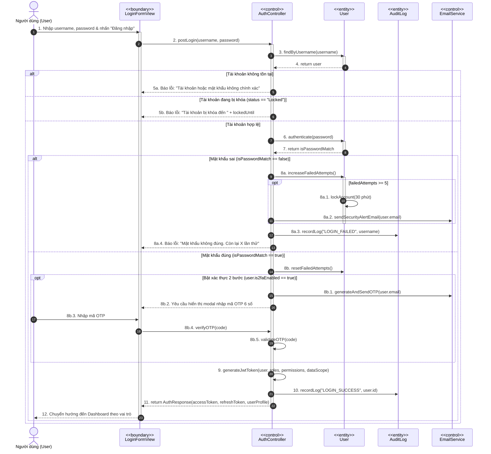
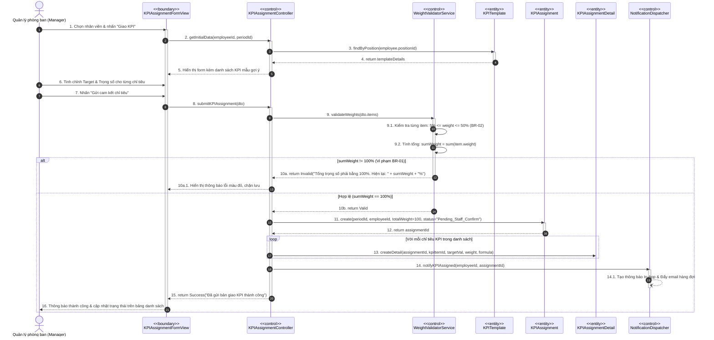
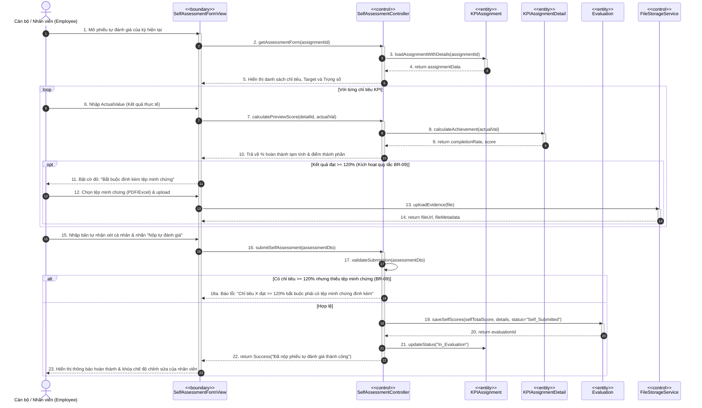
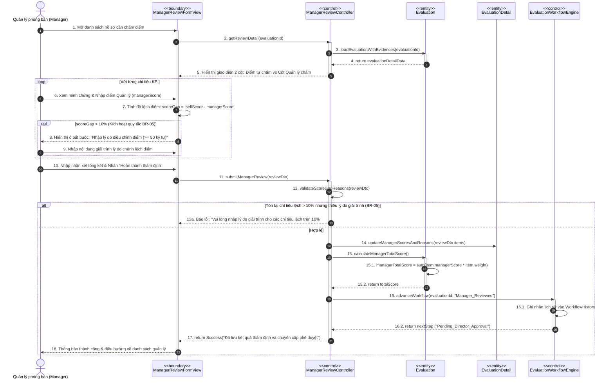
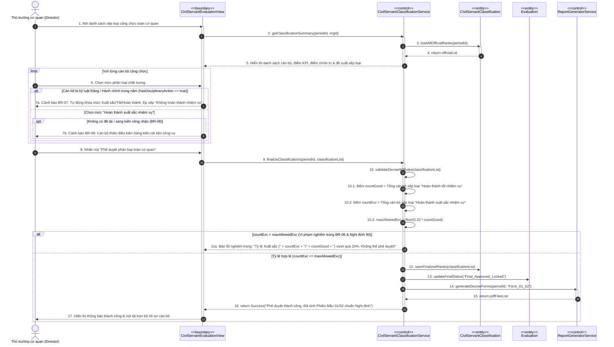
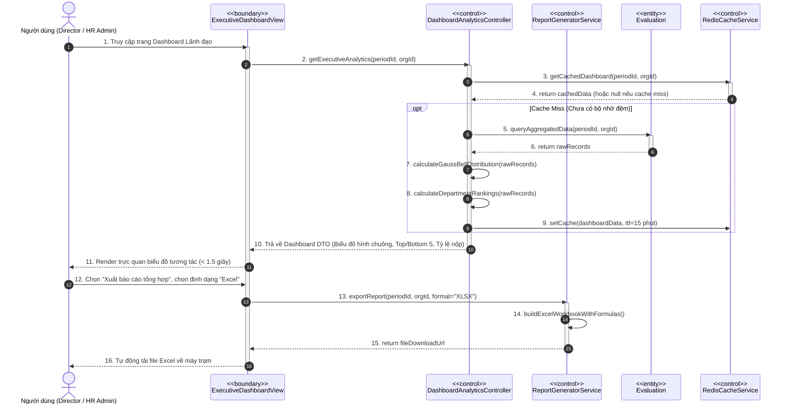
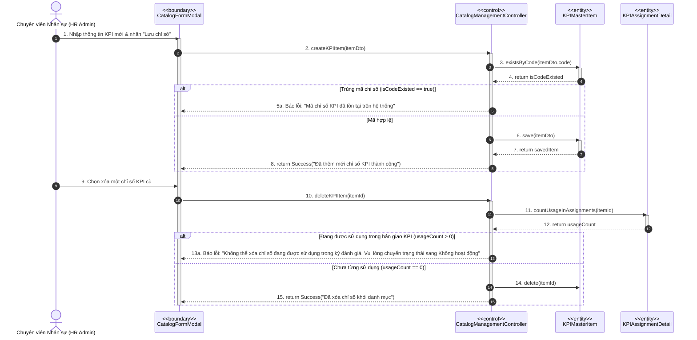
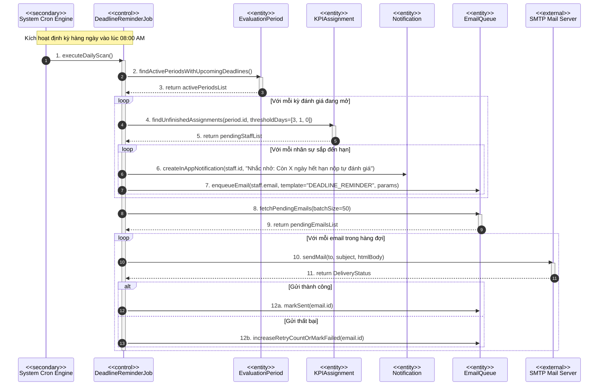

# TÀI LIỆU MÔ HÌNH TƯƠNG TÁC (INTERACTION MODEL)
## HỆ THỐNG QUẢN LÝ VÀ ĐÁNH GIÁ KPI CHO DOANH NGHIỆP VÀ CÁN BỘ CÔNG CHỨC
**Mã tài liệu:** IM-KPI-V1.0  
**Giai đoạn:** Phiên 4 / 10 - Mô hình hóa Tương tác (Interaction Modeling)  
**Tác giả:** Chuyên gia Phân tích Hệ thống (Senior System Analyst)  
**Tài liệu tham chiếu:** [SRS Phiên 1 (SRS-KPI-V1.0)](file:///d:/KPI/docs/Session_01_SRS_Requirements.md) | [Use Case Model Phiên 2 (UCM-KPI-V1.0)](file:///d:/KPI/docs/Session_02_UseCase_Model.md) | [Class Model Phiên 3 (ACM-KPI-V1.0)](file:///d:/KPI/docs/Session_03_Class_Analysis_Model.md)  

---

## MỤC LỤC
1. [Giới thiệu Mô hình Tương tác & Nguyên tắc Thiết kế](#1-giới-thiệu-mô-hình-tương-tác--nguyên-tắc-thiết-kế)
2. [Hệ thống Biểu đồ Tuần tự (Sequence Diagrams)](#2-hệ-thống-biểu-đồ-tuần-tự-sequence-diagrams)
   - SD-01: Quy trình Đăng nhập, Kiểm soát An toàn & Phân quyền JWT
   - SD-02: Quy trình Lập kế hoạch & Giao KPI Cá nhân
   - SD-03: Quy trình Tự đánh giá KPI & Đính kèm Minh chứng số
   - SD-04: Quy trình Quản lý Thẩm định & Chấm điểm Nhân viên
   - SD-05: Quy trình Đánh giá Phân loại Cán bộ Công chức theo Nghị định 90
   - SD-06: Quy trình Tổng hợp Dashboard & Xuất Báo cáo Đa định dạng
   - SD-07: Quy trình Quản lý Danh mục KPI & Ràng buộc Toàn vẹn
   - SD-08: Quy trình Quét Tác vụ ngầm (Scheduler) & Gửi Cảnh báo Deadline
3. [Hệ thống Biểu đồ Giao tiếp (Communication Diagrams)](#3-hệ-thống-biểu-đồ-giao-tiếp-communication-diagrams)
   - CD-01: Quy trình Giao KPI & Cam kết Mục tiêu
   - CD-02: Quy trình Đánh giá & Thẩm định Kết quả KPI
   - CD-03: Quy trình Phê duyệt Đánh giá Đa cấp
4. [Bảng Tổng hợp Ánh xạ Thông điệp & Phương thức Lớp](#4-bảng-tổng-hợp-ánh-xạ-thông-điệp--phương-thức-lớp)

---

## 1. GIỚI THIỆU MÔ HÌNH TƯƠNG TÁC & NGUYÊN TẮC THIẾT KẾ

Mô hình tương tác thể hiện hành vi động (Dynamic Behavior) của hệ thống bằng cách mô tả dòng trao đổi thông điệp (Messages) giữa các đối tượng thuộc 3 tầng kiến trúc BCE:
1. **Actor** $\to$ Tương tác trực tiếp với **Boundary Object** (Giao diện Web/Form/API).
2. **Boundary Object** $\to$ Chuyển tiếp sự kiện và tham số đầu vào đến **Control Object** (Bộ điều khiển nghiệp vụ).
3. **Control Object** $\to$ Thực thi logic nghiệp vụ, gọi các dịch vụ kiểm tra (Validators), truy xuất và thay đổi trạng thái của các **Entity Objects** (Thực thể CSDL).
4. Các luồng xử lý đều tích hợp đầy đủ các cấu trúc rẽ nhánh (`alt`), lặp (`loop`), tùy chọn (`opt`) và xử lý ngoại lệ theo đúng 20 Ràng buộc nghiệp vụ (**BR-01 $\to$ BR-20**).

---

## 2. HỆ THỐNG BIỂU ĐỒ TUẦN TỰ (SEQUENCE DIAGRAMS)

---

### SD-01: QUY TRÌNH ĐĂNG NHẬP, KIỂM SOÁT AN TOÀN & PHÂN QUYỀN JWT
- **Use Case ánh xạ:** `UC-01: Đăng nhập & Xác thực hệ thống`
- **Mục tiêu:** Xác thực danh tính người dùng, kiểm soát chống brute-force (khóa tài khoản khi sai quá 5 lần), hỗ trợ 2FA OTP và cấp phát JWT Token.



#### Bảng mô tả chi tiết các bước xử lý (SD-01):
1. **Bước 1-4:** Người dùng nhập thông tin xác thực. `LoginFormView` gửi yêu cầu đến `AuthController`. Controller truy vấn CSDL để lấy thông tin tài khoản.
2. **Bước 5a-5b:** Kiểm tra tài khoản tồn tại và trạng thái kích hoạt. Nếu tài khoản đang bị khóa do vi phạm brute-force trước đó, trả thông báo chặn tức thì.
3. **Bước 6-8a:** So khớp mật khẩu đã băm (Argon2id). Nếu sai mật khẩu: tăng biến đếm `failedAttempts`. Khi chạm mốc 5 lần, tự động kích hoạt khóa tài khoản 30 phút, gửi email cảnh báo bảo mật và ghi vết `AuditLog`.
4. **Bước 8b:** Mật khẩu đúng: Reset số lần thử sai. Nếu tài khoản có cấu hình bảo mật 2FA, hệ thống sinh mã OTP ngẫu nhiên gửi qua email/authenticator và chờ người dùng xác thực mã.
5. **Bước 9-12:** Đóng gói thông tin người dùng, quyền hạn (Roles/Permissions) và phạm vi dữ liệu (`DataScope`) vào JWT Claims. Cấp phát cặp Access/Refresh Token và chuyển hướng người dùng vào Dashboard tương ứng.

---

### SD-02: QUY TRÌNH LẬP KẾ HOẠCH & GIAO KPI CÁ NHÂN
- **Use Case ánh xạ:** `UC-05: Giao KPI & Thiết lập trọng số cá nhân`
- **Ràng buộc nghiệp vụ áp dụng:** **BR-01** ($\sum \text{Weight} = 100\%$), **BR-02** ($5\% \le \text{Weight}_i \le 50\%$), **BR-13** (Kiểm soát kiêm nhiệm).



#### Bảng mô tả chi tiết các bước xử lý (SD-02):
1. **Bước 1-5:** Quản lý mở form giao KPI. Hệ thống tự động truy xuất `KPITemplate` gắn liền với vị trí chức danh của nhân viên để điền trước danh mục chỉ tiêu chuẩn.
2. **Bước 6-8:** Quản lý điều chỉnh các giá trị mục tiêu (Target) và tỷ lệ phần trăm trọng số (% Weight) cho phù hợp với kế hoạch kỳ đánh giá.
3. **Bước 9-10a:** `WeightValidatorService` thực hiện 2 tầng kiểm tra nghiêm ngặt: Mỗi chỉ tiêu đơn lẻ phải nằm trong khoảng $[5\%, 50\%]$ (**BR-02**) và tổng trọng số toàn bộ bản giao phải bằng chính xác $100\%$ (**BR-01**). Nếu sai lệch, hệ thống hiển thị thông báo chặn cưỡng bức.
4. **Bước 11-13:** Khởi tạo thực thể `KPIAssignment` ở trạng thái `Pending_Staff_Confirm` và tạo hàng loạt các thực thể con `KPIAssignmentDetail` liên kết hợp thành (Composition).
5. **Bước 14-16:** Kích hoạt dịch vụ thông báo đa kênh (In-app và Email) gửi lời mời cam kết mục tiêu đến nhân viên.

---

### SD-03: QUY TRÌNH TỰ ĐÁNH GIÁ KPI & ĐÍNH KÈM MINH CHỨNG
- **Use Case ánh xạ:** `UC-06: Nhân viên tự đánh giá KPI cá nhân`
- **Ràng buộc nghiệp vụ áp dụng:** **BR-09** (Bắt buộc minh chứng khi đạt $\ge 120\%$), **BR-10 & BR-11** (Công thức tính % hoàn thành), **BR-12** (Kiểm soát hạn chót).



#### Bảng mô tả chi tiết các bước xử lý (SD-03):
1. **Bước 1-5:** Nhân viên mở phiếu tự đánh giá. Giao diện hiển thị chi tiết các chỉ tiêu cam kết đầu kỳ.
2. **Bước 6-10:** Khi nhân viên nhập số liệu thực hiện (`ActualValue`), Controller tự động tính toán tỷ lệ % hoàn thành theo đúng công thức:
   - Chỉ số càng cao càng tốt: $\% = \min(\text{Thực tế} / \text{Kế hoạch} \times 100\%, 150\%)$ (**BR-10**).
   - Chỉ số càng thấp càng tốt: $\% = \max((2 - \text{Thực tế} / \text{Kế hoạch}) \times 100\%, 0\%)$ (**BR-11**).
3. **Bước 11-14:** Nếu tỷ lệ hoàn thành $\ge 120\%$, giao diện kích hoạt bắt buộc người dùng tải lên tệp minh chứng số thông qua `FileStorageService` (**BR-09**).
4. **Bước 15-18a:** Khi nhấn nộp, hệ thống kiểm tra toàn vẹn minh chứng. Nếu thiếu minh chứng cho các chỉ tiêu vượt mức, hệ thống từ chối lưu.
5. **Bước 19-23:** Lưu kết quả tự chấm vào thực thể `Evaluation`, chuyển trạng thái sang `Self_Submitted` và khóa form tự đánh giá.

---

### SD-04: QUY TRÌNH QUẢN LÝ THẨM ĐỊNH & CHẤM ĐIỂM
- **Use Case ánh xạ:** `UC-07: Quản lý đánh giá KPI nhân viên`
- **Ràng buộc nghiệp vụ áp dụng:** **BR-04** (Thứ tự đánh giá), **BR-05** (Bắt buộc giải trình điều chỉnh lệch $> 10\%$).



#### Bảng mô tả chi tiết các bước xử lý (SD-04):
1. **Bước 1-5:** Quản lý truy cập hồ sơ. Hệ thống tải dữ liệu phiếu đánh giá và mở giao diện so sánh đối chiếu song song: Cột điểm tự chấm kèm ý kiến giải trình của nhân viên và Cột nhập điểm chính thức của Quản lý.
2. **Bước 6-9:** Quản lý xem xét minh chứng và nhập điểm thẩm định. Giao diện tự động tính độ lệch $|selfScore - managerScore|$. Nếu độ lệch vượt quá $10\%$, hệ thống kích hoạt trường bắt buộc: *Lý do điều chỉnh điểm* ($\ge 50$ ký tự) theo quy định tại **BR-05**.
3. **Bước 10-13a:** Khi nhấn nộp, Controller kiểm tra validation. Nếu phát hiện thiếu lý do giải trình ở bất kỳ chỉ tiêu nào có độ lệch $> 10\%$, hệ thống chặn lại và focus vào ô tương ứng.
4. **Bước 14-18:** Cập nhật điểm thẩm định, tính điểm tổng hợp theo trọng số thang 100 (**BR-20**) và gọi `EvaluationWorkflowEngine` để đẩy hồ sơ lên cấp phê duyệt tiếp theo.

---

### SD-05: QUY TRÌNH ĐÁNH GIÁ PHÂN LOẠI CÁN BỘ CÔNG CHỨC THEO NGHỊ ĐỊNH 90
- **Use Case ánh xạ:** `UC-10: Đánh giá phân loại cán bộ công chức theo Nghị định 90/2020/NĐ-CP`
- **Ràng buộc nghiệp vụ áp dụng:** **BR-06** (Chặn khống chế Xuất sắc $\le 20\%$), **BR-07** (Điểm liệt do kỷ luật), **BR-08** (Bắt buộc sáng kiến/đề tài).



#### Bảng mô tả chi tiết các bước xử lý (SD-05):
1. **Bước 1-5:** Thủ trưởng cơ quan mở màn hình đánh giá phân loại cán bộ công chức. Hệ thống tổng hợp đầy đủ số liệu 2 phần: Điểm KPI thực hiện nhiệm vụ và Điểm phẩm chất chính trị tư tưởng, đạo đức, tác phong, kỷ luật.
2. **Bước 6-7a:** Nếu hồ sơ có ghi nhận kỷ luật Đảng hoặc kỷ luật hành chính trong năm, áp dụng **BR-07**: Tự động khóa các mức hoàn thành và ép chuyển sang *Không hoàn thành nhiệm vụ*.
3. **Bước 7b:** Nếu chọn mức *Hoàn thành xuất sắc*, hệ thống đối soát điều kiện có sáng kiến cải tiến hoặc đề tài khoa học theo **BR-08**.
4. **Bước 8-11a:** Khi Thủ trưởng bấm duyệt, `CivilServantClassificationService` tiến hành kiểm tra công thức chặn trần: $N_{\text{Xuất sắc}} \le 0.20 \times N_{\text{Hoàn thành tốt}}$ (**BR-06**). Nếu vi phạm, hệ thống khóa cứng nút phê duyệt và hiển thị số lượng cụ thể cần điều chỉnh giảm.
5. **Bước 12-17:** Khi tỷ lệ chuẩn hóa, hệ thống đóng băng toàn bộ dữ liệu (**BR-15**) và tự động trích xuất các biểu mẫu Mẫu 01/02 đính kèm hồ sơ cán bộ.

---

### SD-06: QUY TRÌNH TỔNG HỢP DASHBOARD & XUẤT BÁO CÁO
- **Use Case ánh xạ:** `UC-09: Xem Dashboard tổng quan & Xuất báo cáo`
- **Mục tiêu:** Tính toán số liệu phân tích thời gian thực (Real-time Analytics) và xuất báo cáo Excel/PDF.



#### Bảng mô tả chi tiết các bước xử lý (SD-06):
1. **Bước 1-4:** Người dùng mở Dashboard. Controller ưu tiên kiểm tra dữ liệu tính toán sẵn trong bộ nhớ đệm tốc độ cao (`RedisCacheService`).
2. **Bước 5-9:** Nếu cache hết hạn, Controller truy vấn dữ liệu từ bảng `evaluations`, tính toán đường cong phân phối chuẩn (Gaussian Bell Curve) và bảng xếp hạng thi đua, sau đó tái nạp vào Cache với thời gian sống 15 phút.
3. **Bước 10-11:** Hiển thị trực quan dữ liệu lên màn hình trong thời gian đáp ứng $< 1.5$ giây (đạt chuẩn **NFR-PERF-02**).
4. **Bước 12-16:** Khi người dùng yêu cầu kết xuất file, `ReportGeneratorService` tạo tài liệu Excel đầy đủ công thức và tải trực tiếp về máy tính người dùng.

---

### SD-07: QUY TRÌNH QUẢN LÝ DANH MỤC KPI & RÀNG BUỘC TOÀN VẸN
- **Use Case ánh xạ:** `UC-03: Quản lý danh mục KPI dùng chung`
- **Mục tiêu:** Thực hiện thêm mới/chỉnh sửa chỉ số KPI, kiểm tra tính duy nhất của Mã chỉ số và ngăn chặn xóa các danh mục đang có liên kết dữ liệu.



---

### SD-08: QUY TRÌNH QUÉT TÁC VỤ NGẦM & GỬI CẢNH BÁO DEADLINE
- **Use Case ánh xạ:** `UC-34: Tự động nhắc việc & Deadline`
- **Mục tiêu:** Bộ quét nền (Cron Scheduler) tự động rà soát các mốc hạn chót, phát hiện nhân sự trễ hạn, gửi cảnh báo In-App và đẩy Email hàng đợi.



---

## 3. HỆ THỐNG BIỂU ĐỒ GIAO TIẾP (COMMUNICATION DIAGRAMS)

---

### CD-01: QUY TRÌNH GIAO KPI & CAM KẾT MỤC TIÊU

Biểu đồ giao tiếp tập trung vào kiến trúc cấu trúc liên kết và dòng thông điệp đánh số phân cấp giữa các đối tượng trong phân hệ Lập kế hoạch:

```mermaid
flowchart TD
    Mgr(("fa:fa-user Manager\n(Quản lý)"))
    UI["1: KPIAssignmentFormView\n<<boundary>>"]
    Ctrl["2: KPIAssignmentController\n<<control>>"]
    Val["3: WeightValidatorService\n<<control>>"]
    Assign["4: KPIAssignment\n<<entity>>"]
    Detail["5: KPIAssignmentDetail\n<<entity>>"]
    Notif["6: NotificationDispatcher\n<<control>>"]

    Mgr -->|1: submitKPIAssignment()| UI
    UI -->|1.1: processAssignment()| Ctrl
    Ctrl -->|1.2: validateWeights()| Val
    Val -.->|1.2.1: [BR-01, BR-02 OK]| Ctrl
    Ctrl -->|1.3: create()| Assign
    Ctrl -->|1.4: [loop] createDetail()| Detail
    Ctrl -->|1.5: notifyStaff()| Notif
    Notif -.->|1.5.1: sendAlert()| Mgr

    classDef actor fill:#e0f2fe,stroke:#0284c7,stroke-width:2px;
    classDef boundary fill:#fef3c7,stroke:#d97706,stroke-width:2px;
    classDef control fill:#dbeafe,stroke:#2563eb,stroke-width:2px;
    classDef entity fill:#dcfce7,stroke:#16a34a,stroke-width:2px;

    class Mgr actor;
    class UI boundary;
    class Ctrl,Val,Notif control;
    class Assign,Detail entity;
```

#### Dòng thông điệp (Messages Sequence):
- **1:** Quản lý thực hiện nhấn gửi bản giao trên giao diện `KPIAssignmentFormView`.
- **1.1:** Giao diện gọi hàm `processAssignment(dto)` trên `KPIAssignmentController`.
- **1.2:** Controller chuyển danh sách chỉ tiêu cho `WeightValidatorService` để kiểm tra: $\sum \text{Weight} = 100\%$ (**BR-01**) và $5\% \le \text{Weight}_i \le 50\%$ (**BR-02**).
- **1.2.1:** Validator xác nhận hợp lệ.
- **1.3:** Controller khởi tạo thực thể bản ghi chính `KPIAssignment` ở trạng thái chờ cam kết.
- **1.4:** Vòng lặp khởi tạo từng thực thể chi tiết `KPIAssignmentDetail`.
- **1.5:** Controller gọi `NotificationDispatcher` để sinh thông báo và gửi thư điện tử cho nhân viên.

---

### CD-02: QUY TRÌNH ĐÁNH GIÁ & THẨM ĐỊNH KẾT QUẢ KPI

```mermaid
flowchart TD
    Emp(("fa:fa-user Employee\n(Nhân viên)"))
    Mgr(("fa:fa-user Manager\n(Quản lý)"))
    UI_Self["1: SelfAssessmentFormView\n<<boundary>>"]
    UI_Mgr["2: ManagerReviewFormView\n<<boundary>>"]
    Ctrl_Self["3: SelfAssessmentController\n<<control>>"]
    Ctrl_Mgr["4: ManagerReviewController\n<<control>>"]
    Eva["5: Evaluation\n<<entity>>"]
    Detail["6: EvaluationDetail\n<<entity>>"]
    WF["7: EvaluationWorkflowEngine\n<<control>>"]

    Emp -->|1: submitSelfAssessment()| UI_Self
    UI_Self -->|1.1: processSelfAssessment()| Ctrl_Self
    Ctrl_Self -->|1.2: calculateAchievement()| Detail
    Ctrl_Self -->|1.3: saveSelfScores()| Eva

    Mgr -->|2: submitManagerReview()| UI_Mgr
    UI_Mgr -->|2.1: processManagerReview()| Ctrl_Mgr
    Ctrl_Mgr -->|2.2: [opt BR-05] validateGapReason()| Ctrl_Mgr
    Ctrl_Mgr -->|2.3: updateScores()| Detail
    Ctrl_Mgr -->|2.4: calculateTotal()| Eva
    Ctrl_Mgr -->|2.5: advanceStep()| WF

    classDef actor fill:#e0f2fe,stroke:#0284c7,stroke-width:2px;
    classDef boundary fill:#fef3c7,stroke:#d97706,stroke-width:2px;
    classDef control fill:#dbeafe,stroke:#2563eb,stroke-width:2px;
    classDef entity fill:#dcfce7,stroke:#16a34a,stroke-width:2px;

    class Emp,Mgr actor;
    class UI_Self,UI_Mgr boundary;
    class Ctrl_Self,Ctrl_Mgr,WF control;
    class Eva,Detail entity;
```

#### Dòng thông điệp (Messages Sequence):
- **1 $\to$ 1.3:** Nhân viên tự chấm điểm $\to$ Giao diện chuyển controller $\to$ Tính điểm thành phần và lưu vào `Evaluation` và `EvaluationDetail`.
- **2 $\to$ 2.5:** Quản lý mở hồ sơ chấm điểm $\to$ Controller kiểm tra độ lệch điểm $> 10\%$ để bắt buộc nhập lý do (**BR-05**) $\to$ Cập nhật điểm Quản lý $\to$ Tính tổng điểm cuối kỳ $\to$ Báo cho `EvaluationWorkflowEngine` chuyển hồ sơ lên cấp phê duyệt.

---

### CD-03: QUY TRÌNH PHÊ DUYỆT ĐÁNH GIÁ ĐA CẤP

```mermaid
flowchart TD
    Dir(("fa:fa-user Director\n(Lãnh đạo)"))
    UI["1: ApprovalWorkflowModal\n<<boundary>>"]
    Ctrl["2: CivilServantClassificationService\n<<control>>"]
    WF["3: EvaluationWorkflowEngine\n<<control>>"]
    Pub["4: CivilServantClassification\n<<entity>>"]
    Eva["5: Evaluation\n<<entity>>"]
    Rep["6: ReportGeneratorService\n<<control>>"]

    Dir -->|1: approveFinalRankings()| UI
    UI -->|1.1: executeApproval()| Ctrl
    Ctrl -->|1.2: [BR-06] validate20PercentCap()| Ctrl
    Ctrl -->|1.3: [BR-07] verifyDisciplinaryPenalty()| Pub
    Ctrl -->|1.4: lockFinalScores()| Eva
    Ctrl -->|1.5: finalizeWorkflow()| WF
    Ctrl -->|1.6: exportStandardForms()| Rep

    classDef actor fill:#e0f2fe,stroke:#0284c7,stroke-width:2px;
    classDef boundary fill:#fef3c7,stroke:#d97706,stroke-width:2px;
    classDef control fill:#dbeafe,stroke:#2563eb,stroke-width:2px;
    classDef entity fill:#dcfce7,stroke:#16a34a,stroke-width:2px;

    class Dir actor;
    class UI boundary;
    class Ctrl,WF,Rep control;
    class Pub,Eva entity;
```

#### Dòng thông điệp (Messages Sequence):
- **1 $\to$ 1.2:** Lãnh đạo nhấn phê chuẩn phân loại $\to$ Service kiểm tra tỷ lệ khống chế $N_{\text{Xuất sắc}} \le 0.20 \times N_{\text{Hoàn thành tốt}}$ (**BR-06**).
- **1.3 $\to$ 1.4:** Xác nhận không có vi phạm kỷ luật Đảng/chính quyền (**BR-07**) $\to$ Khóa dữ liệu bất biến mức CSDL (**BR-15**).
- **1.5 $\to$ 1.6:** Hoàn tất luồng workflow $\to$ Tự động sinh trọn bộ Mẫu số 01/02 Nghị định 90.

---

## 4. BẢNG TỔNG HỢP ÁNH XẠ THÔNG ĐIỆP & PHƯƠNG THỨC LỚP

| Biểu đồ | Thông điệp trao đổi (Message) | Đối tượng nhận (Receiver) | Phương thức lớp tương ứng (Method Implementation) |
|---|---|---|---|
| **SD-01** | `postLogin(username, password)` | `AuthController` | `+ authenticate(plainPassword: String): AuthResponse` |
| **SD-01** | `lockAccount(30)` | `User` | `+ lockAccount(durationMinutes: Int): Void` |
| **SD-02** | `validateWeights(items)` | `WeightValidatorService` | `+ validateTotalWeight(items: List<DetailDTO>): Boolean` |
| **SD-02** | `createDetail(...)` | `KPIAssignmentDetail` | `+ createDetail(assignmentId, kpiId, target, weight): Long` |
| **SD-03** | `calculateAchievement(actualVal)` | `KPIAssignmentDetail` | `+ calculateAchievement(actual: Float): Float` |
| **SD-03** | `uploadEvidence(file)` | `FileStorageService` | `+ storeFile(file: MultipartFile): StorageMetadata` |
| **SD-04** | `isScoreGapSignificant()` | `EvaluationDetail` | `+ isScoreGapSignificant(): Boolean` (Kiểm tra $|gap| > 10\%$) |
| **SD-04** | `advanceWorkflow(...)` | `EvaluationWorkflowEngine`| `+ advanceStep(evalId: Long, action: String): WorkflowStep` |
| **SD-05** | `validateDecree90Rules(...)` | `CivilServantClassificationService` | `+ validateExcellenceCap(countGood: Int, countExc: Int): Boolean` |
| **SD-05** | `generateDecreeForms(...)` | `ReportGeneratorService` | `+ generateDecreeForms(periodId: Long, templateCode: String): File` |
| **SD-06** | `queryAggregatedData(...)` | `Evaluation` | `+ getSummaryStats(periodId: Long, orgId: Long): AnalyticsDTO` |
| **SD-08** | `sendMail(to, subject, body)` | `SMTP Mail Server` | `+ sendMimeMessage(message: MimeMessage): Void` |

---

## 5. KẾT LUẬN & CHUẨN BỊ CHO PHIÊN 5

Tài liệu Mô hình Tương tác Phiên 4 đã giải quyết trọn vẹn:
1. **8 Biểu đồ Tuần tự (Sequence Diagrams) chuyên sâu:** Tái hiện chi tiết từng bước trao đổi dữ liệu từ tầng Giao diện (`Boundary`) $\to$ Tầng Điều khiển (`Control`) $\to$ Tầng Thực thể (`Entity`), bao phủ mọi tình huống thành công, rẽ nhánh (`alt`), lặp (`loop`) và ngoại lệ (`exception`).
2. **Tích hợp trọn vẹn các Business Rules:** Thể hiện trực quan vị trí kiểm soát của các quy tắc khắt khe như $\sum \text{Weight} = 100\%$ (**BR-01**), đính kèm minh chứng khi $\ge 120\%$ (**BR-09**), giải trình điều chỉnh lệch $> 10\%$ (**BR-05**), hạ bậc kỷ luật (**BR-07**) và chặn trần khống chế Xuất sắc $\le 20\%$ (**BR-06**).
3. **3 Biểu đồ Giao tiếp (Communication Diagrams):** Cung cấp góc nhìn kiến trúc mạng lưới đối tượng và thứ tự thông điệp phân cấp rõ ràng.

> [!TIP]
> **Đầu vào cho Phiên 5:**  
> Dựa trên các tương tác tuần tự này, **Phiên 5: Mô hình Hoạt động & Trạng thái (Activity & State Machine Model)** sẽ mô hình hóa các luồng nghiệp vụ liên phòng ban bằng **Biểu đồ Phân làn (Swimlane Activity Diagrams)** và xây dựng vòng đời chuyển dịch trạng thái chi tiết của các đối tượng cốt lõi: `KPIAssignment`, `Evaluation`, `EvaluationPeriod` và `UserAccount`.
