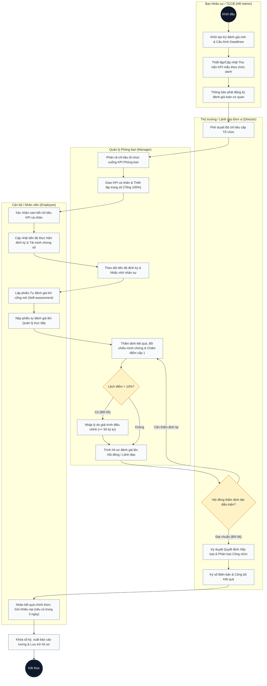
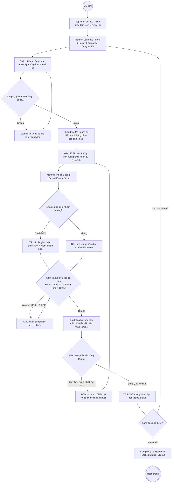
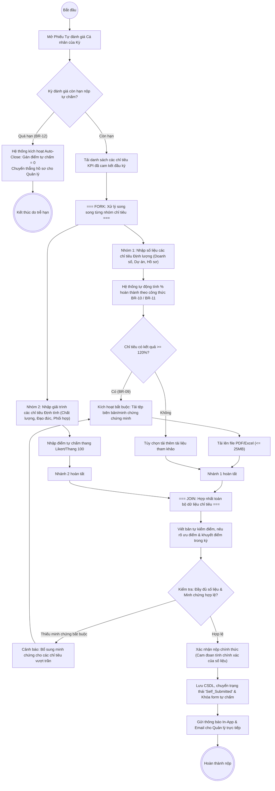
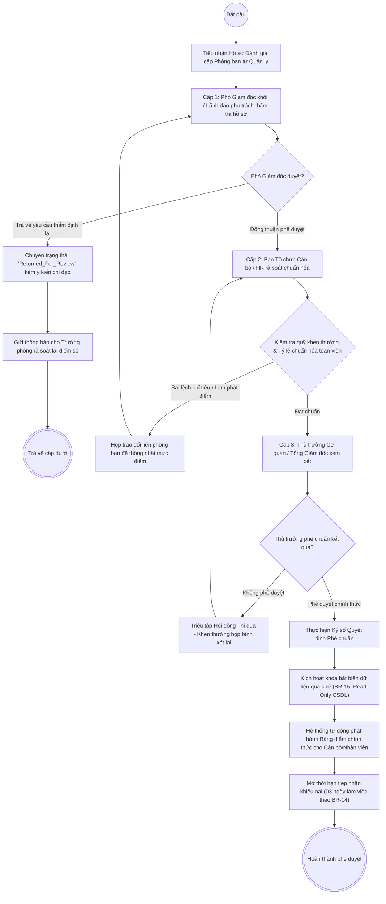
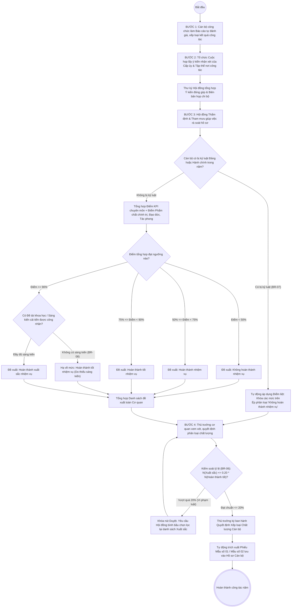
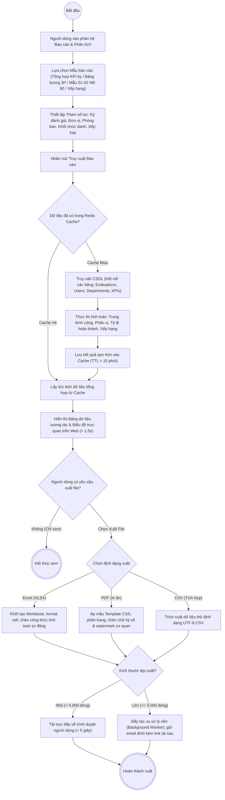
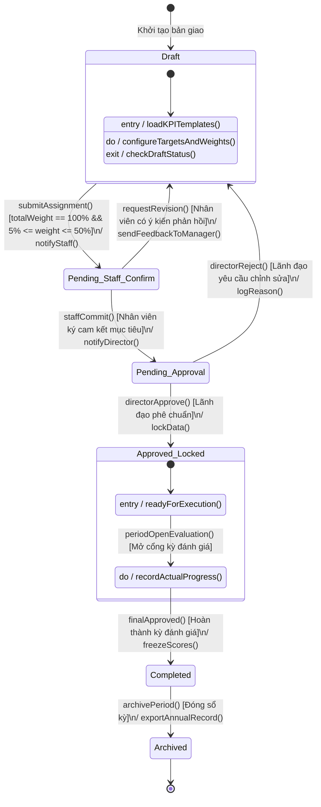
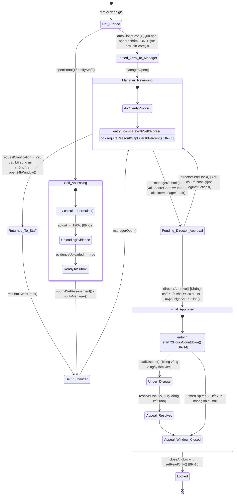
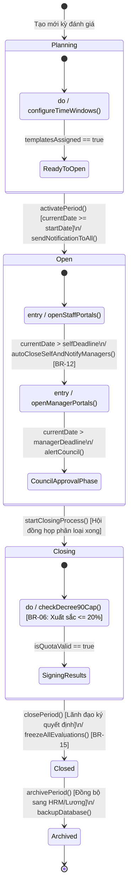
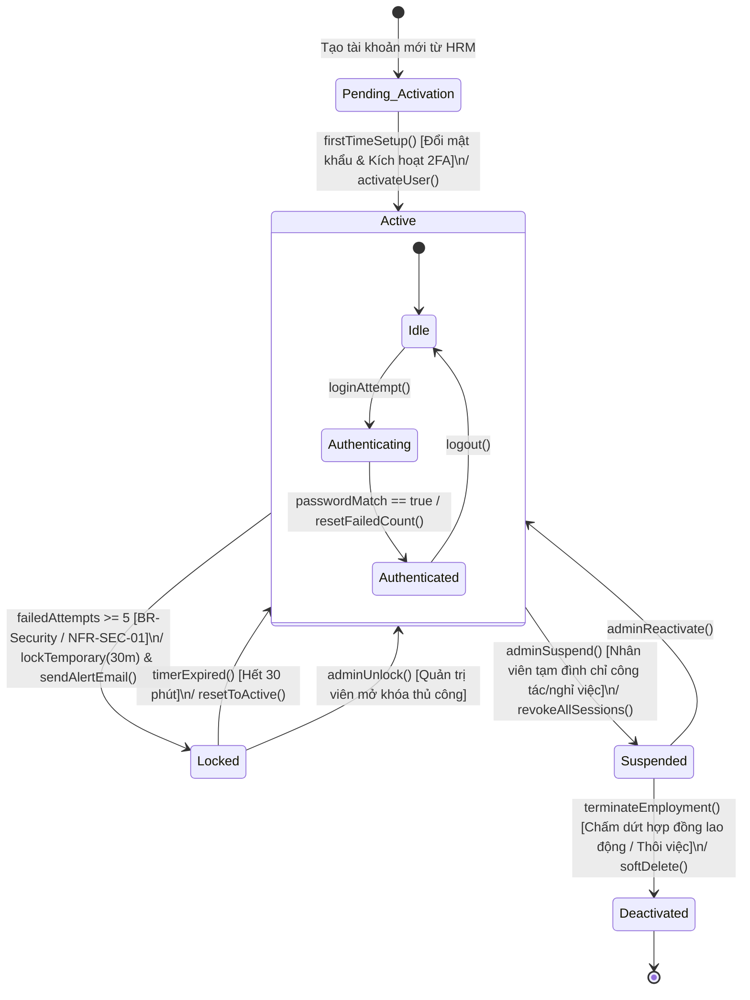

# TÀI LIỆU MÔ HÌNH HOẠT ĐỘNG & TRẠNG THÁI (ACTIVITY & STATE MODEL)
## HỆ THỐNG QUẢN LÝ VÀ ĐÁNH GIÁ KPI CHO DOANH NGHIỆP VÀ CÁN BỘ CÔNG CHỨC
**Mã tài liệu:** ASM-KPI-V1.0  
**Giai đoạn:** Phiên 5 / 10 - Mô hình hóa Hoạt động & Trạng thái (Activity & State Modeling)  
**Tác giả:** Chuyên gia Phân tích Hệ thống (Senior System Analyst)  
**Tài liệu tham chiếu:** [SRS Phiên 1](file:///d:/KPI/docs/Session_01_SRS_Requirements.md) | [Use Case Phiên 2](file:///d:/KPI/docs/Session_02_UseCase_Model.md) | [Class Model Phiên 3](file:///d:/KPI/docs/Session_03_Class_Analysis_Model.md) | [Interaction Model Phiên 4](file:///d:/KPI/docs/Session_04_Interaction_Model.md)  

---

## MỤC LỤC
1. [Giới thiệu Mô hình Hoạt động & Máy trạng thái](#1-giới-thiệu-mô-hình-hoạt-động--máy-trạng-thái)
2. [Hệ thống Biểu đồ Hoạt động Phân làn (Swimlane Activity Diagrams)](#2-hệ-thống-biểu-đồ-hoạt-động-phân-làn-swimlane-activity-diagrams)
   - AD-01: Quy trình tổng thể Đánh giá KPI End-to-End
   - AD-02: Quy trình Phân tầng & Thiết lập KPI Phòng ban (Cascade Goal)
   - AD-03: Quy trình Tự đánh giá & Nộp kết quả (Fork/Join minh chứng song song)
   - AD-04: Quy trình Phê duyệt Đánh giá Đa cấp (Xử lý Từ chối & Thẩm định lại)
   - AD-05: Quy trình Đánh giá Phân loại Cán bộ Công chức theo Nghị định 90/2020/NĐ-CP
   - AD-06: Quy trình Xử lý Dữ liệu & Xuất Báo cáo Đa định dạng
3. [Hệ thống Biểu đồ Máy trạng thái (State Machine Diagrams)](#3-hệ-thống-biểu-đồ-máy-trạng-thái-state-machine-diagrams)
   - SM-01: Máy trạng thái Bản giao KPI (`KPIAssignment`)
   - SM-02: Máy trạng thái Phiếu đánh giá Hiệu suất (`Evaluation`)
   - SM-03: Máy trạng thái Kỳ đánh giá (`EvaluationPeriod`)
   - SM-04: Máy trạng thái Tài khoản Người dùng (`UserAccount`)
4. [Bảng Ma trận Chuyển dịch Trạng thái & Ràng buộc Nghiệp vụ](#4-bảng-ma-trận-chuyển-dịch-trạng-thái--ràng-buộc-nghiệp-vụ)

---

## 1. GIỚI THIỆU MÔ HÌNH HOẠT ĐỘNG & MÁY TRẠNG THÁI

Trong phân tích hệ thống hướng đối tượng:
- **Biểu đồ Hoạt động (Activity Diagram):** Tập trung vào dòng điều khiển (Control Flow) và dòng dữ liệu (Object Flow) của các quy trình nghiệp vụ liên chức năng. Sử dụng cơ chế phân làn (**Swimlanes**) để phân định rạch ròi trách nhiệm giữa 4 vai trò: Ban Nhân sự (`HR`), Quản lý phòng ban (`Manager`), Cán bộ/Nhân viên (`Employee`) và Thủ trưởng cơ quan/Lãnh đạo (`Director`).
- **Biểu đồ Máy trạng thái (State Machine Diagram):** Mô tả chu kỳ sống (Lifecycle) của các thực thể thông tin cốt lõi, xác định các trạng thái bền vững, điều kiện bảo vệ (**Guard Conditions** $[...]$), sự kiện kích hoạt (**Trigger Events**) và các hành vi gắn liền (**Entry / Exit / Do Activities**).

---

## 2. HỆ THỐNG BIỂU ĐỒ HOẠT ĐỘNG PHÂN LÀN (SWIMLANE ACTIVITY DIAGRAMS)

---

### AD-01: QUY TRÌNH TỔNG THỂ ĐÁNH GIÁ KPI (END-TO-END)
- **Mục tiêu:** Mô tả vòng đời khép kín của một chu kỳ đánh giá hiệu suất từ khâu mở kỳ đến khi công bố và lưu trữ kết quả.

---

### AD-02: QUY TRÌNH THIẾT LẬP BỘ KPI CHO PHÒNG BAN & PHÂN TẦNG (CASCADE GOAL)
- **Mục tiêu:** Mô tả quy trình phân rã mục tiêu chiến lược tổ chức $\to$ mục tiêu phòng ban $\to$ chỉ tiêu cá nhân.

---

### AD-03: QUY TRÌNH TỰ ĐÁNH GIÁ & NỘP KẾT QUẢ (FORK/JOIN XỬ LÝ SONG SONG)
- **Mục tiêu:** Nhân viên cập nhật số liệu, đính kèm minh chứng và tự chấm điểm với cơ chế Fork/Join cho các chỉ tiêu độc lập.

---

### AD-04: QUY TRÌNH PHÊ DUYỆT ĐÁNH GIÁ ĐA CẤP (WORKFLOW APPROVAL)
- **Mục tiêu:** Mô tả luồng luân chuyển hồ sơ đánh giá qua các cấp lãnh đạo, xử lý các tình huống từ chối, yêu cầu giải trình bổ sung hoặc phê chuẩn cuối cùng.

---

### AD-05: QUY TRÌNH ĐÁNH GIÁ PHÂN LOẠI CÁN BỘ CÔNG CHỨC THEO NGHỊ ĐỊNH 90
- **Mục tiêu:** Quy chuẩn hóa 4 bước đánh giá phân loại cán bộ, công chức, viên chức theo đúng quy định tại Nghị định số 90/2020/NĐ-CP và Nghị định 48/2023/NĐ-CP.

---

### AD-06: QUY TRÌNH TẠO & XUẤT BÁO CÁO TỔNG HỢP
- **Mục tiêu:** Lựa chọn mẫu, áp bộ lọc động, truy xuất CSDL đa bảng, tính toán thống kê và trích xuất file Excel/PDF.

---

## 3. HỆ THỐNG BIỂU ĐỒ MÁY TRẠNG THÁI (STATE MACHINE DIAGRAMS)

---

### SM-01: MÁY TRẠNG THÁI BẢN GIAO KPI (`KPIAssignment`)
- **Đối tượng:** Thực thể `KPIAssignment`
- **Mục tiêu:** Quản lý vòng đời từ bản nháp thiết lập chỉ tiêu đến khi khóa dữ liệu và lưu trữ lịch sử.

#### Bảng chi tiết trạng thái của `KPIAssignment`:
| Tên trạng thái | Ý nghĩa nghiệp vụ | Quyền thao tác | Ràng buộc nghiệp vụ liên quan |
|---|---|---|---|
| `Draft` | Quản lý đang thiết lập chỉ tiêu, chưa gửi nhân sự. | Quản lý (CRUD) | BR-01, BR-02 |
| `Pending_Staff_Confirm` | Đã gửi nhân sự, chờ nhân sự xem và bấm cam kết. | Nhân viên (Commit/Feedback) | BR-13 (Kiểm tra kiêm nhiệm) |
| `Pending_Approval` | Nhân viên đã cam kết, chờ Lãnh đạo cơ quan duyệt. | Lãnh đạo (Approve/Reject) | - |
| `Approved_Locked` | Đã duyệt. Kế hoạch đóng băng, nhân viên bắt đầu thực hiện. | Read-Only | BR-03 (Lock on Submit) |
| `In_Evaluation` | Kỳ đánh giá mở cổng, bản giao sẵn sàng để nộp kết quả. | Nhân viên (Self-assess) | BR-12 (Kiểm soát hạn chót) |
| `Completed` | Kết quả đánh giá đã được chốt, sẵn sàng tính thưởng. | Read-Only | BR-20 (Thang điểm 100) |
| `Archived` | Dữ liệu lưu trữ lịch sử vĩnh viễn trong kho lưu trữ. | Read-Only (Thanh tra/Audit) | BR-15 (Data Immutability) |

---

### SM-02: MÁY TRẠNG THÁI PHIẾU ĐÁNH GIÁ HIỆU SUẤT (`Evaluation`)
- **Đối tượng:** Thực thể `Evaluation`
- **Mục tiêu:** Quản lý quy trình chấm điểm qua các cấp, kiểm tra điều chỉnh lệch điểm và xử lý khiếu nại.

#### Bảng chi tiết trạng thái của `Evaluation`:
| Trạng thái | Mô tả & Điều kiện kích hoạt | Sự kiện kế tiếp |
|---|---|---|
| `Not_Started` | Kỳ đánh giá mở cổng nhưng nhân viên chưa mở form. | Nhân viên mở form $\to$ `Self_Assessing`. |
| `Self_Assessing` | Nhân viên đang nhập số liệu và tải minh chứng. | Nhấn nộp $\to$ `Self_Submitted`. |
| `Forced_Zero_To_Manager` | Nhân viên quá hạn không nộp (BR-12), hệ thống ép tự chấm 0 điểm. | Chuyển thẳng $\to$ `Manager_Reviewing`. |
| `Self_Submitted` | Nhân viên đã nộp bản tự chấm, chờ Quản lý mở chấm. | Quản lý mở $\to$ `Manager_Reviewing`. |
| `Manager_Reviewing` | Quản lý đang thẩm tra minh chứng và chấm điểm. | Chấm xong $\to$ `Pending_Director_Approval`. |
| `Returned_To_Staff` | Quản lý yêu cầu bổ sung minh chứng số trong 24 giờ. | Bổ sung nộp lại $\to$ `Self_Submitted`. |
| `Pending_Director_Approval` | Quản lý đã chấm xong, chờ Lãnh đạo cơ quan ký duyệt. | Ký duyệt $\to$ `Final_Approved`. |
| `Final_Approved` | Lãnh đạo đã duyệt. Mở thời hạn 72h cho nhân viên khiếu nại (BR-14). | Hết 72h $\to$ `Locked`. Khiếu nại $\to$ `Under_Dispute`. |
| `Under_Dispute` | Đang trong quá trình thụ lý giải quyết đơn khiếu nại kết quả. | Xử lý xong $\to$ `Appeal_Resolved`. |
| `Locked` | Dữ liệu đóng băng vĩnh viễn, chuyển sang chế độ Read-Only (BR-15). | Kết thúc vòng đời. |

---

### SM-03: MÁY TRẠNG THÁI KỲ ĐÁNH GIÁ (`EvaluationPeriod`)
- **Đối tượng:** Thực thể `EvaluationPeriod`
- **Mục tiêu:** Quản lý vòng đời chu kỳ đánh giá toàn cơ quan, điều phối các mốc mở/đóng cổng tự động.

---

### SM-04: MÁY TRẠNG THÁI TÀI KHOẢN NGƯỜI DÙNG (`UserAccount`)
- **Đối tượng:** Thực thể `User`
- **Mục tiêu:** Quản lý an ninh tài khoản, kiểm soát đăng nhập sai, khóa tự động và kích hoạt phiên.

---

## 4. BẢNG MA TRẬN CHUYỂN DỊCH TRẠNG THÁI & RÀNG BUỘC NGHIỆP VỤ

Bảng đối soát chi tiết giữa các sự kiện chuyển trạng thái và các Ràng buộc nghiệp vụ (**BR**) đã được quy định:

| Đối tượng (Entity) | Trạng thái nguồn (From) | Trạng thái đích (To) | Sự kiện kích hoạt (Event) | Điều kiện bảo vệ (Guard Condition) | Hành vi thực thi (Action) | Ràng buộc ánh xạ |
|---|---|---|---|---|---|---|
| `KPIAssignment` | `Draft` | `Pending_Staff_Confirm` | `submitAssignment()` | $\sum \text{Weight} = 100\%$ và $5\% \le \text{Weight}_i \le 50\%$ | Gửi thông báo đến nhân viên | **BR-01, BR-02** |
| `KPIAssignment` | `Pending_Approval`| `Approved_Locked` | `directorApprove()` | Lãnh đạo xác nhận phê chuẩn | Đóng băng dữ liệu chỉ tiêu | **BR-03** |
| `KPIAssignment` | `Pending_Staff_Confirm`| `Draft` | `requestRevision()` | Nhân viên kiêm nhiệm phản hồi tỷ lệ | Mở lại chế độ chỉnh sửa | **BR-13** |
| `Evaluation` | `Not_Started` | `Forced_Zero_To_Manager`| `autoCloseCron()` | $\text{CurrentDate} > \text{SelfDeadline}$ | Gán điểm tự chấm $= 0$ | **BR-12** |
| `Evaluation` | `Self_Assessing` | `Self_Submitted` | `submitSelfAssessment()`| Các chỉ tiêu đạt $\ge 120\%$ bắt buộc có minh chứng số | Khóa form tự chấm, báo Quản lý | **BR-09, BR-10, BR-11** |
| `Evaluation` | `Manager_Reviewing`| `Pending_Director_Approval`| `managerSubmit()`| Lệch điểm $> 10\%$ bắt buộc có lý do $\ge 50$ ký tự | Tính điểm tổng theo thang 100 | **BR-05, BR-20** |
| `Evaluation` | `Pending_Director_Approval`| `Final_Approved`| `directorApprove()` | $N_{\text{Xuất sắc}} \le 0.20 \times N_{\text{Hoàn thành tốt}}$ và không có kỷ luật | Ký số, mở hạn khiếu nại 72h | **BR-06, BR-07, BR-08, BR-14** |
| `Evaluation` | `Final_Approved` | `Locked` | `closeAndLock()` | Hết 72h làm việc kể từ lúc công bố | Chuyển chế độ Read-Only vĩnh viễn | **BR-15** |
| `User` | `Active` | `Locked` | `loginAttempt()` | `failedAttempts >= 5` | Khóa 30 phút, gửi email cảnh báo | **NFR-SEC-01** |

---

## 5. KẾT LUẬN & CHUẨN BỊ CHO PHIÊN 6

Tài liệu Mô hình Hoạt động & Trạng thái Phiên 5 đã hoàn thành:
1. **6 Biểu đồ Hoạt động Phân làn (Swimlanes):** Làm rõ trách nhiệm của từng Actor (`HR`, `Manager`, `Employee`, `Director`), tích hợp đầy đủ các nút Quyết định (`Decision Nodes`), Rẽ nhánh/Hợp nhất (`Fork/Join`) và xử lý ngoại lệ trễ hạn.
2. **4 Biểu đồ Máy trạng thái (State Machine):** Chuẩn hóa vòng đời và sự chuyển dịch của các thực thể cốt lõi (`KPIAssignment`, `Evaluation`, `EvaluationPeriod`, `UserAccount`) bằng cú pháp `Mermaid stateDiagram-v2`.
3. **Tích hợp toàn diện các Business Rules:** Thể hiện trực quan các điểm kiểm soát tự động của hệ thống (khống chế xuất sắc 20%, khóa bất biến dữ liệu, bắt buộc giải trình, tự động đóng kỳ).

> [!TIP]
> **Đầu vào cho Phiên 6:**  
> Dựa trên các thuộc tính của Lớp Thực thể (Phiên 3) và các trạng thái dữ liệu (Phiên 5), **Phiên 6: Thiết kế Cơ sở Dữ liệu (Database Architecture & Physical Design)** sẽ xây dựng **Biểu đồ ERD chi tiết**, thiết kế hơn 30 bảng CSDL vật lý (chuẩn 3NF), định nghĩa toàn bộ khóa chính (PK), khóa ngoại (FK), Indexing, các trường Audit Trail và viết mã kịch bản SQL DDL hoàn chỉnh tương thích PostgreSQL / SQL Server.
