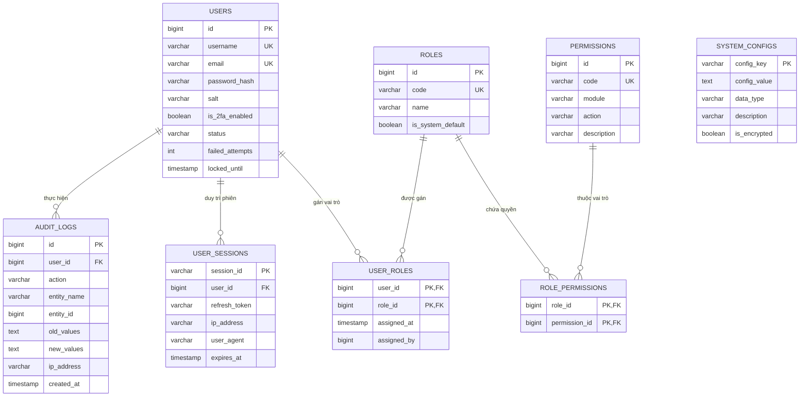
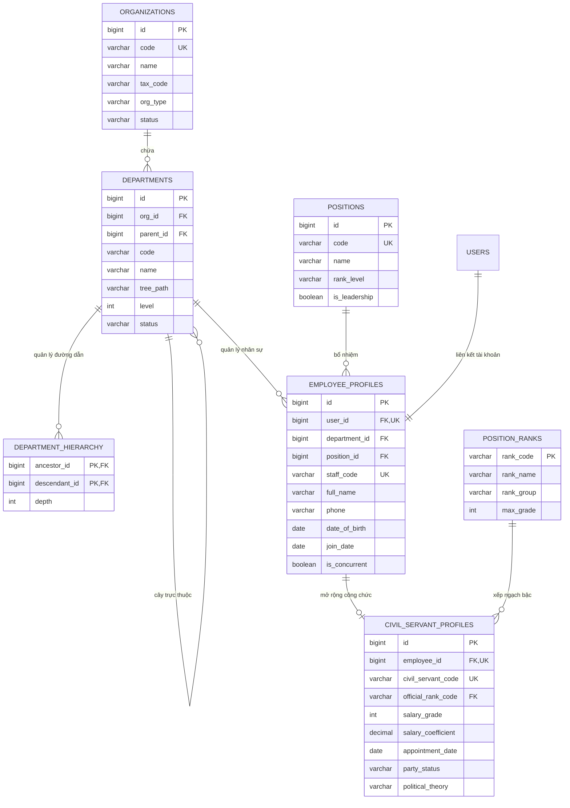
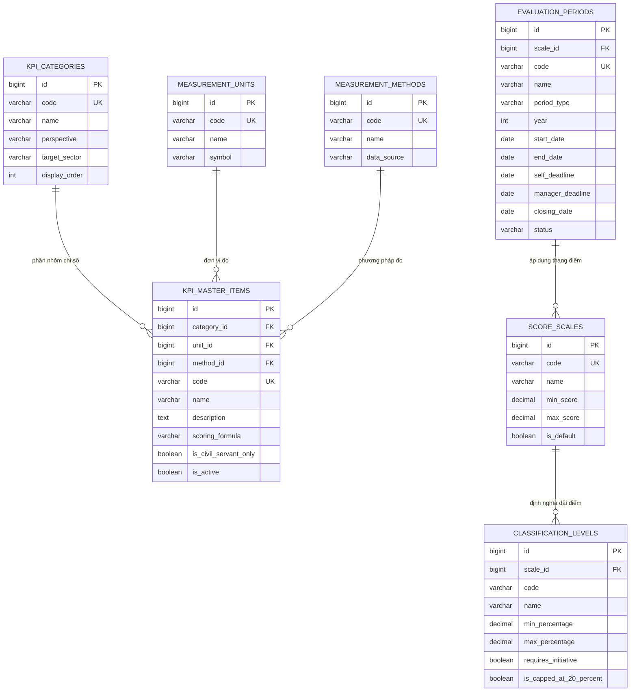
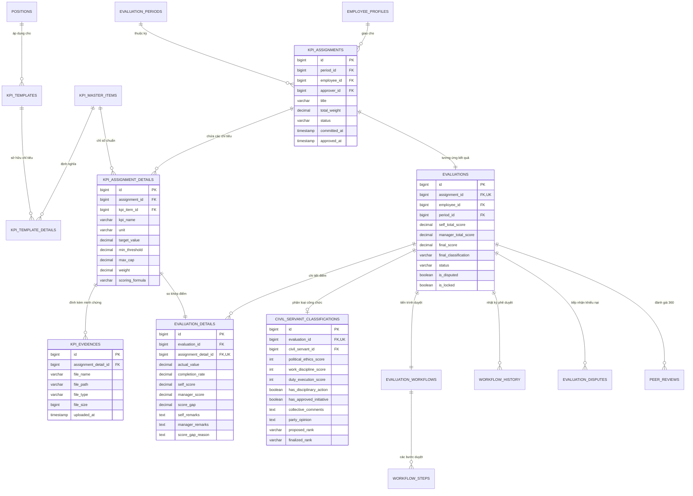

# TÀI LIỆU THIẾT KẾ CƠ SỞ DỮ LIỆU (DATABASE ARCHITECTURE & PHYSICAL DESIGN)
## HỆ THỐNG QUẢN LÝ VÀ ĐÁNH GIÁ KPI CHO DOANH NGHIỆP VÀ CÁN BỘ CÔNG CHỨC
**Mã tài liệu:** DBD-KPI-V1.0  
**Giai đoạn:** Phiên 6 / 10 - Thiết kế Cơ sở Dữ liệu Vật lý (Physical Database Design)  
**Tác giả:** Chuyên gia Phân tích Hệ thống & Kiến trúc sư CSDL (Senior Database Architect)  
**Tài liệu tham chiếu:** [Class Model Phiên 3](file:///d:/KPI/docs/Session_03_Class_Analysis_Model.md) | [State Model Phiên 5](file:///d:/KPI/docs/Session_05_Activity_State_Model.md)  
**Hệ quản trị CSDL mục tiêu:** PostgreSQL 15+ / SQL Server 2022 (Chuẩn ANSI SQL)  

---

## MỤC LỤC
1. [Sơ đồ Thực thể - Mối quan hệ (Entity-Relationship Diagrams - ERD)](#1-sơ-đồ-thực-thể---mối-quan-hệ-erd)
   - 1.1. ERD Nhóm Quản trị & Phân quyền bảo mật
   - 1.2. ERD Nhóm Cơ cấu Tổ chức & Hồ sơ Cán bộ
   - 1.3. ERD Nhóm Danh mục dùng chung
   - 1.4. ERD Nhóm Thiết lập & Kế hoạch Giao KPI
   - 1.5. ERD Nhóm Thực thi, Đánh giá & Phân loại Công chức
   - 1.6. ERD Nhóm Báo cáo, Dashboard & Thông báo
2. [Thiết kế Bảng Chi tiết (Physical Schema Design - 36 Bảng)](#2-thiết-kế-bảng-chi-tiết-physical-schema-design)
3. [Từ điển Dữ liệu (Data Dictionary)](#3-từ-điển-dữ-liệu-data-dictionary)
4. [Phân tích Chuẩn hóa CSDL (Database Normalization & Denormalization)](#4-phân-tích-chuẩn-hóa-csdl)
5. [Hệ thống Ràng buộc Toàn vẹn & Triggers](#5-hệ-thống-ràng-buộc-toàn-vẹn--triggers)
6. [Kịch bản SQL DDL Hoàn chỉnh (PostgreSQL Ready Script)](#6-kịch-bản-sql-ddl-hoàn-chỉnh)

---

## 1. SƠ ĐỒ THỰC THỂ - MỐI QUAN HỆ (ERD)

---

### 1.1. ERD Nhóm Quản trị, Phân quyền & Kiểm toán



---

### 1.2. ERD Nhóm Cơ cấu Tổ chức & Hồ sơ Nhân sự / Cán bộ Công chức



---

### 1.3. ERD Nhóm Danh mục Dùng chung



---

### 1.4. ERD Nhóm Thiết lập, Giao KPI & Đánh giá Hiệu suất



---

## 2. THIẾT KẾ BẢNG CHI TIẾT (PHYSICAL SCHEMA DESIGN)

Tất cả các bảng trong hệ thống đều tuân thủ các quy tắc thiết kế chuẩn:
- **Khóa chính:** `BIGINT GENERATED ALWAYS AS IDENTITY` (hoặc `BIGSERIAL` / `BIGINT IDENTITY(1,1)`).
- **Cột kiểm toán chung (Audit Columns):** Mọi bảng dữ liệu nghiệp vụ đều sở hữu 5 trường bắt buộc:
  - `created_at TIMESTAMP WITH TIME ZONE DEFAULT CURRENT_TIMESTAMP NOT NULL`
  - `created_by BIGINT REFERENCES users(id)`
  - `updated_at TIMESTAMP WITH TIME ZONE`
  - `updated_by BIGINT REFERENCES users(id)`
  - `is_deleted BOOLEAN DEFAULT FALSE NOT NULL` (Hỗ trợ Soft Delete).

---

### PHÂN HỆ 1: QUẢN TRỊ, PHÂN QUYỀN & KIỂM TOÁN (8 BẢNG)

#### Bảng 1: `users` (Tài khoản người dùng)
| Tên cột | Kiểu dữ liệu | Ràng buộc | Chỉ mục (Index) | Mô tả mục đích |
|---|---|---|---|---|
| `id` | BIGINT | PK, IDENTITY | PK_users (Clustered) | Mã định danh người dùng |
| `username` | VARCHAR(50) | NOT NULL, UNIQUE | UK_users_username | Tên đăng nhập hệ thống |
| `email` | VARCHAR(100) | NOT NULL, UNIQUE | UK_users_email | Email công vụ/doanh nghiệp |
| `password_hash`| VARCHAR(255) | NOT NULL | - | Chuỗi băm mật khẩu Argon2id |
| `salt` | VARCHAR(128) | NOT NULL | - | Chuỗi muối mật mã |
| `is_2fa_enabled`| BOOLEAN | DEFAULT FALSE, NOT NULL| - | Bật/tắt xác thực 2 bước OTP |
| `two_factor_secret`| VARCHAR(64)| NULLABLE | - | Khóa bí mật TOTP RFC 6238 |
| `status` | VARCHAR(20) | DEFAULT 'Pending_Activation'| IDX_users_status | Active, Locked, Suspended... |
| `failed_attempts`| INT | DEFAULT 0, NOT NULL | - | Số lần đăng nhập sai liên tiếp |
| `locked_until` | TIMESTAMP TZ | NULLABLE | - | Mở khóa tự động sau thời điểm này |
| `last_login_at`| TIMESTAMP TZ | NULLABLE | - | Thời gian đăng nhập gần nhất |

#### Bảng 2: `roles` (Vai trò người dùng)
| Tên cột | Kiểu dữ liệu | Ràng buộc | Mô tả |
|---|---|---|---|
| `id` | BIGINT | PK, IDENTITY | Mã định danh vai trò |
| `code` | VARCHAR(30) | NOT NULL, UNIQUE | Mã vai trò: `ROLE_ADMIN`, `ROLE_DIRECTOR`, `ROLE_MANAGER`, `ROLE_HR`, `ROLE_STAFF` |
| `name` | VARCHAR(100) | NOT NULL | Tên hiển thị vai trò |
| `description` | VARCHAR(255) | NULLABLE | Mô tả quyền hạn vai trò |
| `is_system_default`| BOOLEAN | DEFAULT FALSE | Cờ bảo vệ không cho phép xóa vai trò mặc định |

#### Bảng 3: `permissions` (Danh mục quyền năng hạn)
| Tên cột | Kiểu dữ liệu | Ràng buộc | Mô tả |
|---|---|---|---|
| `id` | BIGINT | PK, IDENTITY | Mã quyền |
| `code` | VARCHAR(50) | NOT NULL, UNIQUE | Ví dụ: `KPI_ASSIGN_CREATE`, `EVALUATION_APPROVE` |
| `module` | VARCHAR(50) | NOT NULL | Phân hệ trực thuộc |
| `action` | VARCHAR(30) | NOT NULL | Create, Read, Update, Delete, Approve, Export |
| `description` | VARCHAR(255) | NULLABLE | Mô tả chức năng |

#### Bảng 4: `user_roles` (Bảng trung gian Gán vai trò)
- **Khóa chính:** Composite `PK (user_id, role_id)`
- `user_id BIGINT REFERENCES users(id) ON DELETE CASCADE`
- `role_id BIGINT REFERENCES roles(id) ON DELETE RESTRICT`
- `assigned_at TIMESTAMP TZ DEFAULT CURRENT_TIMESTAMP`
- `assigned_by BIGINT REFERENCES users(id)`

#### Bảng 5: `role_permissions` (Bảng trung gian Gán quyền cho vai trò)
- **Khóa chính:** Composite `PK (role_id, permission_id)`
- `role_id BIGINT REFERENCES roles(id) ON DELETE CASCADE`
- `permission_id BIGINT REFERENCES permissions(id) ON DELETE CASCADE`

#### Bảng 6: `audit_logs` (Nhật ký kiểm toán an toàn - Bất biến)
| Tên cột | Kiểu dữ liệu | Ràng buộc | Chỉ mục | Mô tả |
|---|---|---|---|---|
| `id` | BIGINT | PK, IDENTITY | PK_audit | Mã bản ghi |
| `user_id` | BIGINT | REFERENCES users(id) | IDX_audit_user | Người thực hiện hành động |
| `action` | VARCHAR(50) | NOT NULL | IDX_audit_action | `LOGIN`, `UPDATE_SCORE`, `APPROVE` |
| `entity_name` | VARCHAR(50) | NOT NULL | IDX_audit_entity | Tên bảng bị tác động |
| `entity_id` | BIGINT | NOT NULL | IDX_audit_entity_id| Khóa của bản ghi bị tác động |
| `old_values` | JSONB / TEXT | NULLABLE | - | Giá trị cũ trước khi sửa |
| `new_values` | JSONB / TEXT | NULLABLE | - | Giá trị mới sau khi sửa |
| `ip_address` | VARCHAR(45) | NOT NULL | - | Địa chỉ IPv4/IPv6 máy trạm |
| `user_agent` | VARCHAR(255) | NULLABLE | - | Thông tin trình duyệt/OS |
| `created_at` | TIMESTAMP TZ | DEFAULT CURRENT_TIMESTAMP | IDX_audit_time | Thời điểm ghi log |

#### Bảng 7: `system_configs` (Cấu hình tham số hệ thống)
- `config_key VARCHAR(50) PK`: Tên tham số (VD: `SMTP_HOST`, `SESSION_TIMEOUT_MINUTES`, `MAX_EVIDENCE_SIZE_MB`).
- `config_value TEXT NOT NULL`: Giá trị tham số.
- `data_type VARCHAR(20) NOT NULL`: `STRING`, `INTEGER`, `BOOLEAN`, `JSON`.
- `description VARCHAR(255)`: Hướng dẫn cấu hình.
- `is_encrypted BOOLEAN DEFAULT FALSE`: Cờ mã hóa giá trị nhạy cảm (mật khẩu SMTP, API Secret).

#### Bảng 8: `user_sessions` (Quản lý phiên đăng nhập)
- `session_id VARCHAR(128) PK`: Token ID định danh phiên.
- `user_id BIGINT REFERENCES users(id) ON DELETE CASCADE`.
- `refresh_token_hash VARCHAR(255) NOT NULL UNIQUE`.
- `ip_address VARCHAR(45) NOT NULL`.
- `user_agent VARCHAR(255)`.
- `expires_at TIMESTAMP TZ NOT NULL`.
- `is_revoked BOOLEAN DEFAULT FALSE`.

---

### PHÂN HỆ 2: CƠ CẤU TỔ CHỨC & HỒ SƠ NHÂN SỰ (6 BẢNG)

#### Bảng 9: `organizations` (Đơn vị / Cơ quan chủ quản)
- `id BIGINT PK IDENTITY`.
- `code VARCHAR(30) UNIQUE NOT NULL`.
- `name VARCHAR(200) NOT NULL`.
- `tax_code VARCHAR(20)`.
- `address VARCHAR(255)`.
- `org_type VARCHAR(30) NOT NULL CHECK (org_type IN ('Enterprise', 'PublicAdministration', 'PublicService'))`.
- `status VARCHAR(20) DEFAULT 'Active'`.

#### Bảng 10: `departments` (Phòng ban / Đơn vị thành viên)
- `id BIGINT PK IDENTITY`.
- `org_id BIGINT REFERENCES organizations(id) ON DELETE RESTRICT NOT NULL`.
- `parent_id BIGINT REFERENCES departments(id) ON DELETE RESTRICT NULLABLE`.
- `code VARCHAR(30) NOT NULL`.
- `name VARCHAR(150) NOT NULL`.
- `tree_path VARCHAR(255) NOT NULL` (VD: `/1/4/12/` hỗ trợ truy vấn cây phân cấp nhanh).
- `level INT NOT NULL DEFAULT 1`.
- `status VARCHAR(20) DEFAULT 'Active'`.
- *Index:* `UK (org_id, code)`, `IDX_departments_parent (parent_id)`.

#### Bảng 11: `department_hierarchy` (Bảng bao đóng đệ quy - Closure Table)
- Hỗ trợ truy vấn toàn bộ cây cấp dưới với hiệu năng $O(1)$ mà không cần đệ quy sâu.
- `ancestor_id BIGINT REFERENCES departments(id) ON DELETE CASCADE`.
- `descendant_id BIGINT REFERENCES departments(id) ON DELETE CASCADE`.
- `depth INT NOT NULL` (0 nếu là chính nó, 1 là con trực tiếp, 2 là cháu...).
- *Primary Key:* `(ancestor_id, descendant_id)`.

#### Bảng 12: `positions` (Vị trí chức danh công việc)
- `id BIGINT PK IDENTITY`.
- `code VARCHAR(30) UNIQUE NOT NULL`.
- `name VARCHAR(100) NOT NULL`.
- `rank_level VARCHAR(30)`.
- `is_leadership BOOLEAN DEFAULT FALSE` (Cờ chức danh lãnh đạo quản lý).

#### Bảng 13: `employee_profiles` (Hồ sơ Nhân viên / Cán bộ)
- `id BIGINT PK IDENTITY`.
- `user_id BIGINT REFERENCES users(id) ON DELETE RESTRICT UNIQUE NOT NULL`.
- `department_id BIGINT REFERENCES departments(id) ON DELETE RESTRICT NOT NULL`.
- `position_id BIGINT REFERENCES positions(id) ON DELETE RESTRICT NOT NULL`.
- `staff_code VARCHAR(30) UNIQUE NOT NULL`.
- `full_name VARCHAR(100) NOT NULL`.
- `phone VARCHAR(20)`.
- `date_of_birth DATE`.
- `join_date DATE NOT NULL`.
- `is_concurrent BOOLEAN DEFAULT FALSE` (Cờ kiêm nhiệm - **BR-13**).
- *Index:* `IDX_emp_dept (department_id)`, `IDX_emp_staffcode (staff_code)`.

#### Bảng 14: `civil_servant_profiles` (Hồ sơ Cán bộ Công chức chuyên biệt)
- `id BIGINT PK IDENTITY`.
- `employee_id BIGINT REFERENCES employee_profiles(id) ON DELETE CASCADE UNIQUE NOT NULL`.
- `civil_servant_code VARCHAR(30) UNIQUE NOT NULL`.
- `official_rank_code VARCHAR(20) REFERENCES position_ranks(rank_code) NOT NULL`.
- `salary_grade INT NOT NULL CHECK (salary_grade >= 1 AND salary_grade <= 12)`.
- `salary_coefficient NUMERIC(5,2) NOT NULL CHECK (salary_coefficient > 0)`.
- `appointment_date DATE`.
- `party_status VARCHAR(30) DEFAULT 'None' CHECK (party_status IN ('Official', 'Probationary', 'None'))`.
- `political_theory VARCHAR(30) CHECK (political_theory IN ('High', 'Intermediate', 'Primary', 'None'))`.

---

### PHÂN HỆ 3: DANH MỤC DÙNG CHUNG (7 BẢNG)

#### Bảng 15: `position_ranks` (Danh mục Ngạch bậc công chức)
- `rank_code VARCHAR(20) PK`: Ví dụ: `01.001` (Chuyên viên cao cấp), `01.002` (Chuyên viên chính), `01.003` (Chuyên viên), `01.004` (Cán sự).
- `rank_name VARCHAR(100) NOT NULL`.
- `rank_group VARCHAR(50) NOT NULL`.
- `max_grade INT DEFAULT 9`.

#### Bảng 16: `kpi_categories` (Nhóm chỉ số KPI)
- `id BIGINT PK IDENTITY`.
- `code VARCHAR(30) UNIQUE NOT NULL`.
- `name VARCHAR(100) NOT NULL`.
- `perspective VARCHAR(30) CHECK (perspective IN ('Financial', 'Customer', 'InternalProcess', 'LearningGrowth', 'PublicServiceEthics'))`.
- `target_sector VARCHAR(30) DEFAULT 'All' CHECK (target_sector IN ('Enterprise', 'PublicSector', 'All'))`.
- `display_order INT DEFAULT 0`.

#### Bảng 17: `measurement_units` (Đơn vị tính)
- `id BIGINT PK IDENTITY`.
- `code VARCHAR(30) UNIQUE NOT NULL`: `PERCENT`, `VND_MILLION`, `QUANTITY`, `HOURS`, `DOCUMENT`.
- `name VARCHAR(50) NOT NULL`.
- `symbol VARCHAR(15) NOT NULL`: `%`, `Tr.đ`, `Cái`, `h`, `Văn bản`.

#### Bảng 18: `measurement_methods` (Phương pháp đo lường)
- `id BIGINT PK IDENTITY`.
- `code VARCHAR(30) UNIQUE NOT NULL`: `AUTO_ERP`, `MANUAL_REPORT`, `INSPECTION_RECORD`.
- `name VARCHAR(100) NOT NULL`.
- `data_source VARCHAR(100)`.

#### Bảng 19: `kpi_master_items` (Ngân hàng Thư viện Chỉ số KPI)
- `id BIGINT PK IDENTITY`.
- `category_id BIGINT REFERENCES kpi_categories(id) ON DELETE RESTRICT NOT NULL`.
- `unit_id BIGINT REFERENCES measurement_units(id) ON DELETE RESTRICT NOT NULL`.
- `method_id BIGINT REFERENCES measurement_methods(id) ON DELETE RESTRICT NOT NULL`.
- `code VARCHAR(30) UNIQUE NOT NULL`.
- `name VARCHAR(255) NOT NULL`.
- `description TEXT`.
- `scoring_formula VARCHAR(30) DEFAULT 'HigherIsBetter' CHECK (scoring_formula IN ('HigherIsBetter', 'LowerIsBetter', 'TargetRange'))`.
- `is_civil_servant_only BOOLEAN DEFAULT FALSE`.
- `is_active BOOLEAN DEFAULT TRUE`.

#### Bảng 20: `score_scales` (Thang điểm đánh giá)
- `id BIGINT PK IDENTITY`.
- `code VARCHAR(30) UNIQUE NOT NULL`: `SCALE_100`, `SCALE_10`, `SCALE_5`.
- `name VARCHAR(100) NOT NULL`.
- `min_score NUMERIC(5,2) DEFAULT 0.0`.
- `max_score NUMERIC(5,2) DEFAULT 100.0`.
- `is_default BOOLEAN DEFAULT FALSE`.

#### Bảng 21: `classification_levels` (Mức xếp loại hiệu suất)
- `id BIGINT PK IDENTITY`.
- `scale_id BIGINT REFERENCES score_scales(id) ON DELETE CASCADE NOT NULL`.
- `code VARCHAR(30) NOT NULL`: `EXCELLENT`, `GOOD`, `SATISFACTORY`, `UNSATISFACTORY`.
- `name VARCHAR(100) NOT NULL`.
- `min_percentage NUMERIC(5,2) NOT NULL` (VD: 90.00 cho Xuất sắc).
- `max_percentage NUMERIC(5,2) NOT NULL` (VD: 150.00).
- `requires_initiative BOOLEAN DEFAULT FALSE` (**BR-08**).
- `is_capped_at_20_percent BOOLEAN DEFAULT FALSE` (**BR-06**).

#### Bảng 22: `evaluation_periods` (Kỳ đánh giá hiệu suất)
- `id BIGINT PK IDENTITY`.
- `scale_id BIGINT REFERENCES score_scales(id) ON DELETE RESTRICT NOT NULL`.
- `code VARCHAR(30) UNIQUE NOT NULL`.
- `name VARCHAR(150) NOT NULL`.
- `period_type VARCHAR(20) NOT NULL CHECK (period_type IN ('Monthly', 'Quarterly', 'SemiAnnual', 'Annual'))`.
- `year INT NOT NULL`.
- `start_date DATE NOT NULL`.
- `end_date DATE NOT NULL`.
- `self_deadline TIMESTAMP TZ NOT NULL`.
- `manager_deadline TIMESTAMP TZ NOT NULL`.
- `closing_date TIMESTAMP TZ NOT NULL`.
- `status VARCHAR(20) DEFAULT 'Planning' CHECK (status IN ('Planning', 'Open', 'InEvaluation', 'Closing', 'Closed', 'Archived'))`.
- *Index:* `IDX_period_status (status)`, `IDX_period_year (year)`.

---

### PHÂN HỆ 4: THIẾT LẬP & KẾ HOẠCH GIAO KPI (5 BẢNG)

#### Bảng 23: `kpi_templates` (Bộ KPI mẫu theo chức danh)
- `id BIGINT PK IDENTITY`.
- `position_id BIGINT REFERENCES positions(id) ON DELETE CASCADE NOT NULL`.
- `department_id BIGINT REFERENCES departments(id) ON DELETE CASCADE NULLABLE`.
- `code VARCHAR(30) UNIQUE NOT NULL`.
- `name VARCHAR(150) NOT NULL`.
- `description TEXT`.
- `status VARCHAR(20) DEFAULT 'Active'`.

#### Bảng 24: `kpi_template_details` (Chi tiết chỉ tiêu trong bộ mẫu)
- `id BIGINT PK IDENTITY`.
- `template_id BIGINT REFERENCES kpi_templates(id) ON DELETE CASCADE NOT NULL`.
- `kpi_item_id BIGINT REFERENCES kpi_master_items(id) ON DELETE RESTRICT NOT NULL`.
- `target_value NUMERIC(15,2) NOT NULL DEFAULT 100.0`.
- `min_threshold NUMERIC(15,2) DEFAULT 0.0`.
- `weight NUMERIC(5,2) NOT NULL CHECK (weight >= 5.0 AND weight <= 50.0)` (**BR-02**).
- `guidance_notes TEXT`.

#### Bảng 25: `kpi_assignments` (Bản giao KPI cá nhân)
- `id BIGINT PK IDENTITY`.
- `period_id BIGINT REFERENCES evaluation_periods(id) ON DELETE RESTRICT NOT NULL`.
- `employee_id BIGINT REFERENCES employee_profiles(id) ON DELETE RESTRICT NOT NULL`.
- `approver_id BIGINT REFERENCES users(id) ON DELETE RESTRICT NOT NULL`.
- `title VARCHAR(200) NOT NULL`.
- `total_weight NUMERIC(5,2) NOT NULL CHECK (total_weight = 100.00)` (**BR-01**).
- `status VARCHAR(30) DEFAULT 'Draft' CHECK (status IN ('Draft', 'Pending_Staff_Confirm', 'Pending_Approval', 'Approved_Locked', 'In_Evaluation', 'Completed', 'Archived'))`.
- `committed_at TIMESTAMP TZ`.
- `approved_at TIMESTAMP TZ`.
- *Index:* `UK (period_id, employee_id)` (Mỗi nhân viên chỉ có 1 bản giao chính thức/kỳ), `IDX_assign_emp (employee_id)`.

#### Bảng 26: `kpi_assignment_details` (Chi tiết chỉ tiêu KPI được giao)
- `id BIGINT PK IDENTITY`.
- `assignment_id BIGINT REFERENCES kpi_assignments(id) ON DELETE CASCADE NOT NULL`.
- `kpi_item_id BIGINT REFERENCES kpi_master_items(id) ON DELETE RESTRICT NOT NULL`.
- `kpi_name VARCHAR(255) NOT NULL` (Snapshot tên chỉ tiêu tại thời điểm giao - chuẩn 3NF denormalization).
- `unit VARCHAR(30) NOT NULL` (Snapshot đơn vị tính).
- `target_value NUMERIC(15,2) NOT NULL`.
- `min_threshold NUMERIC(15,2) DEFAULT 0.0`.
- `max_cap NUMERIC(5,2) DEFAULT 150.0` (**BR-10**).
- `weight NUMERIC(5,2) NOT NULL CHECK (weight >= 5.0 AND weight <= 50.0)` (**BR-02**).
- `scoring_formula VARCHAR(30) NOT NULL`.

#### Bảng 27: `kpi_evidences` (Tệp tài liệu minh chứng số)
- `id BIGINT PK IDENTITY`.
- `assignment_detail_id BIGINT REFERENCES kpi_assignment_details(id) ON DELETE CASCADE NOT NULL`.
- `file_name VARCHAR(255) NOT NULL`.
- `file_path VARCHAR(500) NOT NULL`.
- `file_type VARCHAR(100) NOT NULL`.
- `file_size BIGINT NOT NULL CHECK (file_size <= 26214400)` (Giới hạn tối đa 25MB - **FR-ADM-07**).
- `description VARCHAR(255)`.
- `uploaded_at TIMESTAMP TZ DEFAULT CURRENT_TIMESTAMP NOT NULL`.

---

### PHÂN HỆ 5: THỰC THI, ĐÁNH GIÁ, CÔNG CHỨC & WORKFLOW (8 BẢNG)

#### Bảng 28: `evaluations` (Phiếu đánh giá hiệu suất tổng hợp)
- `id BIGINT PK IDENTITY`.
- `assignment_id BIGINT REFERENCES kpi_assignments(id) ON DELETE RESTRICT UNIQUE NOT NULL`.
- `employee_id BIGINT REFERENCES employee_profiles(id) ON DELETE RESTRICT NOT NULL`.
- `period_id BIGINT REFERENCES evaluation_periods(id) ON DELETE RESTRICT NOT NULL`.
- `self_total_score NUMERIC(5,2) DEFAULT 0.0 NOT NULL`.
- `manager_total_score NUMERIC(5,2) DEFAULT 0.0 NOT NULL`.
- `final_score NUMERIC(5,2) DEFAULT 0.0 NOT NULL` (**BR-20**).
- `final_classification VARCHAR(50)`.
- `status VARCHAR(30) DEFAULT 'Not_Started' CHECK (status IN ('Not_Started', 'Self_Assessing', 'Self_Submitted', 'Manager_Reviewing', 'Pending_Director_Approval', 'Final_Approved', 'Locked'))`.
- `is_disputed BOOLEAN DEFAULT FALSE`.
- `is_locked BOOLEAN DEFAULT FALSE` (**BR-15**).
- *Index:* `IDX_eval_emp (employee_id)`, `IDX_eval_period (period_id)`, `IDX_eval_status (status)`.

#### Bảng 29: `evaluation_details` (Chi tiết điểm số từng chỉ tiêu)
- `id BIGINT PK IDENTITY`.
- `evaluation_id BIGINT REFERENCES evaluations(id) ON DELETE CASCADE NOT NULL`.
- `assignment_detail_id BIGINT REFERENCES kpi_assignment_details(id) ON DELETE RESTRICT UNIQUE NOT NULL`.
- `actual_value NUMERIC(15,2) NOT NULL DEFAULT 0.0`.
- `completion_rate NUMERIC(7,2) NOT NULL DEFAULT 0.0`.
- `self_score NUMERIC(5,2) NOT NULL DEFAULT 0.0`.
- `manager_score NUMERIC(5,2) NOT NULL DEFAULT 0.0`.
- `score_gap NUMERIC(5,2) GENERATED ALWAYS AS (ABS(self_score - manager_score)) STORED`.
- `self_remarks TEXT`.
- `manager_remarks TEXT`.
- `score_gap_reason TEXT` (Bắt buộc nếu `score_gap > 10.0` - **BR-05**).

#### Bảng 30: `civil_servant_classifications` (Phân loại Cán bộ Công chức theo Nghị định 90)
- `id BIGINT PK IDENTITY`.
- `evaluation_id BIGINT REFERENCES evaluations(id) ON DELETE CASCADE UNIQUE NOT NULL`.
- `civil_servant_id BIGINT REFERENCES civil_servant_profiles(id) ON DELETE RESTRICT NOT NULL`.
- `political_ethics_score INT NOT NULL CHECK (political_ethics_score BETWEEN 0 AND 100)`.
- `work_discipline_score INT NOT NULL CHECK (work_discipline_score BETWEEN 0 AND 100)`.
- `duty_execution_score INT NOT NULL CHECK (duty_execution_score BETWEEN 0 AND 100)`.
- `has_disciplinary_action BOOLEAN DEFAULT FALSE NOT NULL` (**BR-07**).
- `has_approved_initiative BOOLEAN DEFAULT FALSE NOT NULL` (**BR-08**).
- `collective_comments TEXT`.
- `party_opinion TEXT`.
- `proposed_rank VARCHAR(50) NOT NULL`.
- `finalized_rank VARCHAR(50) NOT NULL`.
- `approved_by BIGINT REFERENCES users(id)`.
- `approved_at TIMESTAMP TZ`.

#### Bảng 31: `peer_reviews` (Đánh giá ngang hàng 360 độ - Tùy chọn)
- `id BIGINT PK IDENTITY`.
- `evaluation_id BIGINT REFERENCES evaluations(id) ON DELETE CASCADE NOT NULL`.
- `reviewer_id BIGINT REFERENCES employee_profiles(id) ON DELETE RESTRICT NOT NULL`.
- `behavior_score NUMERIC(5,2) NOT NULL`.
- `feedback_comments TEXT`.
- `is_anonymous BOOLEAN DEFAULT TRUE` (**BR-18**).
- `submitted_at TIMESTAMP TZ DEFAULT CURRENT_TIMESTAMP`.

#### Bảng 32: `evaluation_workflows` (Quản lý tiến trình luồng duyệt)
- `id BIGINT PK IDENTITY`.
- `evaluation_id BIGINT REFERENCES evaluations(id) ON DELETE CASCADE UNIQUE NOT NULL`.
- `current_step VARCHAR(50) NOT NULL`.
- `status VARCHAR(30) DEFAULT 'Running'`.

#### Bảng 33: `workflow_steps` (Các bước định tuyến phê duyệt)
- `id BIGINT PK IDENTITY`.
- `workflow_id BIGINT REFERENCES evaluation_workflows(id) ON DELETE CASCADE NOT NULL`.
- `step_order INT NOT NULL`.
- `step_name VARCHAR(100) NOT NULL`.
- `required_role_id BIGINT REFERENCES roles(id) NOT NULL`.
- `assigned_actor_id BIGINT REFERENCES users(id) NULLABLE`.
- `action_taken VARCHAR(30)` (`Approved`, `Rejected`, `Pending`).
- `comments TEXT`.
- `completed_at TIMESTAMP TZ`.

#### Bảng 34: `workflow_history` (Nhật ký luân chuyển hồ sơ)
- `id BIGINT PK IDENTITY`.
- `evaluation_id BIGINT REFERENCES evaluations(id) ON DELETE CASCADE NOT NULL`.
- `actor_id BIGINT REFERENCES users(id) NOT NULL`.
- `from_state VARCHAR(50) NOT NULL`.
- `to_state VARCHAR(50) NOT NULL`.
- `comments TEXT`.
- `action_time TIMESTAMP TZ DEFAULT CURRENT_TIMESTAMP NOT NULL`.

#### Bảng 35: `evaluation_disputes` (Quản lý khiếu nại kết quả)
- `id BIGINT PK IDENTITY`.
- `evaluation_id BIGINT REFERENCES evaluations(id) ON DELETE CASCADE NOT NULL`.
- `appellant_id BIGINT REFERENCES employee_profiles(id) ON DELETE RESTRICT NOT NULL`.
- `reason TEXT NOT NULL`.
- `proposed_adjustment TEXT`.
- `resolver_id BIGINT REFERENCES users(id)`.
- `resolution_notes TEXT`.
- `status VARCHAR(20) DEFAULT 'Open' CHECK (status IN ('Open', 'UnderReview', 'Resolved', 'Rejected'))`.
- `submitted_at TIMESTAMP TZ DEFAULT CURRENT_TIMESTAMP NOT NULL`.
- `resolved_at TIMESTAMP TZ`.

---

### PHÂN HỆ 6: BÁO CÁO, DASHBOARD & THÔNG BÁO (5 BẢNG)

#### Bảng 36: `dashboard_configs` (Cấu hình hiển thị bảng điều khiển người dùng)
- `id BIGINT PK IDENTITY`.
- `user_id BIGINT REFERENCES users(id) ON DELETE CASCADE NOT NULL`.
- `widget_key VARCHAR(50) NOT NULL`.
- `grid_x INT NOT NULL DEFAULT 0`.
- `grid_y INT NOT NULL DEFAULT 0`.
- `grid_width INT NOT NULL DEFAULT 4`.
- `grid_height INT NOT NULL DEFAULT 3`.

#### Bảng 37: `reports` (Kho tài liệu kết xuất báo cáo)
- `id BIGINT PK IDENTITY`.
- `period_id BIGINT REFERENCES evaluation_periods(id) NOT NULL`.
- `generated_by BIGINT REFERENCES users(id) NOT NULL`.
- `report_type VARCHAR(50) NOT NULL`.
- `title VARCHAR(200) NOT NULL`.
- `parameters_json JSONB`.
- `export_format VARCHAR(10) NOT NULL CHECK (export_format IN ('XLSX', 'PDF', 'CSV'))`.
- `file_url VARCHAR(500) NOT NULL`.
- `generated_at TIMESTAMP TZ DEFAULT CURRENT_TIMESTAMP NOT NULL`.

#### Bảng 38: `notifications` (Thông báo chuông In-App)
- `id BIGINT PK IDENTITY`.
- `recipient_id BIGINT REFERENCES users(id) ON DELETE CASCADE NOT NULL`.
- `title VARCHAR(200) NOT NULL`.
- `content TEXT NOT NULL`.
- `type VARCHAR(30) DEFAULT 'Info'`.
- `target_url VARCHAR(255)`.
- `is_read BOOLEAN DEFAULT FALSE NOT NULL`.
- `read_at TIMESTAMP TZ`.
- `created_at TIMESTAMP TZ DEFAULT CURRENT_TIMESTAMP NOT NULL`.
- *Index:* `IDX_notif_recipient (recipient_id, is_read)`.

#### Bảng 39: `notification_templates` (Mẫu thông báo & Mẫu email)
- `id BIGINT PK IDENTITY`.
- `event_code VARCHAR(50) UNIQUE NOT NULL`: `KPI_ASSIGNED`, `SELF_SUBMITTED`, `DEADLINE_ALERT_3D`.
- `subject_template VARCHAR(255) NOT NULL`.
- `body_template TEXT NOT NULL`.
- `channels VARCHAR(50) DEFAULT 'IN_APP,EMAIL'`.
- `is_active BOOLEAN DEFAULT TRUE`.

#### Bảng 40: `email_queues` (Hàng đợi gửi Email tự động)
- `id BIGINT PK IDENTITY`.
- `to_email VARCHAR(100) NOT NULL`.
- `subject VARCHAR(255) NOT NULL`.
- `html_body TEXT NOT NULL`.
- `status VARCHAR(20) DEFAULT 'Pending' CHECK (status IN ('Pending', 'Sent', 'Failed'))`.
- `retry_count INT DEFAULT 0 NOT NULL`.
- `error_message TEXT`.
- `scheduled_at TIMESTAMP TZ DEFAULT CURRENT_TIMESTAMP NOT NULL`.
- `sent_at TIMESTAMP TZ`.
- *Index:* `IDX_email_queue_status (status, scheduled_at)`.

---

## 3. TỪ ĐIỂN DỮ LIỆU (DATA DICTIONARY)

Chi tiết quy chuẩn các kiểu dữ liệu và miền giá trị (Domain Values) dùng chung trên toàn hệ thống:

| Miền dữ liệu (Domain) | Kiểu dữ liệu vật lý | Quy tắc kiểm tra (Validation Rules) | Giá trị mặc định / Giá trị mẫu | Ý nghĩa nghiệp vụ |
|---|---|---|---|---|
| **Domain_Score** | `NUMERIC(5,2)` | $0.00 \le \text{Score} \le 100.00$ | `0.00` (Mẫu: `87.50`) | Điểm số KPI chuẩn hóa thang 100 (**BR-20**) |
| **Domain_Weight** | `NUMERIC(5,2)` | $5.00 \le \text{Weight} \le 50.00$ | Mẫu: `20.00` | Trọng số từng chỉ tiêu cá nhân (**BR-02**) |
| **Domain_Rate** | `NUMERIC(7,2)` | $0.00 \le \text{Rate} \le 150.00$ | `0.00` (Mẫu: `115.50`) | Tỷ lệ hoàn thành công việc (chặn trần 150% - **BR-10**) |
| **Domain_CivilRank**| `VARCHAR(50)` | `EXCELLENT`, `GOOD`, `SATISFACTORY`, `UNSATISFACTORY` | `GOOD` | 4 mức phân loại cán bộ theo Nghị định 90/2020 |
| **Domain_TreePath** | `VARCHAR(255)` | Bắt đầu và kết thúc bằng `/` (Regex: `^/(\d+/)+$`) | `/1/4/12/` | Đường dẫn cây phân cấp phòng ban đệ quy |
| **Domain_IPAddress**| `VARCHAR(45)` | Định dạng chuẩn IPv4 hoặc IPv6 | `192.168.1.1` | Địa chỉ mạng phục vụ kiểm toán an ninh |
| **Domain_Email** | `VARCHAR(100)` | Cú pháp RFC 5322 Email hợp lệ | `nguyenvana@kpi.gov.vn` | Hòm thư điện tử liên lạc công vụ |

---

## 4. PHÂN TÍCH CHUẨN HÓA CSDL (NORMALIZATION & DENORMALIZATION)

### 4.1. Chứng minh chuẩn 3NF (Third Normal Form)
- **Chuẩn 1NF:** Toàn bộ các thuộc tính trong tất cả các bảng đều là nguyên tử (Atomic). Không tồn tại mảng lặp (Repeating groups) hoặc chuỗi ngăn cách dấu phẩy.
- **Chuẩn 2NF:** Tất cả các bảng đều có khóa chính (hoặc khóa tổ hợp). Mọi thuộc tính không khóa đều phụ thuộc hàm toàn phần vào khóa chính, không có thuộc tính nào phụ thuộc một phần khóa tổ hợp (VD: bảng `user_roles` chỉ chứa thuộc tính phụ thuộc toàn bộ `(user_id, role_id)`).
- **Chuẩn 3NF:** Không tồn tại phụ thuộc bắc cầu (Transitive Dependency). Ví dụ: `employee_profiles` chỉ tham chiếu `department_id`, không lưu thừa thãi tên phòng ban hay tên cơ quan chủ quản (truy xuất qua liên kết khóa ngoại).

### 4.2. Chiến lược Phản chuẩn hóa có kiểm soát (Intentional Denormalization)
Hệ thống áp dụng kỹ thuật Snapshot dữ liệu có chủ đích nhằm giải quyết bài toán **Tính toàn vẹn lịch sử & Bất biến dữ liệu quá khứ (Data Immutability - BR-15)**:
1. **Snapshotted KPI Name & Unit trong `kpi_assignment_details`:**
   - *Lý do:* Danh mục gốc `kpi_master_items` có thể được chỉnh sửa câu chữ hoặc đơn vị tính vào năm sau. Khi đó, bản giao KPI của các năm trước **bắt buộc phải giữ nguyên đúng tên gọi tại thời điểm giao**. Việc lưu snapshot tên chỉ tiêu trực tiếp vào bảng chi tiết đảm bảo không bị biến dạng dữ liệu khi xem lại hồ sơ lịch sử.
2. **Cột tính toán sẵn `final_score` trong `evaluations`:**
   - *Lý do:* Điểm tổng hợp cuối kỳ được tính sẵn và lưu trữ tĩnh để phục vụ trích xuất báo cáo lương và xếp thứ hạng với hàng chục nghìn dòng mà không phải thực thi phép tính tổng có trọng số `SUM(score * weight)` theo thời gian thực mỗi lần truy vấn.

---

## 5. HỆ THỐNG RÀNG BUỘC TOÀN VẸN & TRIGGERS

### 5.1. Ràng buộc toàn vẹn khóa ngoại (Referential Integrity Policy)
- **Cascade Delete (`ON DELETE CASCADE`):** Chỉ áp dụng cho các quan hệ Hợp thành chặt chẽ (Composition):
  - Xóa `kpi_assignments` $\to$ tự động xóa `kpi_assignment_details` $\to$ tự động xóa `kpi_evidences`.
  - Xóa `evaluations` $\to$ tự động xóa `evaluation_details`, `civil_servant_classifications`.
- **Restrict Delete (`ON DELETE RESTRICT`):** Áp dụng cho các bảng danh mục và bảng cha quan trọng để tránh mồ côi dữ liệu:
  - Không cho phép xóa `departments` nếu đang có `employee_profiles` trực thuộc.
  - Không cho phép xóa `kpi_master_items` nếu đã từng được đưa vào bất kỳ `kpi_assignment_details` nào.

### 5.2. Trigger Logic nghiệp vụ trọng yếu

```sql
-- Trigger 1: Tự động tính toán điểm thành phần và độ lệch điểm
CREATE OR REPLACE FUNCTION trg_fn_calculate_evaluation_detail()
RETURNS TRIGGER AS $$
BEGIN
    -- Tính độ lệch điểm tuyệt đối
    NEW.score_gap := ABS(NEW.self_score - NEW.manager_score);
    
    -- Kiểm tra BR-05: Lệch > 10% bắt buộc phải có lý do giải trình
    IF NEW.score_gap > 10.00 AND (NEW.score_gap_reason IS NULL OR LENGTH(TRIM(NEW.score_gap_reason)) < 50) THEN
        RAISE EXCEPTION 'Ràng buộc BR-05 vi phạm: Độ lệch điểm vượt quá 10%% bắt buộc Quản lý phải nhập lý do giải trình tối thiểu 50 ký tự.';
    END IF;
    
    RETURN NEW;
END;
$$ LANGUAGE plpgsql;

CREATE TRIGGER trg_check_evaluation_detail_gap
BEFORE INSERT OR UPDATE ON evaluation_details
FOR EACH ROW EXECUTE FUNCTION trg_fn_calculate_evaluation_detail();
```

---

## 6. KỊCH BẢN SQL DDL HOÀN CHỈNH

Toàn bộ mã nguồn tạo lập cấu trúc cơ sở dữ liệu hoàn chỉnh (DDL), các ràng buộc Check, Foreign Keys, Indexing và Triggers đã được khởi tạo và lưu trữ độc lập tại tập tin:

👉 [schema_kpi_system.sql](file:///d:/KPI/database/schema_kpi_system.sql)

---

## 7. KẾT LUẬN & CHUẨN BỊ CHO PHIÊN 7

Tài liệu Thiết kế Cơ sở Dữ liệu Phiên 6 đã xây dựng:
1. **6 Biểu đồ ERD phân hệ chi tiết:** Thể hiện chính xác 100% các quan hệ $1-1$, $1-N$, $N-N$ (thông qua bảng nối).
2. **Thiết kế chi tiết 40 bảng CSDL:** Chuẩn hóa 3NF, phân định rõ ràng các kiểu dữ liệu, các ràng buộc toàn vẹn khóa ngoại, Indexing tối ưu hóa truy vấn và Snapshot bảo toàn lịch sử (**BR-15**).
3. **Từ điển dữ liệu hoàn chỉnh:** Chuẩn hóa các miền giá trị (Domains) cho điểm số, trọng số, tỷ lệ % và ngạch bậc công chức.
4. **Script SQL DDL hoàn chỉnh:** Sẵn sàng thực thi trên PostgreSQL / SQL Server.

> [!TIP]
> **Đầu vào cho Phiên 7:**  
> Dựa trên thiết kế dữ liệu của Phiên 6 và các lớp điều khiển/màn hình từ Phiên 3-5, **Phiên 7: Thiết kế Kiến trúc Hệ thống (System Architecture & Component/Deployment Diagrams)** sẽ xây dựng mô hình kiến trúc phân tầng (Clean Architecture / Layered Architecture), lựa chọn công nghệ (Tech Stack), thiết kế **Component Diagram**, **Deployment Diagram** môi trường Production (Load Balancer, Web/API Server, DB Cluster, Redis Cache, Message Queue) và chiến lược An toàn bảo mật nhiều lớp.
