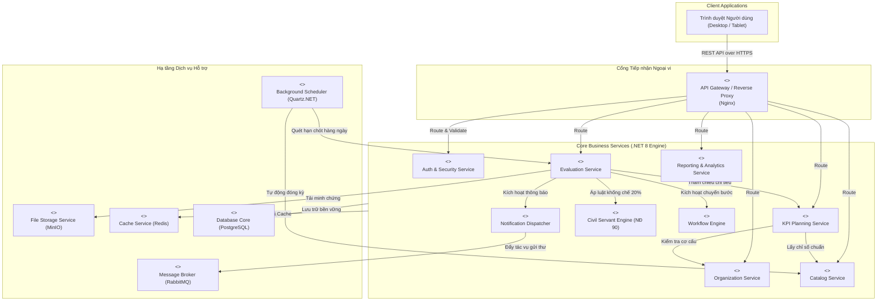
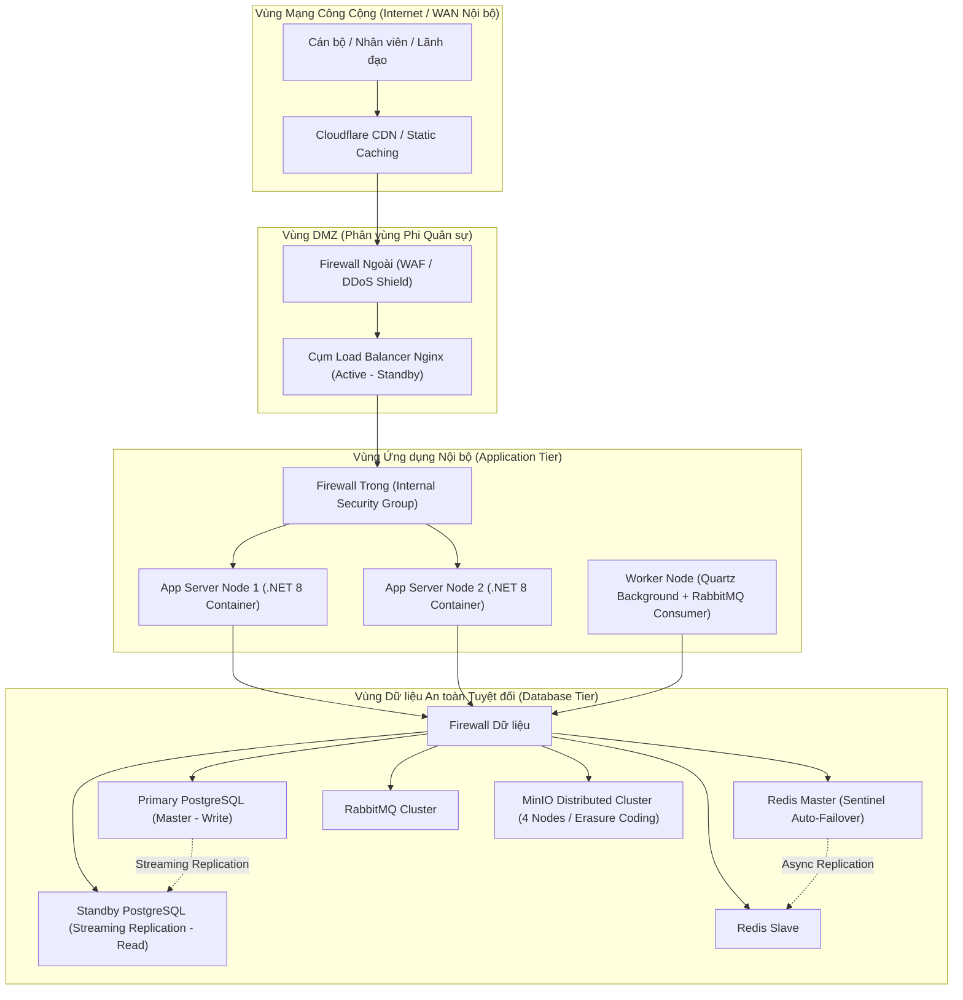
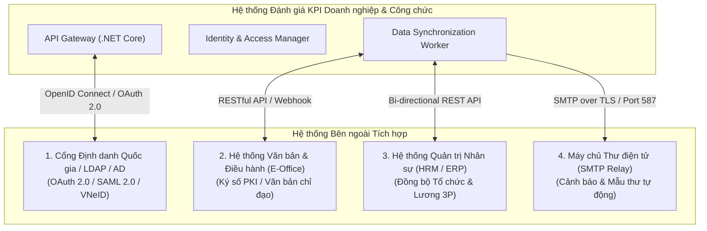

# TÀI LIỆU THIẾT KẾ KIẾN TRÚC HỆ THỐNG (SYSTEM ARCHITECTURE DESIGN)
## HỆ THỐNG QUẢN LÝ VÀ ĐÁNH GIÁ KPI CHO DOANH NGHIỆP VÀ CÁN BỘ CÔNG CHỨC
**Mã tài liệu:** SAD-KPI-V1.0  
**Giai đoạn:** Phiên 7 / 10 - Thiết kế Kiến trúc Hệ thống (System Architecture & Infrastructure)  
**Tác giả:** Chuyên gia Phân tích Hệ thống & Kiến trúc sư Giải pháp (Solution Architect)  
**Tài liệu tham chiếu:** [SRS Phiên 1](file:///d:/KPI/docs/Session_01_SRS_Requirements.md) | [Class Model Phiên 3](file:///d:/KPI/docs/Session_03_Class_Analysis_Model.md) | [Database Design Phiên 6](file:///d:/KPI/docs/Session_06_Database_Design.md)  

---

## MỤC LỤC
1. [Kiến trúc Tổng thể Hệ thống (System Architecture Overview)](#1-kiến-trúc-tổng-thể-hệ-thống)
   - 1.1. Mô hình Phân tầng Đa lớp (Layered & Clean Architecture)
   - 1.2. Đề xuất Ngăn xếp Công nghệ (Technology Stack Selection)
2. [Biểu đồ Thành phần Hệ thống (Component Diagram)](#2-biểu-đồ-thành-phần-hệ-thống-component-diagram)
3. [Biểu đồ Triển khai Hạ tầng Vận hành (Deployment Diagram)](#3-biểu-đồ-triển-khai-hạ-tầng-vận-hành-deployment-diagram)
   - 3.1. Mô hình Hạ tầng Production High Availability (HA)
   - 3.2. Phương án Triển khai On-Premise vs Cloud Deployment
4. [Kiến trúc An toàn & Bảo mật Thông tin (Security Architecture)](#4-kiến-trúc-an-toàn--bảo-mật-thông-tin-security-architecture)
   - 4.1. Mô hình Xác thực & Phân quyền lai (Hybrid RBAC + ABAC)
   - 4.2. Mã hóa Dữ liệu (Data at Rest & Data in Transit)
   - 4.3. An toàn Ứng dụng & API Security (OWASP Top 10)
5. [Kiến trúc Tích hợp Hệ thống (Integration Architecture)](#5-kiến-trúc-tích-hợp-hệ-thống-integration-architecture)
   - 5.1. Tích hợp Định danh Tập trung (SSO / Active Directory / LDAP)
   - 5.2. Tích hợp Dịch vụ Thư điện tử (SMTP Queue) & Webhook Realtime
6. [Chiến lược Hiệu năng & Khả năng Mở rộng (Scalability & Performance)](#6-chiến-lược-hiệu-năng--khả-năng-mở-rộng)

---

## 1. KIẾN TRÚC TỔNG THỂ HỆ THỐNG

### 1.1. Mô hình Phân tầng Đa lớp (Layered & Clean Architecture)

Hệ thống được thiết kế theo mô hình **Modular Monolith hướng Clean Architecture** (sẵn sàng phân rã thành Microservices khi quy mô vượt trên 50.000 cán bộ/nhân viên). Kiến trúc phân tách nghiêm ngặt thành 5 tầng độc lập:

```mermaid
flowchart TD
    subgraph PRESENTATION["1. Presentation Layer (Tầng Trình diễn)"]
        UI_SPA["Web SPA (React.js / Next.js)<br/>Responsive Desktop & Mobile"]
        UI_ADMIN["Admin Portal & Dashboards"]
    end

    subgraph GATEWAY["2. API Gateway & Security Layer"]
        REV_PROXY["Reverse Proxy (Nginx / Envoy)<br/>SSL Termination & Load Balancer"]
        WAF["Web Application Firewall (ModSecurity / Cloud WAF)"]
        AUTH_MW["JWT Authentication & Rate Limiter Middleware"]
    end

    subgraph APPLICATION["3. Application & Business Logic Layer (Clean Core)"]
        AUTH_SVC["Security & Auth Service"]
        ORG_SVC["Organization & Hierarchy Service"]
        CAT_SVC["Master Catalog Service"]
        KPI_SVC["KPI Planning & Cascade Engine"]
        EVA_SVC["Evaluation & Scoring Service"]
        PUB_SVC["Civil Servant Decree 90 Engine (Cap 20%)"]
        WF_ENG["State Machine Workflow Engine"]
        REP_SVC["Analytics & Report Generator Service"]
        NOT_SVC["Notification & Mail Worker"]
    end

    subgraph DATA_ACCESS["4. Data Access Layer (Repository Pattern)"]
        REPO_INT["Entity Repositories (Unit of Work)"]
        ORM_ENG["ORM Engine (Entity Framework Core / Dapper / Hibernate)"]
        CACHE_MGR["Cache Abstraction (Redis Cache Manager)"]
    end

    subgraph PERSISTENCE["5. Persistence & Infrastructure Layer"]
        DB_PRIMARY[("Primary Database (PostgreSQL / SQL Server)")]
        DB_REPLICA[("Read-Replica Database")]
        REDIS_CLUSTER[("Redis Cluster (Cache & Sessions)")]
        MQ_BROKER[("RabbitMQ Broker (Async Tasks)")]
        OBJECT_STORE[("MinIO / S3 Storage (Evidence Files)")]
    end

    PRESENTATION -->|HTTPS / TLS 1.3| GATEWAY
    GATEWAY -->|RESTful API / JSON| APPLICATION
    APPLICATION --> DATA_ACCESS
    DATA_ACCESS --> PERSISTENCE
```



#### Phân tích Trách nhiệm từng Tầng:
1. **Presentation Layer (Tầng Trình diễn):** Ứng dụng Single Page Application (SPA) xây dựng bằng React.js/Next.js với TypeScript, tương tác 100% qua chuẩn giao tiếp RESTful API và WebSocket cho thông báo đẩy thời gian thực.
2. **API Gateway Layer:** Đóng vai trò cửa ngõ tập trung chịu trách nhiệm: Định tuyến URL, chấm dứt SSL (SSL Termination), cân bằng tải, lọc mã độc bằng WAF, kiểm tra tính hợp lệ của JWT Token và hạn chế tần suất gọi (Rate Limiting).
3. **Application & Business Logic Layer:** Trung tâm xử lý toàn bộ các quy tắc nghiệp vụ (**BR-01 $\to$ BR-20**). Tách biệt các module nghiệp vụ thành các Service độc lập, giao tiếp nội bộ qua Interfaces/In-memory Event Bus.
4. **Data Access Layer:** Ứng dụng mẫu thiết kế **Repository & Unit of Work**, cô lập tầng nghiệp vụ khỏi câu lệnh SQL trực tiếp. Kết hợp ORM hiện đại và Dapper cho các truy vấn báo cáo phân tích hiệu năng cao.
5. **Persistence Layer:** Cụm CSDL quan hệ chính (Primary - Write) và phụ (Replica - Read-Only), cụm bộ nhớ đệm Redis và hệ thống lưu trữ tệp số hóa minh chứng MinIO.

---

### 1.2. Đề xuất Ngăn xếp Công nghệ (Technology Stack Selection)

Bảng so sánh và căn cứ lựa chọn giải pháp công nghệ tối ưu cho hệ thống:

| Tầng thành phần | Công nghệ Đề xuất | Công nghệ Thay thế | Căn cứ & Lý do lựa chọn tối ưu |
|---|---|---|---|
| **Frontend Framework** | **React.js 18+ / Next.js (TypeScript)** | Angular 17+ | - Hệ sinh thái component doanh nghiệp phong phú (Ant Design, Shadcn UI).<br>- TypeScript mang lại tính chặt chẽ về mặt kiểu dữ liệu khi làm việc với các form KPI phức tạp.<br>- Next.js hỗ trợ tối ưu hóa render và hiệu năng cao. |
| **Backend Framework** | **ASP.NET Core 8 Web API** | Spring Boot 3.x (Java) / Node.js NestJS | - Hiệu năng xử lý (Throughput/Latency) nằm trong nhóm dẫn đầu thế giới (TechEmpower Benchmark).<br>- Hỗ trợ tích hợp cực kỳ hoàn hảo với Active Directory / LDAP và môi trường công vụ.<br>- Cơ chế Dependency Injection và Clean Architecture nguyên bản, hỗ trợ đa nền tảng (Linux Docker & Windows Server). |
| **Relational Database** | **PostgreSQL 15+** | Microsoft SQL Server 2022 | - Hệ quản trị CSDL mã nguồn mở hàng đầu, không mất chi phí bản quyền thương mại cho cơ quan nhà nước.<br>- Hỗ trợ Partitioning mạnh mẽ, kiểu dữ liệu `JSONB` cho cấu hình báo cáo động.<br>- Độ tin cậy chuẩn ACID và bảo mật đạt chứng chỉ quân sự. |
| **Distributed Caching** | **Redis 7.x Cluster** | Memcached | - Cung cấp cấu trúc dữ liệu đa dạng (String, Hash, Sorted Sets phục vụ tính bảng xếp hạng Ranking).<br>- Cơ chế TTL tự động giải phóng bộ nhớ, độ trễ truy xuất $< 1\text{ms}$. |
| **Message Broker** | **RabbitMQ 3.12+** | Apache Kafka | - Kiến trúc Message Queue truyền thống (AMQP) tối ưu hoàn hảo cho các tác vụ: gửi email theo hàng đợi, quét deadline nền ngầm và tạo file báo cáo nặng.<br>- Đảm bảo thông điệp không bị mất mát (Reliable Delivery & Dead Letter Queue). |
| **Object File Storage** | **MinIO (S3-Compatible)** | AWS S3 / Azure Blob | - Chuẩn giao thức Amazon S3 phổ biến nhất thế giới.<br>- Cho phép triển khai hoàn toàn On-premise trên máy chủ nội bộ của Cơ quan Nhà nước để đảm bảo an ninh dữ liệu công vụ. |

---

## 2. BIỂU ĐỒ THÀNH PHẦN HỆ THỐNG (COMPONENT DIAGRAM)



#### Bảng giao diện (Interfaces) giữa các thành phần chính:
| Thành phần cung cấp | Tên Interface | Phương thức chính | Thành phần tiêu thụ |
|---|---|---|---|
| `Auth & Security Service` | `IAuthenticationService` | `authenticate()`, `validateJwt()`, `checkPermission()` | Toàn bộ các Service |
| `Organization Service` | `IOrganizationService` | `getDepartmentTree()`, `getEmployeeScope()` | `KPI Planning`, `Evaluation`, `Reporting` |
| `Catalog Service` | `ICatalogService` | `getMasterKPIs()`, `getActivePeriod()`, `getScale()` | `KPI Planning`, `Evaluation` |
| `Civil Servant Engine` | `IDecree90Validator` | `validateExcellenceCap()`, `verifyDiscipline()` | `Evaluation Service` |
| `Workflow Engine` | `IWorkflowEngine` | `advanceStep()`, `rejectStep()`, `getCurrentState()` | `Evaluation Service` |
| `File Storage Service` | `IFileStorage` | `uploadEvidence()`, `getPresignedUrl()` | `Evaluation Service` |
| `Notification Dispatcher`| `INotificationService`| `pushInApp()`, `enqueueEmail()` | `Planning`, `Evaluation`, `CronJob` |

---

## 3. BIỂU ĐỒ TRIỂN KHAI HẠ TẦNG (DEPLOYMENT DIAGRAM)

### 3.1. Mô hình Hạ tầng Production High Availability (HA)

Mô hình triển khai chuẩn Enterprise phân tách thành 3 phân vùng mạng bảo mật (**Network Zones / DMZ**) có tường lửa (Firewall) kiểm soát lưu lượng nghiêm ngặt:



---

### 3.2. Phương án Triển khai On-Premise vs Cloud Deployment

| Tiêu chí so sánh | Phương án Triển khai On-Premise (Cơ quan Nhà nước) | Phương án Triển khai Cloud (Doanh nghiệp) |
|---|---|---|
| **Môi trường phù hợp** | Bộ/Ban/Ngành, Sở TT&TT, UBND tỉnh, Tập đoàn Nhà nước | Doanh nghiệp thương mại, Khối tài chính tư nhân |
| **Công nghệ hạ tầng** | VMware vSphere / Proxmox VE / Cụm Kubernetes cục bộ (K3s) | AWS (EKS / ECS), Microsoft Azure hoặc Private Cloud |
| **Cân bằng tải (LB)** | Cặp máy chủ F5 BIG-IP phần cứng hoặc Nginx Keepalived | AWS Application Load Balancer (ALB) / Azure Application Gateway |
| **CSDL Quan hệ** | PostgreSQL chạy trên Red Hat Enterprise Linux (RHEL/AlmaLinux) | AWS Aurora PostgreSQL Multi-AZ / Azure Database for PostgreSQL |
| **Lưu trữ tệp minh chứng**| Cụm MinIO 4 máy chủ (On-premise S3) | Amazon S3 / Azure Blob Storage có cấu hình mã hóa tự động |
| **Khả năng khôi phục (DR)**| Sao lưu tự động hàng ngày ra băng từ (Tape) hoặc NAS riêng | Tự động snapshot cross-region và tự động co giãn (Auto Scaling) |

---

## 4. KIẾN TRÚC AN TOÀN & BẢO MẬT THÔNG TIN (SECURITY ARCHITECTURE)

### 4.1. Mô hình Phân quyền Lai (Hybrid RBAC + ABAC)

Hệ thống kết hợp 2 cấp độ bảo vệ:
1. **RBAC (Role-Based Access Control):** Kiểm soát quyền hạn chức năng (Feature Permission: Được xem, sửa, duyệt hay xuất file).
2. **ABAC (Attribute-Based Access Control / Data Scope):** Kiểm soát phạm vi dữ liệu dựa trên thuộc tính:
   - `Scope = GLOBAL`: Lãnh đạo cấp cao, Ban Tổ chức cán bộ $\to$ Xem toàn bộ cơ quan.
   - `Scope = DEPARTMENT`: Trưởng phòng $\to$ Chỉ xem và đánh giá nhân sự thuộc phòng mình (`emp.department_id == user.department_id`).
   - `Scope = SELF`: Nhân viên $\to$ Chỉ được xem và sửa bản ghi của chính bản thân (`eval.employee_id == user.employee_id`).

#### Ma trận Phân quyền Chức năng cốt lõi (RBAC Matrix):
| Chức năng nghiệp vụ | Super Admin | Director | HR Admin | Dept Manager | Employee |
|---|:---:|:---:|:---:|:---:|:---:|
| Quản lý tài khoản & Phân quyền | **Full** | Read | Read | - | - |
| Quản trị Danh mục KPI dùng chung | Read | Read | **Full** | Read | Read |
| Tạo & Phát hành KPI Template | - | Read | **Full** | Read | - |
| Giao KPI cho nhân viên | - | Read | Read | **Create/Edit** | - |
| Tự đánh giá KPI cá nhân | - | - | - | - | **Execute** |
| Thẩm định & Chấm điểm nhân viên | - | Read | Read | **Execute** | - |
| Phê duyệt đánh giá cán bộ công chức | - | **Approve** | Support | - | - |
| Xem Báo cáo tổng thể toàn đơn vị | Read | **Full** | **Full** | Department Only | - |

---

### 4.2. Mã hóa Dữ liệu Toàn diện (Data Encryption)

```mermaid
flowchart LR
    subgraph IN_TRANSIT["Mã hóa trên Đường truyền (In Transit)"]
        Client["Trình duyệt Client"] -->|TLS 1.3 / HTTPS<br/>Ciphers: ECDHE-ECDSA-AES256-GCM| Nginx["Nginx Reverse Proxy"]
        Nginx -->|mTLS / Virtual Network| AppServer["App Server (.NET Core)"]
    end

    subgraph AT_REST["Mã hóa khi Lưu trữ (At Rest)"]
        AppServer -->|Argon2id + Salt 128-bit| Pass["Mật khẩu Người dùng"]
        AppServer -->|AES-256 GCM Envelope| SensData["Điểm số / Lương thưởng / 2FA Secret"]
        AppServer -->|TDE (Transparent Data Encryption)| DBDisk["Ổ cứng Lưu trữ CSDL"]
    end
```

- **Mã hóa trên đường truyền (In Transit):** Bắt buộc TLS 1.3 với chứng chỉ số SSL EV/OV; bật cờ `HSTS (Strict-Transport-Security)` thời hạn 1 năm để chống tấn công hạ cấp (Downgrade attack).
- **Mã hóa khi lưu trữ (At Rest):**
  - Mật khẩu lưu trữ bằng hàm băm một chiều **Argon2id** (đạt giải nhất Password Hashing Competition), cấu hình Memory-cost $64\text{MB}$, Time-cost $3$ iterations.
  - CSDL bật mã hóa toàn bộ ổ đĩa (Transparent Data Encryption - TDE / LUKS trên Linux).
  - Tệp minh chứng lưu trữ trên MinIO được mã hóa cấp server (SSE-S3).

---

### 4.3. An toàn Ứng dụng & API Security (Chống OWASP Top 10)
- **Chống SQL Injection:** 100% truy vấn CSDL bắt buộc tham số hóa (Parameterized Queries) qua Entity Framework Core / Dapper, không bao giờ cộng chuỗi SQL thô.
- **Chống Cross-Site Scripting (XSS):** Áp dụng chính sách bảo mật nội dung `Content-Security-Policy (CSP)`, React tự động escape HTML khi render.
- **Chống CSRF:** Sử dụng kiến trúc Stateless API với JWT Token mang trong Authorization Header (`Bearer <token>`), không dựa vào cookie trình duyệt.
- **Rate Limiting:** Sử dụng thuật toán Token Bucket trên API Gateway: Giới hạn tối đa 60 requests/phút đối với các API thông thường và 5 requests/phút đối với API Đăng nhập nhằm ngăn chặn brute-force.
- **Kiểm tra đầu vào (Input Validation):** FluentValidation kiểm tra cú pháp, độ dài và các ký tự đặc biệt ở tầng Middleware trước khi dữ liệu chạm tới tầng Service.

---

## 5. KIẾN TRÚC TÍCH HỢP HỆ THỐNG (INTEGRATION ARCHITECTURE)



### 5.1. Tích hợp Định danh Tập trung (SSO / Active Directory / VNeID)
- **Giao thức:** Hỗ trợ song song **OpenID Connect (OIDC)** và **SAML 2.0**.
- **Cơ chế hoạt động:** Khi người dùng chọn "Đăng nhập bằng tài khoản Công vụ", hệ thống chuyển hướng sang IdP của cơ quan cấp trên. Sau khi xác thực thành công, hệ thống nhận mã Token, đối soát `email` hoặc `civil_servant_code` để ánh xạ vào tài khoản nội bộ và cấp quyền tự động (Just-In-Time Provisioning).

### 5.2. Đồng bộ Dữ liệu với HRM và E-Office
- **Đồng bộ chiều vào (Inbound):** Nhận biến động nhân sự (nhân viên mới, luân chuyển phòng ban, kỷ luật) từ phần mềm HRM qua các RESTful Endpoints bảo mật bằng API Key và mTLS.
- **Đồng bộ chiều ra (Outbound):** Ngay sau khi Lãnh đạo ký duyệt kết quả KPI, hệ thống tự động bắn một Webhook mang bảng điểm tổng hợp sang phân hệ Tính lương của HRM để phục vụ chi trả thu nhập tăng thêm / lương hiệu quả 3P.

---

## 6. CHIẾN LƯỢC HIỆU NĂNG & KHẢ NĂNG MỞ RỘNG (PERFORMANCE & SCALABILITY)

### 6.1. Chiến lược Bộ nhớ đệm Đa tầng (Multi-Level Caching)
- **Tầng 1 (Client Cache):** Tận dụng HTTP Cache Headers (`ETag`, `Cache-Control: private, max-age=300`) cho danh mục tĩnh (đơn vị tính, nhóm KPI).
- **Tầng 2 (Application Memory Cache):** Lưu trữ cấu hình tham số hệ thống và bảng vai trò phân quyền ngay trong bộ nhớ RAM của App Server (làm mới qua Redis Pub/Sub khi có cập nhật).
- **Tầng 3 (Distributed Redis Cache):** Bộ đệm dữ liệu thống kê Dashboard, danh sách phòng ban và các thông tin phiên người dùng:
  - Cache Key Pattern: `kpi:dash:{orgId}:{periodId}` (TTL: 15 phút).
  - Cache Invalidation: Tự động xóa cache tương ứng ngay khi có sự kiện chấm điểm mới hoặc phê duyệt hồ sơ.

### 6.2. Tối ưu hóa Cơ sở Dữ liệu
- **Partitioning theo Năm:** Bảng `audit_logs`, `evaluations` và `workflow_history` được phân vùng (Range Partitioning) theo cột `created_at` (mỗi năm 1 partition riêng biệt), giúp duy trì tốc độ tìm kiếm ổn định dù dung lượng dữ liệu tăng qua nhiều năm.
- **Phân tách Đọc - Ghi (Read-Write Splitting):**
  - Mọi thao tác Ghi (`INSERT`, `UPDATE`, `DELETE`) thực thi trên máy chủ **Primary Database**.
  - Các truy vấn Báo cáo, Thống kê, Xem Dashboard thực thi trên máy chủ **Standby Read-Replica** thông qua Connection Pool riêng biệt, giải phóng 70% tải đọc cho CSDL chính.
- **Connection Pooling:** Cấu hình `HikariCP` hoặc `Npgsql Connection Pool` với kích thước pool tối ưu: $\text{PoolSize} = (\text{CoreCount} \times 2) + \text{SpindleCount}$, ngăn ngừa quá tải kết nối khi lượng truy cập tăng vọt cuối kỳ đánh giá.

---

## 7. KẾT LUẬN & CHUẨN BỊ CHO PHIÊN 8

Tài liệu Thiết kế Kiến trúc Hệ thống Phiên 7 đã định hình:
1. **Kiến trúc phân tầng Clean Architecture hiện đại:** Lựa chọn ngăn xếp công nghệ tối ưu (.NET 8 Web API + React.js TypeScript + PostgreSQL + Redis + RabbitMQ) đáp ứng hoàn hảo yêu cầu hiệu năng, độ tin cậy và chi phí bản quyền.
2. **Component Diagram chi tiết:** Xác định rõ ràng ranh giới và giao diện (Interfaces) giữa 9 dịch vụ cốt lõi và 5 dịch vụ hạ tầng.
3. **Deployment Topology chuẩn High Availability (HA):** Thiết kế hạ tầng 3 phân vùng mạng bảo mật (DMZ, App Tier, DB Tier) với cơ chế cân bằng tải Nginx, dự phòng nóng PostgreSQL Streaming Replication và cụm MinIO.
4. **Kiến trúc Bảo mật & Tích hợp Doanh nghiệp:** Kết hợp mô hình RBAC + ABAC data scope, mã hóa Argon2id/AES-256, chống OWASP Top 10 và tích hợp toàn diện SSO/Active Directory/VNeID.

> [!TIP]
> **Đầu vào cho Phiên 8:**  
> Dựa trên kiến trúc hạ tầng và các module dịch vụ đã định nghĩa, **Phiên 8: Phân hệ Danh mục & Quản trị Hệ thống (Master Catalog & Administrative Modules)** sẽ đi sâu vào đặc tả chi tiết 18 danh mục nghiệp vụ dùng chung, cơ chế cấu trúc cây phân cấp phòng ban, cấu hình ma trận phân quyền người dùng và quản trị hệ thống.
> 
> Bạn có thể gửi lệnh `PROMPT PHIÊN 8` để tiếp tục.
