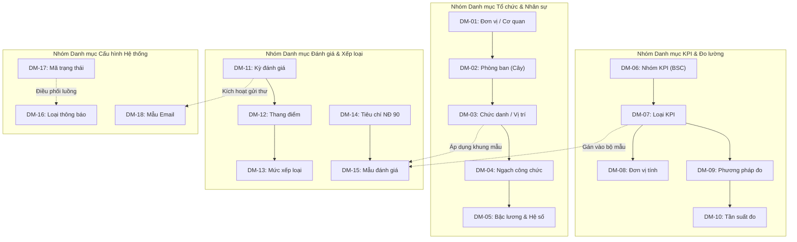
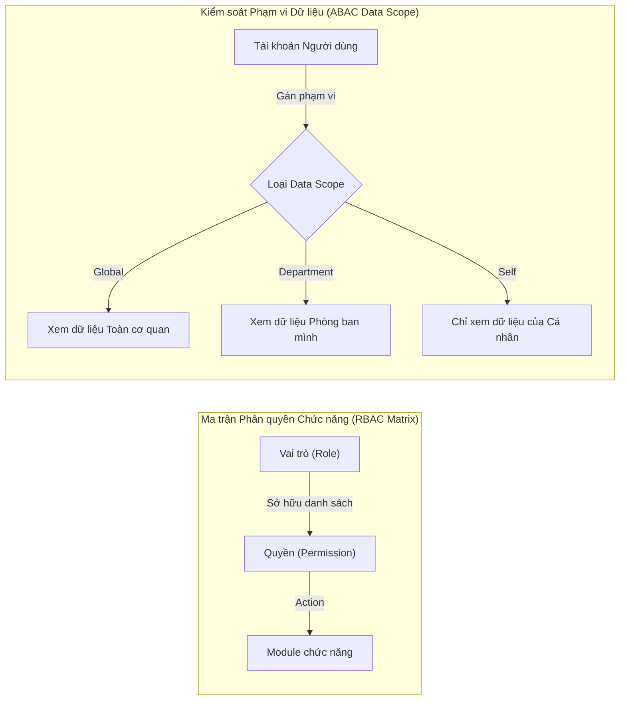

# TÀI LIỆU ĐẶC TẢ PHÂN HỆ DANH MỤC & MODULE QUẢN TRỊ HỆ THỐNG
## HỆ THỐNG QUẢN LÝ VÀ ĐÁNH GIÁ KPI CHO DOANH NGHIỆP VÀ CÁN BỘ CÔNG CHỨC
**Mã tài liệu:** CAD-KPI-V1.0  
**Giai đoạn:** Phiên 8 / 10 - Đặc tả Danh mục & Quản trị (Master Catalogs & System Administration)  
**Tác giả:** Chuyên gia Phân tích Hệ thống (Senior System Analyst)  
**Tài liệu tham chiếu:** [SRS Phiên 1](file:///d:/KPI/docs/Session_01_SRS_Requirements.md) | [Class Model Phiên 3](file:///d:/KPI/docs/Session_03_Class_Analysis_Model.md) | [Database Design Phiên 6](file:///d:/KPI/docs/Session_06_Database_Design.md)  

---

## MỤC LỤC
1. [Tổng quan & Sơ đồ Mối quan hệ Danh mục (Catalog Relationship Diagram)](#1-tổng-quan--sơ-đồ-mối-quan-hệ-danh-mục)
2. [Đặc tả Chi tiết 18 Danh mục Dùng chung Toàn hệ thống](#2-đặc-tả-chi-tiết-18-danh-mục-dùng-chung)
   - **Nhóm 1: Tổ chức & Nhân sự:** DM-01 $\to$ DM-05
   - **Nhóm 2: Chỉ số & Đo lường KPI:** DM-06 $\to$ DM-10
   - **Nhóm 3: Đánh giá & Xếp loại Công chức:** DM-11 $\to$ DM-15
   - **Nhóm 4: Cấu hình Hệ thống & Tương tác:** DM-16 $\to$ DM-18
3. [Đặc tả Chi tiết 4 Module Quản trị Hệ thống](#3-đặc-tả-chi-tiết-4-module-quản-trị-hệ-thống)
   - 3.1. Module Quản lý Tài khoản & Hồ sơ Cán bộ
   - 3.2. Module Quản trị Vai trò & Ma trận Phân quyền (RBAC + ABAC)
   - 3.3. Module Cấu hình Tham số Động (System Configuration)
   - 3.4. Module Giám sát & Tra cứu Nhật ký Kiểm toán (Audit Trail)
4. [Bảng Tổng hợp 18 Danh mục Nghiệp vụ Dùng chung](#4-bảng-tổng-hợp-18-danh-mục-nghiệp-vụ)

---

## 1. TỔNG QUAN & SƠ ĐỒ MỐI QUAN HỆ DANH MỤC

Hệ thống danh mục là "xương sống" định hình tính toàn vẹn của mọi giao dịch thiết lập và đánh giá KPI. Toàn bộ 18 danh mục được chuẩn hóa, loại bỏ dư thừa và liên kết với nhau qua mô hình quan hệ sau:

---

## 2. ĐẶC TẢ CHI TIẾT 18 DANH MỤC DÙNG CHUNG

---

### NHÓM 1: TỔ CHỨC & NHÂN SỰ

#### DM-01: Danh mục Đơn vị / Tổ chức (Organizations)
- **Mã danh mục:** `DM-01` | **Bảng CSDL:** `organizations`
- **Mục đích:** Quản lý danh sách các pháp nhân công ty thành viên, cơ quan sở ban ngành, hỗ trợ mô hình tập đoàn đa đơn vị thành viên (Multi-Tenant).
- **Cấu trúc trường:**
  - `id` (BIGINT, PK): Mã số tự sinh.
  - `code` (VARCHAR(30), Unique, Not Null): Mã định danh cơ quan/công ty.
  - `name` (VARCHAR(200), Not Null): Tên chính thức của đơn vị.
  - `tax_code` (VARCHAR(20)): Mã số thuế / Mã định danh điện tử cơ quan nhà nước.
  - `org_type` (VARCHAR(30), Not Null): `Enterprise`, `PublicAdministration`, `PublicService`.
  - `status` (VARCHAR(20)): `Active`, `Inactive`.
- **Quy tắc kiểm tra (Validation):** Mã đơn vị viết hoa không dấu, không chứa khoảng trắng (Regex: `^[A-Z0-9_-]{3,30}$`).
- **Dữ liệu mẫu (Sample Records):**
  | Mã đơn vị (`code`) | Tên đơn vị (`name`) | Mã định danh (`tax_code`) | Loại hình (`org_type`) | Trạng thái |
  |---|---|---|---|---|
  | `SNGV_HN` | Sở Ngoại vụ Thành phố Hà Nội | `0101234567` | `PublicAdministration` | `Active` |
  | `STC_HN` | Sở Tài chính Thành phố Hà Nội | `0101234568` | `PublicAdministration` | `Active` |
  | `VNPT_CORP` | Tập đoàn Bưu chính Viễn thông Việt Nam | `0100684378` | `Enterprise` | `Active` |
  | `VIETTEL_SOL`| Tổng Công ty Giải pháp Doanh nghiệp Viettel | `0104008119` | `Enterprise` | `Active` |
  | `TTTH_SNGV` | Trung tâm Dịch vụ Đối ngoại Hà Nội | `0101234599` | `PublicService` | `Active` |
- **Chức năng màn hình:** Gridview tìm kiếm theo loại hình, Modal thêm/sửa, không cho xóa nếu có phòng ban con.
- **Phân quyền CRUD:** Super Admin (`C, R, U, D`), Unit Director (`R`).

---

#### DM-02: Danh mục Phòng ban trực thuộc (Departments)
- **Mã danh mục:** `DM-02` | **Bảng CSDL:** `departments`, `department_hierarchy`
- **Mục đích:** Quản lý cơ cấu phòng, ban, trung tâm theo mô hình cây đệ quy phân cấp không giới hạn cấp độ.
- **Cấu trúc trường:**
  - `id` (BIGINT, PK), `org_id` (BIGINT, FK), `parent_id` (BIGINT, FK Nullable).
  - `code` (VARCHAR(30), Not Null), `name` (VARCHAR(150), Not Null).
  - `tree_path` (VARCHAR(255), Not Null): Đường dẫn cây (VD: `/1/4/`).
  - `level` (INT, Default 1): Cấp độ cây sơ đồ.
- **Quy tắc nghiệp vụ:** Không cho phép chọn chính mình hoặc con cháu làm cấp cha (chống vòng lặp vô tận). Không được xóa phòng ban đang có nhân sự trực thuộc.
- **Dữ liệu mẫu (Sample Records):**
  | Mã PB (`code`) | Tên phòng ban (`name`) | Thuộc Đơn vị | Cấp cha (`parent_id`) | Đường dẫn cây (`tree_path`) |
  |---|---|---|---|---|
  | `VAN_PHONG` | Văn phòng Sở | `SNGV_HN` | NULL | `/1/` |
  | `PHONG_TCCB`| Phòng Tổ chức Cán bộ | `SNGV_HN` | NULL | `/2/` |
  | `PHONG_HTQT`| Phòng Hợp tác Quốc tế | `SNGV_HN` | NULL | `/3/` |
  | `BAN_LE_TAN`| Ban Lễ tân Đối ngoại | `SNGV_HN` | 3 (`PHONG_HTQT`) | `/3/4/` |
  | `KHOI_CNTT` | Khối Giải pháp Công nghệ | `VIETTEL_SOL` | NULL | `/10/` |
- **Phân quyền CRUD:** Super Admin (`C, R, U, D`), HR Admin (`C, R, U`), Manager (`R`).

---

#### DM-03: Danh mục Chức vụ / Chức danh công việc (Positions)
- **Mã danh mục:** `DM-03` | **Bảng CSDL:** `positions`
- **Mục đích:** Khung vị trí việc làm dùng làm căn cứ gắn bộ KPI mẫu (Template) và phân định quyền duyệt.
- **Cấu trúc trường:** `id` (PK), `code` (Unique), `name`, `rank_level`, `is_leadership` (BOOLEAN).
- **Dữ liệu mẫu:**
  | Mã chức vụ | Tên chức danh việc làm | Nhóm cấp bậc | Là lãnh đạo quản lý? | Ghi chú |
  |---|---|---|:---:|---|
  | `GIAM_DOC` | Giám đốc Sở / Tổng Giám đốc | Lãnh đạo cấp cao | **Có** | Áp dụng Mẫu 01 NĐ 90 |
  | `PHO_GD` | Phó Giám đốc Sở / Phó TGĐ | Lãnh đạo cấp cao | **Có** | Áp dụng Mẫu 01 NĐ 90 |
  | `TRUONG_PHONG`| Trưởng phòng / Trưởng ban | Lãnh đạo cấp trung | **Có** | Thẩm định điểm cấp 1 |
  | `CHUYEN_VIEN` | Chuyên viên nghiệp vụ | Chuyên môn | Không | Áp dụng Mẫu 02 NĐ 90 |
  | `CAN_SU` | Cán sự / Nhân viên hỗ trợ | Thừa hành | Không | Áp dụng Mẫu 02 NĐ 90 |

---

#### DM-04: Danh mục Ngạch công chức / Hạng viên chức (Position Ranks)
- **Mã danh mục:** `DM-04` | **Bảng CSDL:** `position_ranks`
- **Mục đích:** Chuẩn hóa ngạch công chức theo quy định Bộ Nội vụ phục vụ bình xét thi đua và nâng lương trước thời hạn (**BR-17**).
- **Dữ liệu mẫu:**
  | Mã ngạch (`rank_code`) | Tên ngạch công chức | Nhóm ngạch | Số bậc tối đa | Điều kiện thâm niên |
  |---|---|---|:---:|---|
  | `01.001` | Chuyên viên cao cấp | Ngạch loại A3 | 6 bậc | $\ge 6$ năm giữ ngạch A2 |
  | `01.002` | Chuyên viên chính | Ngạch loại A2 | 8 bậc | $\ge 9$ năm giữ ngạch A1 |
  | `01.003` | Chuyên viên | Ngạch loại A1 | 9 bậc | Tốt nghiệp Đại học trở lên |
  | `01.004` | Cán sự | Ngạch loại B | 12 bậc | Tốt nghiệp Cao đẳng/Trung cấp |
  | `01.005` | Nhân viên | Ngạch loại C | 12 bậc | Sơ cấp trở lên |

---

#### DM-05: Danh mục Bậc lương & Hệ số lương (Salary Grades)
- **Mã danh mục:** `DM-05` | **Bảng CSDL:** `salary_grades`
- **Mục đích:** Bảng ánh xạ hệ số lương theo ngạch phục vụ liên kết kết quả KPI sang nâng bậc lương (**BR-17**).
- **Dữ liệu mẫu (Ví dụ Ngạch Chuyên viên 01.003):**
  | Mã ngạch | Bậc lương | Hệ số lương | Thời hạn nâng bậc thường xuyên | Ghi chú |
  |---|:---:|:---:|:---:|---|
  | `01.003` | Bậc 1 | **2.34** | 36 tháng | Tập sự hoàn thành |
  | `01.003` | Bậc 2 | **2.67** | 36 tháng | Xét KPI đạt Hoàn thành tốt |
  | `01.003` | Bậc 3 | **3.00** | 36 tháng | Xét KPI đạt Hoàn thành tốt |
  | `01.003` | Bậc 4 | **3.33** | 36 tháng | 2 năm Xuất sắc được nâng trước hạn |
  | `01.003` | Bậc 5 | **3.66** | 36 tháng | - |

---

### NHÓM 2: CHỈ SỐ & ĐO LƯỜNG KPI

#### DM-06: Danh mục Nhóm KPI Lớn (KPI Categories / Perspectives)
- **Mã danh mục:** `DM-06` | **Bảng CSDL:** `kpi_categories`
- **Mục đích:** Phân loại chỉ số theo 4 viễn cảnh Thẻ điểm cân bằng (BSC) đối với Doanh nghiệp và Nhóm tiêu chuẩn đạo đức công vụ đối với Cơ quan Nhà nước.
- **Dữ liệu mẫu:**
  | Mã nhóm | Tên nhóm chỉ tiêu KPI | Viễn cảnh BSC | Áp dụng cho | Thứ tự hiển thị |
  |---|---|---|---|:---:|
  | `CAT_FIN` | Chỉ số Tài chính & Hiệu quả kinh tế | `Financial` | Doanh nghiệp | 1 |
  | `CAT_CUST`| Chỉ số Khách hàng & Mức độ hài lòng | `Customer` | Doanh nghiệp | 2 |
  | `CAT_PROC`| Chỉ số Tiến độ & Quy trình nội bộ | `InternalProcess` | Dùng chung | 3 |
  | `CAT_LRN` | Chỉ số Học tập & Đổi mới sáng tạo | `LearningGrowth` | Dùng chung | 4 |
  | `CAT_ETH` | Phẩm chất chính trị & Đạo đức công vụ | `PublicServiceEthics`| Cán bộ Công chức | 5 |

---

#### DM-07: Danh mục Loại KPI (KPI Types)
- **Mã danh mục:** `DM-07` | **Bảng CSDL:** `kpi_types`
- **Mục đích:** Phân định tính chất đo lường của chỉ tiêu để áp dụng cơ chế chấm điểm phù hợp.
- **Dữ liệu mẫu:**
  | Mã loại | Tên loại chỉ số | Phương thức tính | Yêu cầu minh chứng |
  |---|---|---|:---:|
  | `QUANT` | KPI Định lượng (Quantitative) | Công thức toán học tự động | Bắt buộc nếu $\ge 120\%$ |
  | `QUALI` | KPI Định tính (Qualitative) | Đánh giá theo thang đo tiêu chí | Luôn khuyến nghị |
  | `BEHAV` | KPI Hành vi & Thái độ (Behavioral)| Thang đo Likert 5 mức | Điểm từ đồng nghiệp/cấp trên |
  | `EXTRA` | Chỉ tiêu Đột xuất / Giao thêm | Điểm thưởng cộng trực tiếp | Quyết định giao nhiệm vụ |
  | `DISCIP`| Chỉ tiêu Kỷ luật / Trừ điểm | Điểm phạt trừ vào tổng | Biên bản xử lý kỷ luật |

---

#### DM-08: Danh mục Đơn vị tính (Measurement Units)
- **Mã danh mục:** `DM-08` | **Bảng CSDL:** `measurement_units`
- **Dữ liệu mẫu:**
  | Mã đơn vị | Tên đơn vị tính | Ký hiệu | Kiểu giá trị hiển thị |
  |---|---|:---:|---|
  | `PERCENT` | Tỷ lệ phần trăm | `%` | Số thập phân (VD: `98.5%`) |
  | `VND_M` | Triệu Việt Nam Đồng | `Tr.đ` | Số thực phân cách hàng nghìn |
  | `DOC` | Văn bản / Hồ sơ thủ tục | `Hồ sơ` | Số nguyên dương |
  | `HOURS` | Giờ làm việc / Xử lý | `Giờ` | Số thập phân |
  | `PROJECT` | Dự án / Đề án hoàn thành | `Dự án`| Số nguyên |

---

#### DM-09: Danh mục Phương pháp đo lường (Measurement Methods)
- **Mã danh mục:** `DM-09` | **Bảng CSDL:** `measurement_methods`
- **Dữ liệu mẫu:**
  | Mã phương pháp | Tên phương pháp | Nguồn dữ liệu kiểm chứng | Mức độ tin cậy |
  |---|---|---|:---:|
  | `AUTO_ERP` | Tự động đồng bộ từ ERP / CRM | Cơ sở dữ liệu phần mềm lõi | Rất cao (Không thể sửa tay) |
  | `EOFFICE_LOG` | Trích xuất từ phần mềm Quản lý văn bản | Nhật ký tiếp nhận và xử lý văn bản | Cao |
  | `INSPECT_MIN` | Biên bản kiểm tra / Nghiệm thu | File Scan PDF có ký số | Cao |
  | `MANUAL_REP` | Báo cáo định kỳ tự lập | Báo cáo nội bộ phòng ban | Trung bình (Cần đối soát) |
  | `SURVEY_SAT` | Khảo sát mức độ hài lòng người dân | Cổng Dịch vụ công trực tuyến | Rất cao |

---

#### DM-10: Danh mục Tần suất đo lường (Measurement Frequencies)
- **Mã danh mục:** `DM-10` | **Bảng CSDL:** `measurement_frequencies`
- **Dữ liệu mẫu:**
  | Mã tần suất | Tên tần suất theo dõi | Số ngày chu kỳ | Bật cảnh báo nhắc việc |
  |---|---|:---:|:---:|
  | `FREQ_DAY` | Hàng ngày (Daily tracking) | 1 ngày | Không |
  | `FREQ_WEEK`| Hàng tuần (Weekly check-in) | 7 ngày | Thứ Sáu hàng tuần |
  | `FREQ_MTH` | Hàng tháng (Monthly review) | 30 ngày | Ngày 25 hàng tháng |
  | `FREQ_QTR` | Hàng quý (Quarterly KPI) | 90 ngày | Trước kết thúc quý 5 ngày |
  | `FREQ_YEAR`| Hàng năm (Annual review) | 365 ngày | Tháng 12 hàng năm |

---

### NHÓM 3: ĐÁNH GIÁ & XẾP LOẠI CÔNG CHỨC

#### DM-11: Danh mục Kỳ đánh giá (Evaluation Periods)
- **Mã danh mục:** `DM-11` | **Bảng CSDL:** `evaluation_periods`
- **Dữ liệu mẫu:**
  | Mã kỳ | Tên kỳ đánh giá | Loại kỳ | Năm | Hạn tự chấm | Hạn Quản lý duyệt | Ngày khóa kỳ |
  |---|---|---|:---:|:---:|:---:|:---:|
  | `KPI_2026_Q1` | Đánh giá Hiệu suất Quý 1/2026 | Hàng quý | 2026 | 31/03/2026 | 05/04/2026 | 10/04/2026 |
  | `KPI_2026_Q2` | Đánh giá Hiệu suất Quý 2/2026 | Hàng quý | 2026 | 30/06/2026 | 05/07/2026 | 10/07/2026 |
  | `KPI_2026_Q3` | Đánh giá Hiệu suất Quý 3/2026 | Hàng quý | 2026 | 30/09/2026 | 05/10/2026 | 10/10/2026 |
  | `KPI_2026_Q4` | Đánh giá Hiệu suất Quý 4/2026 | Hàng quý | 2026 | 20/12/2026 | 25/12/2026 | 31/12/2026 |
  | `KPI_2026_YEAR`| Đánh giá & Phân loại Công chức Năm 2026 | Cả năm | 2026 | 15/12/2026 | 22/12/2026 | 31/12/2026 |

---

#### DM-12: Danh mục Thang điểm (Score Scales)
- **Mã danh mục:** `DM-12` | **Bảng CSDL:** `score_scales`
- **Dữ liệu mẫu:**
  | Mã thang điểm | Tên thang điểm | Điểm tối thiểu | Điểm tối đa | Chế độ làm tròn | Mặc định |
  |---|---|:---:|:---:|:---:|:---:|
  | `SCALE_100` | Thang điểm 100 chuẩn | 0.00 | 100.00 | 2 số thập phân | **Có** |
  | `SCALE_10` | Thang điểm 10 | 0.00 | 10.00 | 1 số thập phân | Không |
  | `SCALE_5` | Thang đo Likert 5 mức độ | 1.00 | 5.00 | Không làm tròn | Không |
  | `SCALE_4` | Thang phân loại 4 mức Chính phủ| 1.00 | 4.00 | Số nguyên | Không |
  | `SCALE_150` | Thang 100 có thưởng vượt trần | 0.00 | 150.00 | 2 số thập phân | Không |

---

#### DM-13: Danh mục Mức xếp loại chất lượng (Classification Levels)
- **Mã danh mục:** `DM-13` | **Bảng CSDL:** `classification_levels`
- **Mục đích:** Ánh xạ điểm số sang danh hiệu xếp loại (tích hợp luật khống chế 20% và sáng kiến).
- **Dữ liệu mẫu:**
  | Mã xếp loại | Tên mức xếp loại | Ngưỡng điểm % | Bắt buộc sáng kiến (BR-08) | Khống chế $\le 20\%$ (BR-06) |
  |---|---|:---:|:---:|:---:|
  | `EXCELLENT` | Hoàn thành xuất sắc nhiệm vụ | $\ge 90.00\%$ | **Bắt buộc** | **Bắt buộc** |
  | `GOOD` | Hoàn thành tốt nhiệm vụ | $75.00\% - < 90\%$ | Không | Không |
  | `SATISFACTORY`| Hoàn thành nhiệm vụ | $50.00\% - < 75\%$ | Không | Không |
  | `UNSATISFACTORY`| Không hoàn thành nhiệm vụ | $< 50.00\%$ | Không | Không |
  | `DISCIPLINARY`| Điểm liệt kỷ luật (KHTNV) | Mọi mức điểm | Điểm liệt | Ép tự động (BR-07) |

---

#### DM-14: Danh mục Tiêu chí đánh giá Cán bộ Công chức theo Nghị định 90
- **Mã danh mục:** `DM-14` | **Bảng CSDL:** `civil_servant_criteria`
- **Dữ liệu mẫu:**
  | Mã tiêu chí | Nhóm tiêu chuẩn luật định | Nội dung kiểm tra tiêu chuẩn | Trọng số tối đa |
  |---|---|---|:---:|
  | `CRIT_POL` | Tư tưởng chính trị | Chấp hành đường lối, chủ trương Đảng, pháp luật Nhà nước | 20 điểm |
  | `CRIT_ETH` | Đạo đức, lối sống | Không quan liêu, tham nhũng, giữ gìn đoàn kết nội bộ | 20 điểm |
  | `CRIT_DISC`| Tác phong, kỷ luật công vụ | Chấp hành văn hóa công sở, kỷ cương hành chính | 20 điểm |
  | `CRIT_EXEC`| Kết quả thực hiện nhiệm vụ | Tiến độ, chất lượng hồ sơ chuyên môn theo vị trí việc làm | 40 điểm |
  | `CRIT_INIT`| Sáng kiến cải tiến công tác | Đề tài nghiên cứu hoặc sáng kiến được hội đồng công nhận | Điều kiện đủ |

---

#### DM-15: Danh mục Nhóm Mẫu đánh giá (Template Categories)
- **Mã danh mục:** `DM-15` | **Bảng CSDL:** `template_categories`
- **Dữ liệu mẫu:**
  | Mã nhóm mẫu | Tên nhóm bộ mẫu | Đối tượng áp dụng | Khung văn bản quy định |
  |---|---|---|---|
  | `TPL_LEADER` | Khung KPI Cán bộ Lãnh đạo Quản lý | Thủ trưởng, Phó Thủ trưởng, Trưởng phòng | Mẫu số 01 - NĐ 90/2020 |
  | `TPL_STAFF` | Khung KPI Công chức Chuyên môn | Chuyên viên, Cán sự, Nhân viên | Mẫu số 02 - NĐ 90/2020 |
  | `TPL_SALES` | Khung KPI Nhân viên Kinh doanh | Kinh doanh, Thị trường, Tiếp thị | Quy chế Lương 3P |
  | `TPL_TECH` | Khung KPI Kỹ thuật & Công nghệ | Kỹ sư phần mềm, Vận hành mạng | SLA hệ thống |
  | `TPL_BACK` | Khung KPI Khối Gián tiếp / Hỗ trợ | Kế toán, Hành chính, Lễ tân | SLA nội bộ phòng ban |

---

### NHÓM 4: HỆ THỐNG & TƯƠNG TÁC

#### DM-16: Danh mục Loại thông báo (Notification Types)
- **Mã danh mục:** `DM-16` | **Bảng CSDL:** `notification_types`
- **Dữ liệu mẫu:**
  | Mã loại | Tên loại thông báo | Kênh phát | Mức độ khẩn cấp | Biểu tượng icon |
  |---|---|---|---|:---:|
  | `ALERT_DEADLINE`| Nhắc nhở thời hạn nộp/duyệt | In-App, Email | Khẩn cấp | ⏰ Warning |
  | `TASK_ASSIGN` | Thông báo được giao KPI mới | In-App, Email | Bình thường | 📋 Task |
  | `REVIEW_REQ` | Yêu cầu thẩm định điểm cấp dưới | In-App, Email | Cao | ✍️ Review |
  | `RESULT_PUB` | Công bố bảng điểm chính thức | In-App, Email | Bình thường | 📢 Announce |
  | `SYS_MAINT` | Thông báo bảo trì hệ thống | Banner In-App | Thông tin | ⚙️ System |

---

#### DM-17: Danh mục Mã trạng thái toàn hệ thống (System Status Codes)
- **Mã danh mục:** `DM-17` | **Bảng CSDL:** `system_status_codes`
- **Dữ liệu mẫu:**
  | Mã trạng thái | Module áp dụng | Ý nghĩa nghiệp vụ | Cho phép chỉnh sửa? |
  |---|---|---|:---:|
  | `DRAFT` | Bản giao / Phiếu đánh giá | Bản nháp đang soạn thảo | Có |
  | `PENDING_CONFIRM`| Bản giao KPI | Chờ nhân viên ký cam kết | Chỉ nhân viên |
  | `IN_EVALUATION` | Phiếu đánh giá | Cổng đánh giá mở, chờ nộp điểm | Có |
  | `FINAL_APPROVED` | Phiếu đánh giá | Lãnh đạo đã duyệt, mở 72h khiếu nại | Không |
  | `LOCKED_READONLY`| Toàn hệ thống | Đóng băng dữ liệu vĩnh viễn (BR-15) | **Tuyệt đối không** |

---

#### DM-18: Danh mục Mẫu Email tự động (Email Templates)
- **Mã danh mục:** `DM-18` | **Bảng CSDL:** `notification_templates`
- **Dữ liệu mẫu:**
  | Mã mẫu thư | Tiêu đề thư (Subject Template) | Sự kiện kích hoạt | Các biến ngữ cảnh động |
  |---|---|---|---|
  | `MAIL_KPI_ASSIGN`| `[Hệ thống KPI] Thông báo giao chỉ tiêu kỳ {{PeriodName}}` | Quản lý gửi giao KPI | `{{StaffName}}`, `{{ManagerName}}`, `{{Link}}` |
  | `MAIL_ALERT_3D` | `[Cảnh báo] Còn 03 ngày hết hạn nộp tự đánh giá KPI` | Cron quét còn 3 ngày | `{{StaffName}}`, `{{Deadline}}`, `{{Link}}` |
  | `MAIL_ALERT_0D` | `[Khẩn cấp] Hôm nay là hạn chót nộp tự đánh giá KPI` | Cron quét ngày cuối | `{{StaffName}}`, `{{CutOffTime}}` |
  | `MAIL_DISPUTE` | `[Khiếu nại] Nhân viên {{StaffName}} gửi đơn khiếu nại kết quả`| Nhân viên gửi khiếu nại | `{{StaffName}}`, `{{Reason}}`, `{{Link}}` |
  | `MAIL_RESULT` | `[Thông báo] Kết quả đánh giá hiệu suất chính thức kỳ {{PeriodName}}`| Lãnh đạo ký duyệt | `{{StaffName}}`, `{{FinalScore}}`, `{{Rank}}` |

---

## 3. ĐẶC TẢ CHI TIẾT 4 MODULE QUẢN TRỊ HỆ THỐNG

---

### 3.1. Module Quản lý Tài khoản & Hồ sơ Cán bộ (User Management)
- **Chức năng chính:**
  1. **CRUD Người dùng:** Tạo tài khoản lẻ hoặc Import hàng loạt từ file Excel mẫu (tự động kiểm tra trùng `username`, `email`, `staff_code`).
  2. **Quản lý Vòng đời Tài khoản:** Kích hoạt (`Active`), Khóa tạm thời (`Locked`), Đình chỉ (`Suspended`), Đổi mật khẩu bắt buộc ở lần đăng nhập đầu tiên.
  3. **Gán Vị trí & Phòng ban:** Liên kết tài khoản với hồ sơ nhân sự, cấu hình quyền kiêm nhiệm phòng ban thứ hai (**BR-13**).
  4. **Cơ chế Khóa tự động (Brute-force Protection):** Tự động khóa 30 phút nếu đăng nhập sai quá 5 lần liên tiếp (**NFR-SEC-01**).

---

### 3.2. Module Quản trị Vai trò & Ma trận Phân quyền (RBAC + ABAC)
- **Chức năng chính:**
  1. **Quản lý Vai trò (Roles):** Cho phép tạo thêm vai trò mới bên cạnh 5 vai trò hệ thống mặc định (`Super Admin`, `Director`, `Manager`, `HR Admin`, `Staff`).
  2. **Ma trận Phân quyền (Permission Matrix):** Giao diện lưới hai chiều trực quan: Dòng là các Module chức năng, Cột là các hành vi (`Create`, `Read`, `Update`, `Delete`, `Approve`, `Export`). Tích chọn để gán quyền cho vai trò.
  3. **Phân quyền Phạm vi Dữ liệu (Data-Level Scoping / ABAC):**
     - Cấu hình phạm vi: *Toàn đơn vị* (Global), *Phòng ban & Phòng trực thuộc* (Department & Sub-departments), hoặc *Chỉ bản thân* (Self-only).

---

### 3.3. Module Cấu hình Tham số Động (System Configuration)
- **Chức năng chính:** Cung cấp giao diện quản trị các tham số vận hành mà không cần sửa mã nguồn hoặc khởi động lại máy chủ:
  1. **Cấu hình Máy chủ Thư điện tử (SMTP):** `Host`, `Port` (587/465), `Username`, `Password` (Mã hóa an toàn bằng AES-256), `SenderName`. Có nút "Gửi email thử nghiệm (Test Connection)".
  2. **Cấu hình Bảo mật & Phiên làm việc:** Thời gian hết hạn Access Token (mặc định 60 phút), thời gian hết hạn Refresh Token (7 ngày), số lần đăng nhập sai tối đa (5 lần).
  3. **Cấu hình Quy tắc KPI:** Ngưỡng chặn trần thành tích mặc định (MaxCap: $150\%$), dải trọng số cho phép ($[5\%, 50\%]$), thời gian cửa sổ khiếu nại (72 giờ làm việc).
  4. **Cấu hình Tham số Hiển thị:** Tên đơn vị, Logo cơ quan, Tiêu đề chân trang, Thông tin bản quyền.

---

### 3.4. Module Giám sát & Tra cứu Nhật ký Kiểm toán (Audit Trail)
- **Chức năng chính:**
  1. **Ghi vết Bất biến (Tamper-Proof Logging):** Tự động ghi nhận mọi hành vi làm thay đổi dữ liệu: Ai, Lúc nào, Từ IP nào, Tác động lên bản ghi nào, Giá trị cũ (`OldValue`), Giá trị mới (`NewValue`). Không ai có quyền sửa hoặc xóa bảng này.
  2. **Bộ lọc & Tìm kiếm Đa tiêu chí:** Lọc theo Khoảng thời gian, Tài khoản thực hiện, Hành vi (`LOGIN`, `UPDATE_SCORE`, `APPROVE`), Tên bảng (`evaluations`, `users`).
  3. **Kết xuất Báo cáo Thanh tra:** Cho phép xuất dữ liệu kiểm toán ra file Excel/PDF phục vụ đoàn kiểm tra, thanh tra nội bộ hoặc kiểm toán nhà nước.

---

## 4. BẢNG TỔNG HỢP 18 DANH MỤC NGHIỆP VỤ

| Mã DM | Tên danh mục | Số trường | Cấu trúc dữ liệu | Phân quyền thao tác | Ràng buộc nghiệp vụ liên quan |
|:---:|---|:---:|---|:---:|---|
| **DM-01** | Đơn vị / Cơ quan | 8 | Bảng đơn độc lập | Super Admin (CRUD) | Không xóa khi có phòng ban trực thuộc |
| **DM-02** | Phòng ban trực thuộc | 9 | Cây đệ quy (Closure Table)| Super Admin, HR (CRUD)| Ngăn chặn vòng lặp cây, chặn xóa khi có người |
| **DM-03** | Chức vụ / Vị trí việc làm | 6 | Bảng đơn danh mục | Super Admin, HR (CRUD)| Gắn cờ lãnh đạo phục vụ Mẫu 01 NĐ 90 |
| **DM-04** | Ngạch công chức / Viên chức | 5 | Khung chuẩn Bộ Nội vụ | HR Admin (CRUD) | Thâm niên phục vụ xét nâng bậc (BR-17) |
| **DM-05** | Bậc lương & Hệ số | 6 | Bảng quan hệ với ngạch | HR Admin (CRUD) | Điều kiện nâng lương trước hạn 2 năm Xuất sắc |
| **DM-06** | Nhóm chỉ số KPI (BSC) | 7 | Phân loại 5 nhóm lớn | HR Admin (CRUD) | Chia tách viễn cảnh Doanh nghiệp vs Công chức |
| **DM-07** | Loại chỉ số KPI | 5 | Phân định tính chất đo | HR Admin (CRUD) | Kích hoạt bắt buộc minh chứng khi $\ge 120\%$ |
| **DM-08** | Đơn vị đo lường | 5 | Danh mục ký hiệu đơn vị | HR Admin (CRUD) | Snapshot tên & đơn vị vào bản giao (BR-15) |
| **DM-09** | Phương pháp đo lường | 5 | Nguồn gốc dữ liệu | HR Admin (CRUD) | Phân cấp độ tin cậy của minh chứng |
| **DM-10** | Tần suất đo lường | 5 | Chu kỳ theo dõi | HR Admin (CRUD) | Kích hoạt lịch nhắc việc định kỳ |
| **DM-11** | Kỳ đánh giá hiệu suất | 13 | Khung thời hạn chi tiết | HR Admin (CRUD) | Tự động khóa sổ khi hết hạn (Cut-off BR-12) |
| **DM-12** | Thang điểm đánh giá | 7 | Thang đo chuẩn hóa | HR Admin (CRUD) | Quy chuẩn về thang chuẩn 100 điểm (BR-20) |
| **DM-13** | Mức xếp loại hiệu suất | 8 | Bảng ánh xạ điểm số | HR Admin (CRUD) | **Chặn trần Xuất sắc $\le 20\%$ (BR-06, BR-08)** |
| **DM-14** | Tiêu chí đánh giá NĐ 90 | 6 | 4 tiêu chuẩn luật định | HR Admin (CRUD) | Tự động hạ bậc khi bị kỷ luật Đảng (BR-07) |
| **DM-15** | Mẫu đánh giá (Templates) | 7 | Nhóm khung vị trí | HR Admin (CRUD) | Kiểm soát tổng trọng số $= 100\%$ (BR-01, BR-02) |
| **DM-16** | Loại thông báo hệ thống | 6 | Danh mục kênh & Icon | Super Admin (CRUD) | Phân luồng thông báo In-App và Email |
| **DM-17** | Mã trạng thái hệ thống | 5 | Bảng tra cứu trạng thái | Toàn hệ thống (Read)| Khóa bất biến trạng thái `LOCKED` (BR-15) |
| **DM-18** | Mẫu thư điện tử (Email) | 6 | Mẫu văn bản có tham số | Super Admin, HR (CRUD)| Tự động hóa gửi thư theo tiến trình workflow |

---

## 5. KẾT LUẬN & CHUẨN BỊ CHO PHIÊN 9

Tài liệu Đặc tả Danh mục & Quản trị Phiên 8 đã chuẩn hóa:
1. **Đặc tả toàn diện 18 Danh mục nghiệp vụ:** Có cấu trúc trường dữ liệu, validation rules, bộ dữ liệu mẫu thực tế 5+ dòng, màn hình CRUD và phân quyền chi tiết.
2. **Tích hợp chặt chẽ các quy tắc cốt lõi:** Cơ chế bảo toàn lịch sử snapshot (**BR-15**), khống chế xuất sắc $\le 20\%$ (**BR-06**), yêu cầu sáng kiến (**BR-08**), điểm liệt kỷ luật (**BR-07**) và cấu trúc cây phòng ban phân cấp đệ quy.
3. **Đặc tả 4 Module Quản trị nền tảng:** Quản lý Người dùng, Ma trận Phân quyền đa cấp (RBAC + ABAC data scope), Cấu hình Động và Nhật ký Kiểm toán bất biến (Audit Trail).

> [!TIP]
> **Đầu vào cho Phiên 9:**  
> Dựa trên 18 danh mục và các luồng quy trình đã thiết lập, **Phiên 9: Thiết kế Giao diện Người dùng & Đặc tả API (UI Wireframes & RESTful API Specifications)** sẽ xây dựng layout bố cục chi tiết cho 17 màn hình người dùng, sơ đồ điều hướng tổng thể (Navigation Flowchart) và đặc tả toàn bộ hệ thống RESTful API theo chuẩn OpenAPI 3.0 / Swagger (Request/Response JSON, Status Codes, Authentication Headers).
> 
> Bạn có thể gửi lệnh `PROMPT PHIÊN 9` để tiếp tục.
