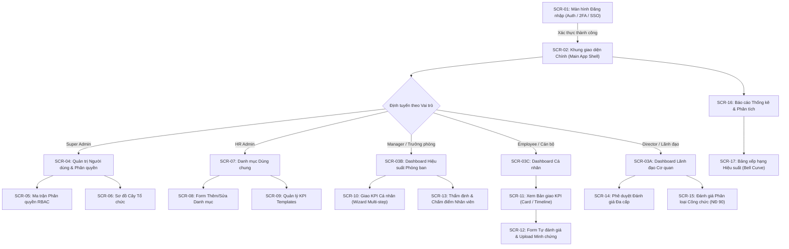

# TÀI LIỆU THIẾT KẾ GIAO DIỆN NGƯỜI DÙNG & ĐẶC TẢ RESTFUL API
## HỆ THỐNG QUẢN LÝ VÀ ĐÁNH GIÁ KPI CHO DOANH NGHIỆP VÀ CÁN BỘ CÔNG CHỨC
**Mã tài liệu:** UAD-KPI-V1.0  
**Giai đoạn:** Phiên 9 / 10 - Thiết kế Giao diện & Đặc tả API (UI/UX & RESTful API Specifications)  
**Tác giả:** Chuyên gia Phân tích Hệ thống, UI/UX Designer & API Architect  
**Tài liệu tham chiếu:** [Use Case Phiên 2](file:///d:/KPI/docs/Session_02_UseCase_Model.md) | [Database Design Phiên 6](file:///d:/KPI/docs/Session_06_Database_Design.md) | [System Architecture Phiên 7](file:///d:/KPI/docs/Session_07_System_Architecture.md)  

---

## MỤC LỤC
1. [Sơ đồ Điều hướng Hệ thống (System Navigation Flowchart)](#1-sơ-đồ-điều-hướng-hệ-thống-system-navigation-flowchart)
2. [Đặc tả Bố cục & Wireframe 17 Màn hình Người dùng (UI Wireframes)](#2-đặc-tả-bố-cục--wireframe-17-màn-hình-người-dùng)
   - Nhóm 1: Màn hình Chung & Bảng điều khiển (SCR-01 $\to$ SCR-03)
   - Nhóm 2: Màn hình Quản trị & Phân quyền (SCR-04 $\to$ SCR-06)
   - Nhóm 3: Màn hình Quản lý Danh mục (SCR-07 $\to$ SCR-08)
   - Nhóm 4: Màn hình Thiết lập & Giao KPI (SCR-09 $\to$ SCR-11)
   - Nhóm 5: Màn hình Đánh giá, Thẩm định & Phân loại Công chức (SCR-12 $\to$ SCR-15)
   - Nhóm 6: Màn hình Báo cáo, Thống kê & Xếp hạng (SCR-16 $\to$ SCR-17)
3. [Đặc tả Hệ thống RESTful API (API Specifications)](#3-đặc-tả-hệ-thống-restful-api-api-specifications)
   - 3.1. API Authentication & Security
   - 3.2. API Quản trị Hệ thống & Người dùng
   - 3.3. API Danh mục Dùng chung (Master Catalogs)
   - 3.4. API Thiết lập & Giao KPI
   - 3.5. API Thực thi, Đánh giá & Workflow
   - 3.6. API Báo cáo & Phân tích (Analytics)
   - 3.7. API Thông báo (Notifications)
4. [Nguyên tắc Trải nghiệm Người dùng & Tiếp cận (UX/UI & Accessibility)](#4-nguyên-tắc-trải-nghiệm-người-dùng--tiếp-cận)

---

## 1. SƠ ĐỒ ĐIỀU HƯỚNG HỆ THỐNG (SYSTEM NAVIGATION FLOWCHART)

Sơ đồ thể hiện luồng chuyển trang và định tuyến theo vai trò sau khi xác thực thành công:



---

## 2. ĐẶC TẢ BỐ CỤC & WIREFRAME 17 MÀN HÌNH NGƯỜI DÙNG

---

### NHÓM 1: MÀN HÌNH CHUNG & BẢNG ĐIỀU KHIỂN

#### SCR-01: Trang Đăng nhập & Xác thực hai bước (Login & 2FA Modal)
- **Mã màn hình:** `SCR-01` | **Người dùng:** Tất cả Actor | **URL:** `/auth/login`
- **Bố cục tổng quan:** Giao diện chia đôi màn hình (Split screen 50/50). Cột trái là banner đồ họa quảng bá hệ thống; Cột phải là Form đăng nhập thẻ nổi (Floating Card) với logo cơ quan, tiêu đề và các trường nhập liệu.
- **Thành phần giao diện chính:**
  - Ô nhập `Tên đăng nhập / Email công vụ` (Input có icon người dùng).
  - Ô nhập `Mật khẩu` (Input dạng password có nút ẩn/hiện mắt).
  - Nút checkbox `Ghi nhớ phiên đăng nhập`.
  - Nút chính `Đăng nhập` (Primary Button màu xanh thương hiệu).
  - Đường kẻ phân cách `HOẶC` và nút phụ `Đăng nhập bằng tài khoản Công vụ / SSO (VNeID/AD)`.
  - **Modal 2FA (Popup khi bật bảo mật):** Hộp thoại 6 ô nhập số OTP, đồng hồ đếm ngược 60 giây và nút `Gửi lại mã`.
- **Validation Rules:**
  - Bắt buộc điền đủ tài khoản và mật khẩu trước khi kích hoạt nút đăng nhập.
  - Chống tấn công brute-force: Sau 5 lần nhập sai, khóa form 30 phút (**NFR-SEC-01**).
- **Phản hồi tương tác (Responsive):** Trên thiết bị di động (Mobile), ẩn cột banner đồ họa, form đăng nhập tự động co giãn full-width.

---

#### SCR-02: Khung giao diện Chính (Main Application Shell Layout)
- **Mã màn hình:** `SCR-02` | **Người dùng:** Tất cả Actor sau khi đăng nhập
- **Bố cục khung (Master Shell Grid):**
  ```
  +-----------------------------------------------------------------------------------+
  | [Logo] [Nút ẩn/hiện Sidebar]        [Tìm kiếm nhanh]    [🔔 (3)] [Avatar User ▼]  | Header (64px)
  +--------------------+--------------------------------------------------------------+
  | 📊 Dashboard       |                                                              |
  | 📋 Giao KPI        |                                                              |
  | ✍️  Đánh giá        |                 VÙNG NỘI DUNG THAY ĐỔI                        | Content Area
  | ⚖️  Công chức NĐ90  |                  (ROUTER CONTENT AREA)                       | (Tự co giãn)
  | 📈 Báo cáo         |                                                              |
  | ⚙️  Cấu hình danh mục|                                                             |
  +--------------------+--------------------------------------------------------------+
  | © 2026 Hệ thống Đánh giá KPI Doanh nghiệp & Công chức. Phiên bản 1.0.                | Footer (36px)
  +-----------------------------------------------------------------------------------+
  ```
- **Thành phần UI:**
  - **Header Bar:** Breadcrumbs điều hướng, thanh tìm kiếm toàn cục (Global Search), chuông thông báo In-App thời gian thực (hiển thị badge đỏ số tin chưa đọc), Menu avatar người dùng (Đổi mật khẩu, Hồ sơ cá nhân, Đăng xuất).
  - **Sidebar Menu:** Danh mục menu đa cấp dạng Accordion, tự động ẩn hiện theo ma trận quyền RBAC của người dùng. Cho phép thu gọn (Collapse) thành dải icon 64px để tăng diện tích hiển thị.
  - **Footer Bar:** Bản quyền, thông tin đường dây nóng hỗ trợ kỹ thuật và trạng thái kết nối mạng (Online/Offline indicator).

---

#### SCR-03: Dashboard Tổng quan đa vai trò (Role-based Overview Dashboard)
- **Mã màn hình:** `SCR-03` | **URL:** `/dashboard`
- **Bố cục tổng quan:** Thiết kế dạng lưới Widget linh hoạt (Grid Cards 4 cột).
- **Nội dung tùy biến theo Vai trò:**
  - **Chế độ Lãnh đạo (Executive Mode):**
    - 4 Thẻ KPI vĩ mô: *Tỷ lệ hoàn thành toàn viện (%), Số nhân sự hoàn thành, Tỷ lệ tiến độ nộp báo cáo, Số hồ sơ chờ ký duyệt*.
    - Biểu đồ phân bổ xếp loại (Phân phối chuẩn hình chuông Gauss: Xuất sắc, Tốt, Hoàn thành, KHTNV).
    - Bảng xếp hạng Top 5 phòng ban dẫn đầu hiệu suất và 5 phòng ban chậm tiến độ.
  - **Chế độ Trưởng phòng (Manager Mode):**
    - Biểu đồ thanh tiến độ hoàn thành các mục tiêu chiến lược của phòng ban.
    - Danh sách nhân sự thuộc phòng kèm trạng thái nộp tự đánh giá (Đã nộp, Chờ chấm, Trễ hạn).
    - Cảnh báo các chỉ tiêu có nguy cơ không đạt mục tiêu (At-Risk KPIs).
  - **Chế độ Cán bộ / Nhân viên (Employee Mode):**
    - Vòng tròn phần trăm hoàn thành chỉ tiêu cá nhân tạm tính.
    - Danh sách các deadline sắp đến (Cảnh báo đỏ nếu còn $\le 3$ ngày).
    - Bảng tóm tắt các điểm mạnh, điểm cần cải thiện từ kỳ trước.

---

### NHÓM 2: MÀN HÌNH QUẢN TRỊ & PHÂN QUYỀN

#### SCR-04: Quản lý Người dùng & Hồ sơ Cán bộ (User Management)
- **Mã màn hình:** `SCR-04` | **Quyền truy cập:** Super Admin, HR Admin | **URL:** `/admin/users`
- **Bố cục:** Bảng dữ liệu (Data Grid) kèm thanh công cụ tìm kiếm và lọc nâng cao.
- **Thành phần giao diện:**
  - Thanh bộ lọc: Lọc theo Phòng ban, Chức danh, Vai trò, Trạng thái (`Active`, `Locked`).
  - Thanh nút bấm: `+ Thêm người dùng`, `📥 Nhập từ Excel`, `📤 Xuất danh sách`.
  - Bảng dữ liệu: Các cột *Mã NV, Họ tên, Email, Phòng ban, Chức vụ, Vai trò, Trạng thái, Thao tác*.
  - Nút thao tác nhanh trên từng dòng: *Xem hồ sơ, Chỉnh sửa, Reset mật khẩu, Khóa/Mở khóa*.
  - **Modal Thêm/Sửa người dùng:** Tab 1 (Thông tin tài khoản), Tab 2 (Hồ sơ nhân sự), Tab 3 (Ngạch bậc công chức - nếu thuộc khối nhà nước), Tab 4 (Gán vai trò RBAC).

---

#### SCR-05: Quản lý Phân quyền theo Ma trận (Role-Permission Matrix View)
- **Mã màn hình:** `SCR-05` | **Quyền truy cập:** Super Admin | **URL:** `/admin/permissions`
- **Bố cục:** Bảng ma trận 2 chiều (Cross-table matrix).
- **Thành phần giao diện:**
  - Dropdown chọn Vai trò (`Role Selector`): Lãnh đạo, Trưởng phòng, Nhân viên, Nhân sự...
  - Nút `+ Tạo vai trò mới`, `Lưu ma trận quyền`.
  - Bảng ma trận:
    - Cột 1: Danh sách Phân hệ & Chức năng con (Auth, Tổ chức, Danh mục, Giao KPI, Chấm điểm, Báo cáo...).
    - Các cột quyền hạn (Checkboxes): `Xem (Read)`, `Thêm (Create)`, `Sửa (Update)`, `Xóa (Delete)`, `Phê duyệt (Approve)`, `Xuất file (Export)`.
    - Cột chọn Phạm vi dữ liệu (Data Scope Dropdown): `Toàn cơ quan`, `Phòng ban`, `Cá nhân`.
  - Nút tiện ích `Chọn tất cả (Select All)` theo từng phân hệ.

---

#### SCR-06: Quản lý Cơ cấu Tổ chức (Interactive Tree View)
- **Mã màn hình:** `SCR-06` | **Quyền truy cập:** Super Admin, HR Admin | **URL:** `/admin/organization`
- **Bố cục:** Giao diện chia 2 cột (Cột trái 40%: Sơ đồ cây phân cấp; Cột phải 60%: Chi tiết phòng ban được chọn).
- **Thành phần giao diện:**
  - **Cột trái:** Sơ đồ cây tương tác (Interactive Treeview). Hỗ trợ kéo thả (Drag & Drop) để chuyển phòng ban trực thuộc sang khối khác. Các icon phân biệt Cơ quan cha, Phòng ban nghiệp vụ, Tổ/Đội.
  - **Cột phải:** Form thông tin phòng ban gồm: *Mã phòng, Tên phòng, Trưởng phòng đại diện, Số lượng nhân sự hiện tại, Danh sách nhân sự trực thuộc*.
  - Nút bấm: `+ Thêm phòng ban trực thuộc`, `Chỉnh sửa`, `Chuyển trạng thái Vô hiệu hóa`.

---

### NHÓM 3: MÀN HÌNH DANH MỤC DÙNG CHUNG

#### SCR-07: Danh sách Danh mục dùng chung (Master Catalogs Grid)
- **Mã màn hình:** `SCR-07` | **Quyền truy cập:** HR Admin | **URL:** `/catalogs`
- **Bố cục:** Tabs danh mục bên trái (18 danh mục DM-01 $\to$ DM-18); Khung hiển thị dữ liệu bảng bên phải.
- **Thành phần giao diện:** Bảng danh sách chỉ số KPI với bộ lọc theo Nhóm KPI, Đơn vị tính, Phương pháp đo; nút chức năng thêm mới, sửa và xuất file mẫu Excel.

#### SCR-08: Form Thêm / Chỉnh sửa Danh mục Động (Dynamic Catalog Modal)
- **Mã màn hình:** `SCR-08` | **Loại:** Modal Popup form
- **Thành phần giao diện:** Form nhập liệu thích ứng tự động (Dynamic Form Schema) theo từng loại danh mục: Mã chỉ số, Tên hiển thị, Dropdown chọn Đơn vị tính, Dropdown chọn Thang điểm, Switch bật/tắt kích hoạt (`IsActive`).

---

### NHÓM 4: MÀN HÌNH THIẾT LẬP & GIAO KPI

#### SCR-09: Quản lý Bộ KPI mẫu theo Chức danh (KPI Templates)
- **Mã màn hình:** `SCR-09` | **Quyền:** HR Admin | **URL:** `/kpi/templates`
- **Thành phần giao diện:** Danh sách các gói mẫu theo vị trí việc làm (VD: Chuyên viên Pháp chế, Chuyên viên Tổng hợp, Nhân viên Kinh doanh); Bảng chi tiết các chỉ tiêu con, trọng số gợi ý và nút `Nhân bản mẫu (Clone Template)`.

---

#### SCR-10: Giao KPI Cá nhân đa bước (Wizard Multi-Step Form)
- **Mã màn hình:** `SCR-10` | **Quyền:** Trưởng phòng (Manager) | **URL:** `/kpi/assignments/create`
- **Bố cục:** Form tuần tự 3 bước (Wizard Step-by-Step):
  - **Bước 1: Chọn Nhân sự & Nguồn chỉ tiêu:** Chọn nhân viên cần giao; chọn "Áp dụng theo bộ mẫu Chức danh" hoặc "Tự thiết lập mới".
  - **Bước 2: Thiết lập Chi tiết Chỉ tiêu & Trọng số:**
    - Bảng danh sách chỉ tiêu: Tên chỉ tiêu, Đơn vị, Chỉ tiêu kế hoạch (Target), Ngưỡng tối thiểu, Trần tối đa (MaxCap $150\%$), Trọng số (% Weight).
    - **Thanh chỉ báo tổng trọng số (Weight Indicator Bar):** Hiển thị trực quan realtime $\sum \text{Weight}$. Đổi màu đỏ nếu $\ne 100\%$, màu xanh lá cây khi đạt đúng $100\%$ (**BR-01**).
  - **Bước 3: Xem trước & Ký cam kết:** Xem bản đồ phân tầng mục tiêu (Cascade Alignment) và nhấn nút `Gửi nhân viên xác nhận cam kết`.

---

#### SCR-11: Xem Bản giao KPI Cá nhân (Card & Timeline View)
- **Mã màn hình:** `SCR-11` | **Quyền:** Employee, Manager | **URL:** `/kpi/my-assignment`
- **Bố cục:** Thẻ tóm tắt thông tin kỳ đánh giá ở đầu trang; Dòng thời gian tiến độ (Timeline) thể hiện các giai đoạn: *Giao chỉ tiêu $\to$ Cam kết $\to$ Thực thi $\to$ Tự đánh giá $\to$ Phê duyệt*. Các chỉ tiêu hiển thị dạng danh sách thẻ chi tiết kèm tiến độ thực hiện hiện tại.

---

### NHÓM 5: MÀN HÌNH ĐÁNH GIÁ, THẨM ĐỊNH & PHÂN LOẠI CÔNG CHỨC

#### SCR-12: Form Tự đánh giá KPI Cá nhân (Self-Assessment Form)
- **Mã màn hình:** `SCR-12` | **Quyền:** Employee | **URL:** `/evaluations/self-assess`
- **Bố cục:** Bảng danh mục các chỉ tiêu đã cam kết.
- **Thành phần UI trên từng dòng chỉ tiêu:**
  - Cột 1: Thông tin chỉ tiêu, Kế hoạch, Trọng số.
  - Cột 2: Ô nhập số liệu thực hiện (`Actual Value`).
  - Cột 3: % Hoàn thành tạm tính (Hệ thống tự động tính theo công thức **BR-10, BR-11**).
  - Cột 4: Điểm tự chấm tạm tính.
  - Cột 5: Khu vực tải tệp minh chứng: Tự động bật biểu tượng cảnh báo bắt buộc đính kèm khi % Hoàn thành $\ge 120\%$ (**BR-09**). Hỗ trợ kéo thả file PDF, Excel, ảnh (tối đa 25MB).
  - Ô nhập bản tự nhận xét, kiểm điểm ưu khuyết điểm của cá nhân.
  - Nút `Lưu nháp (Draft)` và nút `Nộp phiếu tự đánh giá (Submit)`.

---

#### SCR-13: Màn hình Quản lý Thẩm định & Chấm điểm (Manager Review)
- **Mã màn hình:** `SCR-13` | **Quyền:** Manager | **URL:** `/evaluations/manager-review/:id`
- **Bố cục:** Bảng so sánh song song 2 cột đối chiếu (Side-by-side Comparison):
  - **Khối A (Dữ liệu của Nhân viên):** Số liệu báo cáo, Điểm nhân viên tự chấm, Danh sách file minh chứng đính kèm (có nút xem trước file trực tiếp trên trình duyệt - Preview Modal).
  - **Khối B (Khu vực Chấm của Quản lý):** Ô nhập điểm số chính thức của Quản lý.
  - **Cơ chế kiểm soát lệch điểm (BR-05):** Nếu điểm quản lý chấm lệch quá $10\%$ so với điểm tự chấm, hệ thống tự động mở ra ô nhập bắt buộc: *"Lý do điều chỉnh điểm"* (validation bắt buộc nhập $\ge 50$ ký tự).
  - Biểu đồ mạng nhện (Radar Chart) so sánh tương quan giữa điểm tự chấm và điểm quản lý chấm.

---

#### SCR-14: Màn hình Phê duyệt Đánh giá Đa cấp (Workflow Approval)
- **Mã màn hình:** `SCR-14` | **Quyền:** Unit Director | **URL:** `/evaluations/approvals`
- **Bố cục:** Bảng tổng hợp kết quả đánh giá theo từng phòng ban; Thẻ thống kê tỷ lệ phân bổ xếp loại toàn cơ quan; Nút `Ký số phê duyệt trọn gói` hoặc nút `Trả về thẩm định lại (kèm ô nhập ý kiến chỉ đạo)`.

---

#### SCR-15: Đánh giá Phân loại Cán bộ Công chức theo Nghị định 90
- **Mã màn hình:** `SCR-15` | **Quyền:** Unit Director, HR Admin | **URL:** `/civil-servant/evaluations`
- **Bố cục:**
  - Bảng danh sách cán bộ công chức cơ quan gồm 2 phần điểm: Phần 1 (Điểm KPI chuyên môn định lượng) và Phần 2 (Điểm tiêu chí chính trị tư tưởng, đạo đức, lối sống, kỷ luật công vụ).
  - **Thanh cảnh báo tỷ lệ khống chế Xuất sắc (BR-06 Indicator):**
    - Hiển thị công thức: $N_{\text{Xuất sắc}} \le 0.20 \times N_{\text{Hoàn thành tốt}}$.
    - Đếm số lượng thực tế: Ví dụ: *Xuất sắc: 12 người / Hoàn thành tốt: 60 người (Tỷ lệ: 20.0% - Đạt chuẩn)*.
    - Nếu tỷ lệ vượt quá $20\%$, thanh chuyển sang màu đỏ cảnh báo, hệ thống **khóa hoàn toàn nút Phê duyệt**.
  - Kiểm tra điểm liệt kỷ luật Đảng/chính quyền (**BR-07**): Hiển thị icon cảnh báo đỏ và khóa không cho chọn mức Xuất sắc/Tốt đối với cán bộ bị kỷ luật.
  - Nút `Ký duyệt Quyết định Phân loại` và `Xuất trọn bộ Phiếu Mẫu 01 / Mẫu 02`.

---

### NHÓM 6: MÀN HÌNH BÁO CÁO, THỐNG KÊ & XẾP HẠNG

#### SCR-16: Báo cáo Tổng hợp KPI & Phân tích Đa chiều (Reports & Analytics)
- **Mã màn hình:** `SCR-16` | **URL:** `/reports/kpi-summary`
- **Bố cục:** Bộ lọc thời gian và phòng ban ở trên; Khu vực biểu đồ trực quan ở giữa (Biểu đồ cột so sánh qua các kỳ, Biểu đồ tròn cơ cấu xếp loại); Bảng số liệu chi tiết ở dưới cùng có nút xuất Excel/PDF.

#### SCR-17: Bảng Xếp hạng Hiệu suất & Phân phối Chuẩn (Bell Curve Ranking)
- **Mã màn hình:** `SCR-17` | **URL:** `/reports/ranking`
- **Bố cục:** Đồ thị đường cong phân phối chuẩn hình chuông Gauss (Gaussian Bell Curve); Bảng vinh danh Top 10 cá nhân xuất sắc nhất kỳ (Leaderboard).

---

## 3. ĐẶC TẢ HỆ THỐNG RESTFUL API (API SPECIFICATIONS)

Toàn bộ hệ thống API được thiết kế theo chuẩn **RESTful JSON**, xác thực qua HTTP Header `Authorization: Bearer <JWT_TOKEN>`, hỗ trợ đầy đủ các mã trạng thái HTTP chuẩn.

---

### 3.1. API Authentication & Security

#### Endpoint: `POST /api/v1/auth/login`
- **Mô tả:** Xác thực người dùng bằng username/password, kiểm tra 2FA và cấp phát JWT Token.
- **Rate Limit:** Tối đa 5 requests/phút/IP (ngăn chặn brute-force).
- **Request Headers:** `Content-Type: application/json`
- **Request Body JSON:**
  ```json
  {
    "username": "nguyenvana",
    "password": "Password@123",
    "twoFactorCode": "123456"
  }
  ```
- **Response Body JSON (HTTP 200 OK):**
  ```json
  {
    "success": true,
    "code": 200,
    "message": "Đăng nhập thành công",
    "data": {
      "accessToken": "eyJhbGciOiJIUzI1NiIsInR5cCI...",
      "refreshToken": "7c9e6679-7425-40de-944b...",
      "expiresIn": 3600,
      "user": {
        "id": 12,
        "username": "nguyenvana",
        "fullName": "Nguyễn Văn A",
        "email": "vana@sngv.hanoi.gov.vn",
        "roles": ["ROLE_MANAGER"],
        "dataScope": "DEPARTMENT",
        "departmentId": 3,
        "organizationId": 1
      }
    }
  }
  ```
- **Error Responses:**
  - `400 Bad Request`: Thiếu thông tin bắt buộc.
  - `401 Unauthorized`: Sai mật khẩu hoặc mã OTP không hợp lệ.
  - `423 Locked`: Tài khoản bị khóa tạm thời do nhập sai quá 5 lần.

#### Endpoint: `POST /api/v1/auth/refresh-token`
- **Mô tả:** Đổi Refresh Token lấy Access Token mới (Token Rotation).
- **Request Body JSON:** `{"refreshToken": "7c9e6679-7425-40de-944b..."}`
- **Response:** `200 OK` trả về cặp token mới.

---

### 3.2. API Quản trị Cơ cấu Tổ chức & Người dùng

#### Endpoint: `GET /api/v1/organizations/{id}/department-tree`
- **Mô tả:** Truy xuất sơ đồ cây phân cấp toàn bộ phòng ban trực thuộc đơn vị.
- **Roles Allowed:** `ROLE_ADMIN`, `ROLE_DIRECTOR`, `ROLE_HR`.
- **Response Body JSON (HTTP 200 OK):**
  ```json
  {
    "success": true,
    "data": [
      {
        "id": 1,
        "code": "VAN_PHONG",
        "name": "Văn phòng Sở",
        "level": 1,
        "employeeCount": 15,
        "children": [
          {
            "id": 4,
            "code": "BAN_LE_TAN",
            "name": "Ban Lễ tân Đối ngoại",
            "level": 2,
            "employeeCount": 6,
            "children": []
          }
        ]
      }
    ]
  }
  ```

---

### 3.3. API Thiết lập & Giao KPI

#### Endpoint: `POST /api/v1/kpi-assignments`
- **Mô tả:** Quản lý tạo mới bản giao KPI cho nhân viên kèm danh sách chỉ tiêu và trọng số.
- **Roles Allowed:** `ROLE_MANAGER`, `ROLE_DIRECTOR`.
- **Request Body JSON:**
  ```json
  {
    "periodId": 5,
    "employeeId": 42,
    "title": "Bản giao chỉ tiêu KPI Quý 1/2026 - Nguyễn Văn B",
    "items": [
      {
        "kpiItemId": 101,
        "targetValue": 50.0,
        "minThreshold": 30.0,
        "maxCap": 150.0,
        "weight": 40.0,
        "scoringFormula": "HigherIsBetter"
      },
      {
        "kpiItemId": 102,
        "targetValue": 100.0,
        "minThreshold": 80.0,
        "maxCap": 120.0,
        "weight": 60.0,
        "scoringFormula": "HigherIsBetter"
      }
    ]
  }
  ```
- **Xử lý Ràng buộc Nghiệp vụ:**
  - Nếu $\sum \text{weight} \ne 100.0$: Trả về lỗi `422 Unprocessable Entity` kèm thông điệp: *"Tổng trọng số các chỉ tiêu phải bằng chính xác 100%. Hiện tại là 90%"* (**BR-01**).
  - Nếu có item có weight $< 5.0$ hoặc $> 50.0$: Trả về lỗi `422` theo **BR-02**.
- **Response (HTTP 201 Created):** Trả về ID bản giao vừa tạo thành công.

---

### 3.4. API Thực thi, Đánh giá & Workflow

#### Endpoint: `POST /api/v1/evaluations/{id}/self-assess`
- **Mô tả:** Cán bộ/nhân viên nộp kết quả tự chấm điểm kèm giải trình và tài liệu minh chứng số.
- **Roles Allowed:** `ROLE_STAFF`, `ROLE_MANAGER` (Người sở hữu bản giao).
- **Request Body JSON:**
  ```json
  {
    "details": [
      {
        "assignmentDetailId": 201,
        "actualValue": 65.0,
        "selfRemarks": "Hoàn thành vượt mức 130% kế hoạch được giao",
        "evidenceIds": [1089, 1090]
      }
    ],
    "selfAssessmentSummary": "Trong kỳ đã nỗ lực hoàn thành xuất sắc các nhiệm vụ trọng tâm được giao."
  }
  ```
- **Xử lý Ràng buộc:**
  - Nếu `actualValue` đạt $\ge 120\%$ kế hoạch mà mảng `evidenceIds` rỗng: Trả về lỗi `422` bắt buộc đính kèm tệp minh chứng (**BR-09**).
- **Response:** `200 OK` cập nhật trạng thái phiếu sang `Self_Submitted`.

#### Endpoint: `POST /api/v1/evaluations/{id}/manager-review`
- **Mô tả:** Quản lý trực tiếp chấm điểm thẩm định cho nhân viên.
- **Request Body JSON:**
  ```json
  {
    "details": [
      {
        "assignmentDetailId": 201,
        "managerScore": 80.0,
        "managerRemarks": "Thẩm tra số liệu nghiệm thu ghi nhận 80 điểm",
        "scoreGapReason": "Giải trình điều chỉnh: Khối lượng công việc giai đoạn cuối kỳ có sự hỗ trợ của chuyên viên khác nên trừ 15 điểm tự chấm."
      }
    ],
    "managerGeneralComment": "Cán bộ có tinh thần trách nhiệm cao, năng nổ trong công tác."
  }
  ```
- **Xử lý Ràng buộc:**
  - Nếu $|selfScore - managerScore| > 10.0$ mà `scoreGapReason` có độ dài $< 50$ ký tự: Trả về lỗi `422 Unprocessable Entity` theo đúng **BR-05**.

---

### 3.5. API Đánh giá Phân loại Cán bộ Công chức theo Nghị định 90

#### Endpoint: `POST /api/v1/civil-servant/finalize-classification`
- **Mô tả:** Thủ trưởng đơn vị phê chuẩn bảng xếp loại cán bộ công chức toàn cơ quan theo Nghị định 90/2020/NĐ-CP và Nghị định 48/2023/NĐ-CP.
- **Roles Allowed:** `ROLE_DIRECTOR`.
- **Request Body JSON:**
  ```json
  {
    "periodId": 5,
    "organizationId": 1,
    "classifications": [
      {
        "civilServantId": 10,
        "finalizedRank": "EXCELLENT"
      },
      {
        "civilServantId": 11,
        "finalizedRank": "GOOD"
      }
    ]
  }
  ```
- **Xử lý Ràng buộc Nghiệp vụ:**
  - Kiểm tra điều kiện: $N_{\text{EXCELLENT}} \le 0.20 \times N_{\text{GOOD}}$ (**BR-06**).
  - Nếu vi phạm: Trả về `422 Unprocessable Entity`:
    ```json
    {
      "success": false,
      "code": 422,
      "message": "Vi phạm Nghị định 90/2020/NĐ-CP: Số cán bộ Hoàn thành xuất sắc (15) vượt quá 20% số cán bộ Hoàn thành tốt (50). Tối đa cho phép: 10 cán bộ."
    }
    ```
  - Nếu hợp lệ: Cập nhật trạng thái `Final_Approved_Locked` (**BR-15**) và tự động sinh tệp Mẫu 01/02.

---

### 3.6. API Báo cáo & Trích xuất Dữ liệu

#### Endpoint: `GET /api/v1/reports/export/{format}`
- **Mô tả:** Xuất file báo cáo theo định dạng (`XLSX`, `PDF`, `CSV`).
- **Query Parameters:** `periodId=5&departmentId=3&templateCode=SUMMARY_KPI`.
- **Response:** Trả về file Stream nhị phân kèm HTTP Headers:
  - `Content-Disposition: attachment; filename="BaoCao_KPI_Q1_2026.xlsx"`
  - `Content-Type: application/vnd.openxmlformats-officedocument.spreadsheetml.sheet`

---

## 4. NGUYÊN TẮC TRẢI NGHIỆM NGƯỜI DÙNG & TIẾP CẬN (UX/UI & ACCESSIBILITY)

1. **Nguyên tắc "3 Nhấp chuột" (3-Click Rule):** Mọi tác vụ nghiệp vụ quan trọng (mở phiếu tự chấm, tìm kiếm báo cáo, xem danh mục) người dùng đều có thể truy cập trong vòng không quá 3 lần click chuột từ Dashboard chính.
2. **Khả năng Tiếp cận (Accessibility - WCAG 2.1 AA Compliance):**
   - Độ tương phản màu sắc (Color Contrast Ratio) giữa chữ và nền đạt tối thiểu **4.5:1** cho văn bản thông thường.
   - Hỗ trợ điều hướng hoàn toàn bằng bàn phím (`Tab`, `Enter`, `Esc`) cho mọi modal và form nhập liệu.
   - Thẻ `aria-label` và `role` đầy đủ trên toàn bộ các nút bấm và icon biểu đồ hỗ trợ phần mềm đọc màn hình cho người khiếm thị.
3. **Phản hồi Tức thì (Optimistic UI & Micro-interactions):** Khi bấm nộp hoặc lưu chỉ tiêu, hiển thị trạng thái loading spinner tức thời, thông báo kết quả qua Toast Popup ở góc phải màn hình trong 3 giây.

---

## 5. KẾT LUẬN & CHUẨN BỊ CHO PHIÊN 10

Tài liệu Thiết kế Giao diện & Đặc tả API Phiên 9 đã hoàn thành:
1. **Sơ đồ điều hướng tổng thể (Navigation Map):** Định tuyến thông suốt theo vai trò người dùng.
2. **Bố cục & Wireframe chi tiết 17 màn hình (SCR-01 đến SCR-17):** Bao phủ toàn bộ các phân hệ từ Đăng nhập 2FA, Quản trị phân quyền, Giao KPI đa bước, Chấm điểm thẩm định 2 cột đối chiếu đến Bảng phân loại công chức kiểm soát trần 20%.
3. **Đặc tả RESTful API chuẩn OpenAPI 3.0:** Đầy đủ Header, URL, Request/Response JSON Schemas, Error Handling và tích hợp chặt chẽ các điểm kiểm tra Business Rules (**BR-01, BR-02, BR-05, BR-06, BR-09, BR-15**).

> [!TIP]
> **Đầu vào cho Phiên 10 (Phiên Cuối cùng):**  
> **Phiên 10: Tổng hợp Toàn diện, Ma trận Truy vết & Kế hoạch Triển khai (Final Synthesis, Traceability Matrix & Roadmap)** sẽ xây dựng:
> - Ma trận truy vết yêu cầu toàn diện (Requirements Traceability Matrix - RTM): Liên kết từ Yêu cầu (FR) $\to$ Use Case $\to$ Lớp $\to$ Bảng CSDL $\to$ API Endpoint $\to$ Màn hình.
> - Kế hoạch kiểm thử tổng thể (Test Plan & 20+ Test Cases trọng yếu).
> - Phân tích rủi ro & giải pháp giảm thiểu (Risk Matrix).
> - Lộ trình triển khai 4 giai đoạn (MVP $\to$ Go-Live toàn diện).
> 
> Bạn có thể gửi lệnh `PROMPT PHIÊN 10` để hoàn tất toàn bộ đồ án phân tích hệ thống.
