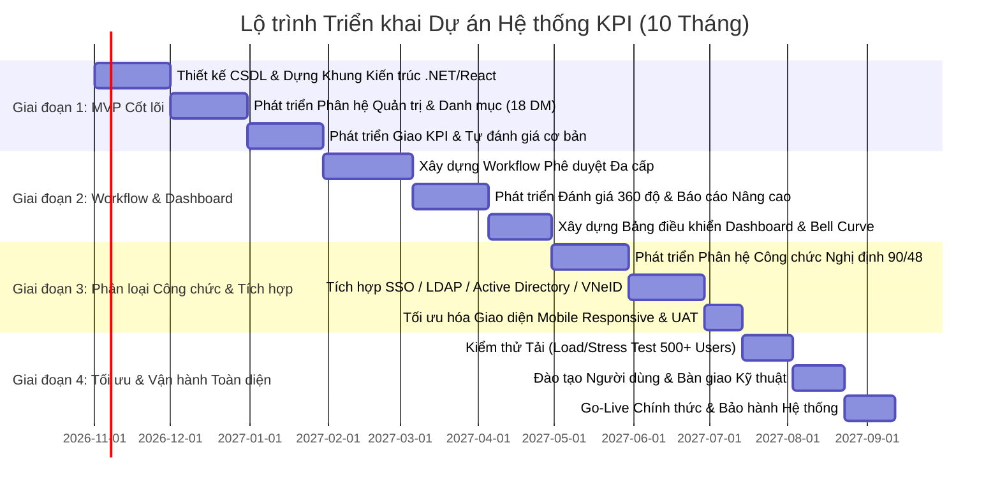

# TÀI LIỆU TỔNG HỢP TOÀN DIỆN, MA TRẬN TRUY VẾT & LỘ TRÌNH TRIỂN KHAI
## HỆ THỐNG QUẢN LÝ VÀ ĐÁNH GIÁ KPI CHO DOANH NGHIỆP VÀ CÁN BỘ CÔNG CHỨC
**Mã tài liệu:** FSR-KPI-V1.0  
**Giai đoạn:** Phiên 10 / 10 - Tổng hợp, Truy vết Yêu cầu & Lộ trình Triển khai (Final Synthesis & Traceability)  
**Tác giả:** Chuyên gia Phân tích Hệ thống & Giám đốc Dự án (Senior System Analyst & Project Director)  
**Tài liệu tham chiếu:** Toàn bộ hồ sơ phân tích thiết kế từ [Phiên 1](file:///d:/KPI/docs/Session_01_SRS_Requirements.md) đến [Phiên 9](file:///d:/KPI/docs/Session_09_UI_API_Design.md)  

---

## MỤC LỤC
1. [Ma trận Truy vết Yêu cầu Toàn diện (Requirements Traceability Matrix - RTM)](#1-ma-trận-truy-vết-yêu-cầu-toàn-diện-rtm)
2. [Bảng Tổng hợp Toàn bộ Sản phẩm Phân tích Thiết kế (Sessions 1-10)](#2-bảng-tổng-hợp-toàn-bộ-sản-phẩm-phân-tích-thiết-kế)
3. [Kế hoạch Kiểm thử Phần mềm Tổng thể (Master Test Plan)](#3-kế-hoạch-kiểm-thử-phần-mềm-tổng-thể-master-test-plan)
   - 3.1. Danh mục 20 Test Cases Kiểm thử Nghiệp vụ Trọng yếu
   - 3.2. Các Kịch bản Kiểm thử Chuyên sâu (Scenarios)
4. [Từ điển Thuật ngữ & Viết tắt (Glossary)](#4-từ-điển-thuật-ngữ--viết-tắt-glossary)
5. [Ma trận Phân tích Rủi ro & Kế hoạch Giảm thiểu (Risk Matrix)](#5-ma-trận-phân-tích-rủi-ro--kế-hoạch-giảm-thiểu-risk-matrix)
6. [Lộ trình Triển khai Dự án 4 Giai đoạn (Implementation Roadmap)](#6-lộ-trình-triển-khai-dự-án-4-giai-đoạn)
7. [Kết luận & Khuyến nghị Chiến lược Triển khai](#7-kết-luận--khuyến-nghị-chiến-lược-triển-khai)

---

## 1. MA TRẬN TRUY VẾT YÊU CẦU TOÀN DIỆN (RTM)

Ma trận truy vết (RTM) bảo đảm **100% các yêu cầu nghiệp vụ** được định nghĩa tại SRS (Phiên 1) đều được ánh xạ xuyên suốt qua các tầng kiến trúc: Ca sử dụng $\to$ Lớp đối tượng $\to$ Biểu đồ tương tác $\to$ Bảng CSDL $\to$ API Endpoint $\to$ Giao diện người dùng.

| Mã YC (FR) | Tên Yêu cầu Chức năng | Use Case (UC) | Lớp đối tượng (Class) | Biểu đồ Tương tác | Bảng CSDL (Table) | RESTful API Endpoint | Màn hình (Screen) |
|---|---|---|---|---|---|---|---|
| **FR-ADM-01** | Quản lý Đa tổ chức / Đơn vị | UC-02 | `Organization` | SD-07 | `organizations` | `GET/POST /api/v1/organizations` | SCR-06 |
| **FR-ADM-02** | Quản lý Cơ cấu phòng ban | UC-02 | `Department` | SD-07 | `departments`, `department_hierarchy` | `GET /api/v1/organizations/{id}/department-tree` | SCR-06 |
| **FR-ADM-03** | Quản lý Hồ sơ người dùng | UC-03 | `User`, `EmployeeProfile` | SD-01 | `users`, `employee_profiles` | `CRUD /api/v1/users` | SCR-04 |
| **FR-ADM-04** | Phân quyền vai trò RBAC | UC-04 | `Role`, `Permission` | SD-01 | `roles`, `permissions`, `role_permissions` | `GET/PUT /api/v1/roles/{id}/permissions` | SCR-05 |
| **FR-ADM-05** | Phân quyền phạm vi dữ liệu | UC-04 | `AuthController` | SD-01 | `users.data_scope` | `GET /api/v1/auth/me` | SCR-05 |
| **FR-ADM-06** | Nhật ký kiểm toán an toàn | UC-05 | `AuditLog` | SD-01 | `audit_logs` | `GET /api/v1/admin/audit-logs` | SCR-04 |
| **FR-CAT-01** | Danh mục Phân loại KPI | UC-07 | `KPICategory` | SD-07 | `kpi_categories` | `CRUD /api/v1/catalogs/kpi-categories` | SCR-07 |
| **FR-CAT-02** | Danh mục Kỳ đánh giá | UC-08 | `EvaluationPeriod` | SD-08 | `evaluation_periods` | `CRUD /api/v1/catalogs/evaluation-periods` | SCR-07 |
| **FR-CAT-03** | Thang điểm & Công thức | UC-09 | `ScoreScale` | SD-07 | `score_scales` | `CRUD /api/v1/catalogs/score-scales` | SCR-07, SCR-08 |
| **FR-CAT-04** | Mức xếp loại hiệu suất | UC-10 | `ClassificationLevel` | SD-05 | `classification_levels` | `CRUD /api/v1/catalogs/classification-levels` | SCR-07 |
| **FR-CAT-05** | Đơn vị tính & Phương pháp đo| UC-07 | `MeasurementUnit` | SD-07 | `measurement_units`, `measurement_methods`| `CRUD /api/v1/catalogs/measurement-units` | SCR-07 |
| **FR-CAT-06** | Chức danh & Ngạch bậc | UC-11 | `Position`, `CivilServant` | SD-05 | `positions`, `position_ranks` | `CRUD /api/v1/catalogs/positions` | SCR-07 |
| **FR-SET-01** | Xây dựng Bộ KPI mẫu | UC-12 | `KPITemplate` | SD-02 | `kpi_templates`, `kpi_template_details` | `CRUD /api/v1/kpi-templates` | SCR-09 |
| **FR-SET-02** | Phân tầng mục tiêu (Cascade)| UC-13 | `KPIAssignmentController`| SD-02 | `kpi_assignments` | `GET /api/v1/kpi-assignments/cascade-tree` | SCR-10 |
| **FR-SET-03** | Giao KPI & Thiết lập trọng số| UC-14 | `KPIAssignment` | SD-02 | `kpi_assignments`, `kpi_assignment_details`| `POST /api/v1/kpi-assignments` | SCR-10 |
| **FR-SET-04** | Kiểm tra $\sum \text{Weight} = 100\%$ | UC-14 | `WeightValidatorService` | SD-02 | `kpi_assignments.total_weight` | `POST /api/v1/kpi-assignments` | SCR-10 |
| **FR-SET-05** | Quy trình duyệt bản giao | UC-16 | `EvaluationWorkflowEngine`| SD-02 | `kpi_assignments.status` | `PUT /api/v1/kpi-assignments/{id}/approve` | SCR-11 |
| **FR-SET-06** | Điều chỉnh KPI giữa kỳ | UC-17 | `KPIAssignment` | SD-02 | `kpi_assignments` (Versioning) | `POST /api/v1/kpi-assignments/{id}/revise` | SCR-10 |
| **FR-EVA-01** | Cập nhật số liệu thực hiện | UC-18 | `EvaluationDetail` | SD-03 | `evaluation_details.actual_value` | `PUT /api/v1/evaluations/{id}/progress` | SCR-12 |
| **FR-EVA-02** | Quản lý Minh chứng đính kèm | UC-19 | `KPIEvidence` | SD-03 | `kpi_evidences` | `POST /api/v1/evaluations/evidences/upload`| SCR-12 |
| **FR-EVA-03** | Phiếu tự đánh giá nhân viên | UC-20 | `Evaluation`, `EvaluationDetail`| SD-03 | `evaluations`, `evaluation_details` | `POST /api/v1/evaluations/{id}/self-assess` | SCR-12 |
| **FR-EVA-04** | Đánh giá của Quản lý | UC-21 | `ManagerReviewController` | SD-04 | `evaluation_details.manager_score` | `POST /api/v1/evaluations/{id}/manager-review`| SCR-13 |
| **FR-EVA-05** | Đánh giá 360 độ (Ngang hàng) | UC-22 | `PeerReview` | SD-04 | `peer_reviews` | `POST /api/v1/evaluations/{id}/peer-review` | SCR-13 |
| **FR-EVA-06** | Thẩm định đa cấp (Workflow) | UC-25 | `EvaluationWorkflowEngine`| SD-04 | `evaluation_workflows`, `workflow_steps` | `POST /api/v1/evaluations/{id}/advance-step`| SCR-14 |
| **FR-EVA-07** | Khiếu nại kết quả đánh giá | UC-26 | `EvaluationDispute` | SD-04 | `evaluation_disputes` | `POST /api/v1/evaluations/{id}/dispute` | SCR-12 |
| **FR-PUB-01** | Tiêu chí chính trị, đạo đức | UC-23 | `CivilServantClassification`| SD-05 | `civil_servant_classifications` | `GET/PUT /api/v1/civil-servant/{id}/ethics` | SCR-15 |
| **FR-PUB-02** | Đo lường thực hiện chức trách | UC-23 | `CivilServantClassification`| SD-05 | `civil_servant_classifications` | `GET/PUT /api/v1/civil-servant/{id}/duties` | SCR-15 |
| **FR-PUB-03** | Ý kiến Chi ủy / Cấp ủy | UC-23 | `CivilServantClassification`| SD-05 | `civil_servant_classifications.party_opinion`| `PUT /api/v1/civil-servant/{id}/party-opinion`| SCR-15 |
| **FR-PUB-04** | Khống chế Xuất sắc $\le 20\%$ | UC-24 | `CivilServantService` | SD-05 | `classification_levels.is_capped` | `POST /api/v1/civil-servant/finalize` | SCR-15 |
| **FR-PUB-05** | Điểm liệt kỷ luật Đảng | UC-23 | `CivilServantService` | SD-05 | `civil_servant_classifications.has_disciplinary`| `POST /api/v1/civil-servant/finalize` | SCR-15 |
| **FR-PUB-06** | Xuất Mẫu 01/02 Nghị định 90 | UC-32 | `ReportGeneratorService` | SD-05 | `reports` | `GET /api/v1/reports/decree-90/{format}` | SCR-15 |
| **FR-REP-01** | Executive Dashboard Lãnh đạo | UC-27 | `DashboardController` | SD-06 | `evaluations`, `departments` | `GET /api/v1/dashboard/executive` | SCR-03A |
| **FR-REP-02** | Manager Dashboard Phòng ban | UC-28 | `DashboardController` | SD-06 | `evaluations`, `kpi_assignments` | `GET /api/v1/dashboard/department` | SCR-03B |
| **FR-REP-03** | Bảng xếp hạng Hiệu suất | UC-30 | `DashboardController` | SD-06 | `evaluations` | `GET /api/v1/reports/ranking` | SCR-17 |
| **FR-REP-04** | Phân tích Xu hướng (Trend) | UC-30 | `AnalyticsService` | SD-06 | `evaluations` | `GET /api/v1/reports/trends` | SCR-16 |
| **FR-REP-05** | Xuất báo cáo Excel/PDF | UC-31 | `ReportGeneratorService` | SD-06 | `reports` | `GET /api/v1/reports/export/{format}` | SCR-16 |
| **FR-NOT-01** | Thông báo chuông In-App | UC-33 | `NotificationDispatcher` | SD-08 | `notifications` | `GET /api/v1/notifications` | SCR-02 |
| **FR-NOT-02** | Cảnh báo hạn chót tự động | UC-34 | `DeadlineReminderJob` | SD-08 | `notifications`, `email_queues` | Background Job (Quartz.NET) | SCR-03 |
| **FR-NOT-03** | Gửi Email mẫu tự động | UC-35 | `EmailService` | SD-08 | `email_queues`, `notification_templates` | Background Worker | SCR-18 |

---

## 2. BẢNG TỔNG HỢP TOÀN BỘ SẢN PHẨM PHÂN TÍCH THIẾT KẾ

Bảng tổng kết toàn bộ các tài liệu và sản phẩm kỹ thuật đã hoàn thành qua 10 phiên:

| STT | Tên Sản phẩm Kỹ thuật | Mô tả chi tiết & Tiêu chuẩn áp dụng | Phiên thực hiện | Số lượng / Quy mô |
|:---:|---|---|:---:|:---:|
| 1 | **Tài liệu SRS Đặc tả Yêu cầu** | Chuẩn IEEE 830 / ISO 29148; 47 FRs, 11 NFRs, 20 Business Rules | Phiên 1 | 01 Tài liệu (33KB) |
| 2 | **Mô hình Use Case Diagrams** | Biểu đồ Mermaid Use Case tổng quan & 6 phân hệ chức năng | Phiên 2 | 07 Biểu đồ |
| 3 | **Đặc tả Use Case chi tiết** | Chuẩn Fully-Dressed Specifications (Main/Alt/Exception flows) | Phiên 2 | 10 Bản đặc tả cốt lõi |
| 4 | **Ma trận Phân quyền CRUD** | Ma trận Actor $\times$ Use Case cho toàn bộ hệ thống | Phiên 2 | 35 Use Cases |
| 5 | **Mô hình Lớp BCE & Package** | Phân tách 3 tầng Boundary, Control, Entity và Biểu đồ Gói | Phiên 3 | 05 Biểu đồ Class |
| 6 | **Đặc tả Lớp Thực thể** | Định nghĩa chi tiết thuộc tính, phương thức, ràng buộc PK/FK | Phiên 3 | 32 Entity Classes |
| 7 | **Biểu đồ Tuần tự (Sequence)** | Dòng trao đổi thông điệp tuần tự có Activation bar, Alt, Loop | Phiên 4 | 08 Biểu đồ chi tiết |
| 8 | **Biểu đồ Giao tiếp (Communication)** | Cấu trúc liên kết mạng lưới đối tượng có thông điệp phân cấp | Phiên 4 | 03 Biểu đồ |
| 9 | **Biểu đồ Hoạt động Phân làn** | Swimlane Activity Diagrams (HR, Manager, Employee, Director) | Phiên 5 | 06 Biểu đồ quy trình |
| 10 | **Biểu đồ Máy trạng thái** | Vòng đời chuyển dịch trạng thái chuẩn `stateDiagram-v2` | Phiên 5 | 04 Máy trạng thái |
| 11 | **Sơ đồ Thực thể Quan hệ (ERD)** | Biểu đồ Mermaid `erDiagram` phân hệ thể hiện bội số $1-1, 1-N, N-N$ | Phiên 6 | 06 Biểu đồ ERD |
| 12 | **Thiết kế Bảng CSDL Vật lý** | Cấu trúc 40 bảng chuẩn 3NF, Snapshot, Constraints, Indexes | Phiên 6 | 40 Bảng CSDL |
| 13 | **Kịch bản SQL DDL Script** | Script ANSI/PostgreSQL DDL sẵn sàng thực thi, kèm Triggers | Phiên 6 | 01 File (`.sql`) |
| 14 | **Kiến trúc Hệ thống & Component** | Clean Architecture, Component Interfaces & Dependencies | Phiên 7 | 02 Biểu đồ |
| 15 | **Kiến trúc Triển khai Hạ tầng** | Production High Availability Topology (DMZ, App, DB, Cache) | Phiên 7 | 02 Biểu đồ Deployment |
| 16 | **Đặc tả Danh mục Dùng chung** | 18 Danh mục nghiệp vụ, dữ liệu mẫu thực tế 5+ dòng/danh mục | Phiên 8 | 18 Danh mục DM |
| 17 | **Đặc tả Module Quản trị** | Quản trị Người dùng, RBAC+ABAC Matrix, Cấu hình động, Audit | Phiên 8 | 04 Module Quản trị |
| 18 | **Wireframes Giao diện Người dùng**| Bố cục layout, validation rules, hành vi tương tác, WCAG AA | Phiên 9 | 17 Màn hình SCR |
| 19 | **Đặc tả Hệ thống RESTful API** | Chuẩn OpenAPI 3.0 / Swagger, Request/Response JSON Schemas | Phiên 9 | 07 Nhóm Endpoints |
| 20 | **Kế hoạch Kiểm thử & Truy vết** | Ma trận RTM, Master Test Plan, Phân tích rủi ro, Lộ trình Gantt | Phiên 10 | 01 Tài liệu hoàn chỉnh |

---

## 3. KẾ HOẠCH KIỂM THỬ PHẦN MỀM TỔNG THỂ (MASTER TEST PLAN)

### 3.1. Danh mục 20 Test Cases Kiểm thử Nghiệp vụ Trọng yếu

| Mã TC | Tên Ca Kiểm thử | Phân hệ | Tiền điều kiện | Các bước thực hiện | Kết quả kỳ vọng (Expected Result) | Mức độ ưu tiên |
|---|---|---|---|---|---|:---:|
| **TC-01** | Đăng nhập tài khoản hợp lệ | Auth | Tài khoản ở trạng thái `Active` | 1. Nhập username & password đúng.<br>2. Nhấn "Đăng nhập". | Đăng nhập thành công, cấp phát JWT, chuyển hướng Dashboard đúng vai trò. | **Critical** |
| **TC-02** | Khóa tài khoản sau 5 lần nhập sai | Auth | Tài khoản đang `Active` | 1. Nhập sai mật khẩu liên tiếp 5 lần.<br>2. Bấm đăng nhập ở lần thứ 5. | Báo lỗi, chuyển trạng thái `Locked` 30 phút, gửi email cảnh báo an toàn (**NFR-SEC-01**). | **High** |
| **TC-03** | Xác thực 2 bước (2FA OTP) | Auth | Tài khoản đã bật 2FA | 1. Đăng nhập đúng mật khẩu.<br>2. Nhập mã OTP 6 số từ email. | Nếu OTP đúng $\to$ Đăng nhập thành công; Nếu OTP sai/hết hạn $\to$ Báo lỗi. | **High** |
| **TC-04** | Kiểm tra tổng trọng số $= 100\%$ | Giao KPI | Quản lý đang tạo bản giao | 1. Nhập các chỉ tiêu có tổng trọng số = 90%.<br>2. Nhấn "Gửi cam kết". | Hệ thống chặn lưu, hiển thị thông báo lỗi màu đỏ theo đúng **BR-01**. | **Critical** |
| **TC-05** | Giới hạn trọng số đơn lẻ $[5\%, 50\%]$ | Giao KPI | Quản lý đang tạo bản giao | 1. Nhập 1 chỉ tiêu có trọng số = 3% (hoặc 55%).<br>2. Nhấn Lưu. | Hệ thống chặn lưu, báo lỗi chỉ tiêu vi phạm khoảng cho phép theo **BR-02**. | **Medium** |
| **TC-06** | Khóa dữ liệu sau phê duyệt | Giao KPI | Bản giao được Lãnh đạo duyệt | 1. Quản lý/Nhân viên cố tình sửa Target/Trọng số qua API/Giao diện. | Hệ thống từ chối cập nhật, trả về lỗi `403 Forbidden` do trạng thái `Approved_Locked` (**BR-03**). | **Critical** |
| **TC-07** | Thứ tự thực hiện tự đánh giá | Đánh giá | Nhân viên chưa nộp tự chấm | 1. Quản lý mở màn hình để chấm điểm cho nhân viên. | Hệ thống khóa form chấm của Quản lý, hiển thị thông báo chờ nhân viên tự chấm (**BR-04**). | **High** |
| **TC-08** | Công thức tính % Càng cao càng tốt | Đánh giá | Chỉ tiêu Target = 100 | 1. Nhập Thực tế = 120.<br>2. Quan sát % hoàn thành. | Hệ thống tính tự động: $120 / 100 \times 100\% = 120.00\%$ (**BR-10**). | **Critical** |
| **TC-09** | Chặn trần MaxCap 150% | Đánh giá | Chỉ tiêu Target = 100, MaxCap=150% | 1. Nhập Thực tế = 180 (đạt 180%). | Hệ thống tự động gán trần $= 150.00\%$ theo đúng **BR-10**. | **High** |
| **TC-10** | Công thức tính % Càng thấp càng tốt | Đánh giá | Chỉ tiêu chi phí Target = 100 | 1. Nhập Thực tế = 80.<br>2. Quan sát % hoàn thành. | Hệ thống tính: $(2 - 80/100) \times 100\% = 120.00\%$ theo **BR-11**. | **High** |
| **TC-11** | Bắt buộc minh chứng khi $\ge 120\%$ | Đánh giá | Chỉ tiêu đạt tỷ lệ $130\%$ | 1. Để trống tệp minh chứng.<br>2. Nhấn nút "Nộp phiếu tự đánh giá". | Hệ thống chặn nộp, cảnh báo bắt buộc đính kèm file minh chứng theo **BR-09**. | **Critical** |
| **TC-12** | Bắt buộc giải trình lệch điểm $> 10\%$ | Thẩm định | Điểm tự chấm = 90, Quản lý chấm = 70 | 1. Quản lý chấm 70 điểm (lệch 20%).<br>2. Để trống ô lý do.<br>3. Bấm Hoàn thành. | Hệ thống chặn lưu, focus vào ô lý do, bắt buộc nhập tối thiểu 50 ký tự theo **BR-05**. | **Critical** |
| **TC-13** | Tự động gán 0 điểm khi trễ hạn | Cron Job | Nhân viên chưa nộp khi quá hạn | 1. Hệ thống chạy Cron Job đóng kỳ tự động khi qua ngày Cut-off date. | Phiếu tự đánh giá tự động gán điểm 0, đẩy thẳng hồ sơ lên Quản lý (**BR-12**). | **High** |
| **TC-14** | Chặn trần Xuất sắc $\le 20\%$ Nghị định 90 | Công chức | Cơ quan có 10 người Hoàn thành tốt | 1. Hội đồng đề xuất 3 người Hoàn thành xuất sắc ($3/10 = 30\%$).<br>2. Lãnh đạo bấm Duyệt. | Hệ thống chặn cưỡng bức, khóa nút duyệt, hiển thị cảnh báo vi phạm tỷ lệ $20\%$ theo **BR-06**. | **Blocker** |
| **TC-15** | Điểm liệt do kỷ luật Đảng/chính quyền | Công chức | Cán bộ bị kỷ luật trong năm | 1. Cán bộ đạt KPI 95 điểm.<br>2. Tích chọn "Có kỷ luật trong năm". | Hệ thống tự động ép xếp loại "Không hoàn thành nhiệm vụ", khóa các mức trên (**BR-07**). | **Critical** |
| **TC-16** | Bắt buộc sáng kiến khi xếp Xuất sắc | Công chức | Điểm KPI = 95 điểm | 1. Cán bộ không có sáng kiến/đề tài công nhận.<br>2. Chọn xếp loại Xuất sắc. | Hệ thống cảnh báo thiếu điều kiện, hạ về mức "Hoàn thành tốt nhiệm vụ" (**BR-08**). | **High** |
| **TC-17** | Cửa sổ khiếu nại 72 giờ | Khiếu nại | Kết quả đã công bố 24 giờ | 1. Nhân viên nhấn nút "Khiếu nại kết quả".<br>2. Nhập lý do và gửi. | Hệ thống tiếp nhận đơn khiếu nại thành công (**BR-14**). | **Medium** |
| **TC-18** | Hết hạn khiếu nại chuyển Read-Only | Đóng kỳ | Kết quả đã công bố quá 72 giờ | 1. Nhân viên bấm khiếu nại hoặc Quản lý bấm sửa điểm. | Hệ thống khóa chỉ đọc (Read-Only), từ chối mọi thao tác chỉnh sửa (**BR-15**). | **High** |
| **TC-19** | Phân quyền ngang phòng ban | Bảo mật | Trưởng phòng A đăng nhập | 1. Trưởng phòng A cố truy cập URL phiếu đánh giá của nhân sự Phòng B. | Hệ thống từ chối truy cập, trả về `403 Forbidden` theo đúng quy định tại **BR-19**. | **Critical** |
| **TC-20** | Xuất báo cáo Mẫu 01/02 Nghị định 90 | Báo cáo | Đã phê duyệt xếp loại công chức | 1. Bấm "Xuất Phiếu Mẫu 01 (Lãnh đạo)". | Hệ thống tạo file PDF chuẩn form biểu quy định, tự động điền đầy đủ dữ liệu. | **High** |

---

### 3.2. Các Kịch bản Kiểm thử Chuyên sâu (Test Scenarios)
1. **Happy Path Testing:** Kiểm thử trọn vẹn luồng công việc lý tưởng: Mở kỳ $\to$ Giao KPI $\to$ Xác nhận cam kết $\to$ Cập nhật tiến độ $\to$ Tự chấm $\to$ Quản lý chấm $\to$ Lãnh đạo phê duyệt $\to$ Khóa sổ kỳ $\to$ Xuất báo cáo thành công không lỗi.
2. **Boundary Testing (Kiểm thử Giá trị Biên):** Thử nghiệm tại các ngưỡng nhạy cảm: Trọng số $5.0\%$ và $50.0\%$; Tỷ lệ hoàn thành $119.9\%$ (chưa cần minh chứng) và $120.0\%$ (bắt buộc minh chứng); Tỷ lệ xuất sắc đúng bằng $20.0\%$ và $20.1\%$; Thời hạn khiếu nại tại phút thứ 4.319 (còn hạn) và 4.321 (hết 72h).
3. **Negative Testing:** Nhập chuỗi ký tự vào ô số; Tải file virus/script độc hại `.exe`, `.bat` vào ô minh chứng (hệ thống chặn ở tầng file upload validator); Nhập lý do giải trình 49 ký tự (hệ thống chặn vì thiếu 1 ký tự).
4. **Security Testing (OWASP Top 10):** Chạy công cụ kiểm thử tự động (OWASP ZAP / Burp Suite) quét lỗ hổng SQLi, XSS, IDOR/BOLA, kiểm tra khả năng rò rỉ JWT secret key và thử nghiệm tấn công brute-force.
5. **Performance & Stress Testing:** Sử dụng Apache JMeter mô phỏng $500$ người dùng đồng thời nộp phiếu tự chấm và trích xuất báo cáo tại thời điểm cao điểm cuối kỳ; Đảm bảo CPU Server $< 75\%$, RAM ổn định và Response Time $\le 1.5$ giây (**NFR-PERF**).

---

## 4. TỪ ĐIỂN THUẬT NGỮ & VIẾT TẮT (GLOSSARY)

| Thuật ngữ / Viết tắt | Tên tiếng Anh đầy đủ | Định nghĩa & Ý nghĩa nghiệp vụ trong hệ thống |
|---|---|---|
| **KPI** | Key Performance Indicator | Chỉ số đánh giá hiệu quả công việc cốt lõi, lượng hóa mức độ hoàn thành mục tiêu. |
| **BSC** | Balanced Scorecard | Thẻ điểm cân bằng: Phương pháp quản trị mục tiêu qua 4 viễn cảnh (Tài chính, Khách hàng, Quy trình, Phát triển). |
| **OKRs** | Objectives and Key Results | Mục tiêu và Kết quả Then chốt: Khung quản trị liên kết mục tiêu chiến lược với hành động cụ thể. |
| **Lương 3P** | Position - Person - Performance | Mô hình đãi ngộ: Trả lương theo Vị trí (P1) - Năng lực cá nhân (P2) - Hiệu quả công việc KPI (P3). |
| **Nghị định 90** | Decree No. 90/2020/NĐ-CP | Nghị định của Chính phủ về đánh giá, xếp loại chất lượng cán bộ, công chức, viên chức. |
| **Nghị định 48** | Decree No. 48/2023/NĐ-CP | Nghị định sửa đổi, bổ sung một số điều của Nghị định số 90/2020/NĐ-CP. |
| **Khống chế 20%**| Excellence Quota Cap | Quy định pháp lý: Tỷ lệ công chức xếp loại "Hoàn thành xuất sắc nhiệm vụ" không vượt quá 20% số "Hoàn thành tốt". |
| **RBAC** | Role-Based Access Control | Kiểm soát truy cập dựa trên vai trò người dùng (Admin, Manager, Staff...). |
| **ABAC** | Attribute-Based Access Control | Kiểm soát truy cập dựa trên thuộc tính dữ liệu (Phạm vi dữ liệu phòng ban, tổ chức). |
| **JWT** | JSON Web Token | Chuẩn mở (RFC 7519) định dạng mã thông báo xác thực an toàn truyền qua HTTP Header. |
| **RTM** | Requirements Traceability Matrix | Ma trận truy vết yêu cầu: Bảng đối soát bảo đảm mọi yêu cầu đều được hiện thực hóa. |
| **MaxCap** | Maximum Achievement Ceiling | Ngưỡng chặn trần thành tích (mặc định $150\%$) nhằm tránh lạm phát điểm số. |
| **Audit Trail** | Tamper-Proof Audit Logging | Nhật ký kiểm toán an toàn bất biến ghi lại mọi lịch sử thay đổi số liệu trong CSDL. |
| **Closure Table** | Hierarchy Closure Pattern | Kỹ thuật thiết kế CSDL quan hệ lưu trữ cây phân cấp phòng ban tối ưu hóa truy vấn $O(1)$. |

---

## 5. MA TRẬN PHÂN TÍCH RỦI RO & KẾ HOẠCH GIẢM THIỂU (RISK MATRIX)

```mermaid
quadrantChart
    title Ma trận Phân bổ Rủi ro Dự án (Impact vs Probability)
    x-axis Xác suất Thấp --> Xác suất Cao
    y-axis Tác động Thấp --> Tác động Rất Cao
    quadrant-1 Rủi ro Nguy cấp (Tập trung Ưu tiên)
    quadrant-2 Rủi ro Tiềm tàng (Lập phương án dự phòng)
    quadrant-3 Rủi ro Thấp (Theo dõi định kỳ)
    quadrant-4 Rủi ro Nghiệp vụ Thường xuyên (Quy chuẩn hóa)
    "R-01: Nghẽn mạng cuối kỳ": [0.75, 0.85]
    "R-02: Bất hợp tác khi giao KPI": [0.65, 0.70]
    "R-03: Vi phạm tỷ lệ 20% NĐ 90": [0.55, 0.90]
    "R-04: Thất thoát minh chứng": [0.25, 0.85]
    "R-05: Sai sót công thức phức tạp": [0.45, 0.60]
    "R-06: Rò rỉ điểm số trước công bố": [0.20, 0.80]
    "R-07: Xung đột dữ liệu khi kiêm nhiệm": [0.40, 0.50]
    "R-08: Quá tải dung lượng lưu trữ": [0.50, 0.40]
    "R-09: Chậm tiến độ do thay đổi nhân sự": [0.60, 0.65]
    "R-10: Khiếu nại kết quả kéo dài": [0.70, 0.55]
```

#### Bảng chi tiết 10 Rủi ro & Giải pháp Giảm thiểu:
| Mã Rủi ro | Mô tả chi tiết Rủi ro | Phân loại | Xác suất | Tác động | Giải pháp Giảm thiểu & Kế hoạch Khắc phục |
|---|---|:---:|:---:|:---:|---|
| **R-01** | Hệ thống quá tải, nghẽn mạng vào ngày chót nộp tự đánh giá | Kỹ thuật | Cao ($75\%$) | Rất lớn | Triển khai bộ đệm Redis đa tầng, cấu hình Load Balancer co giãn tải, mở cổng đánh giá trước hạn 7 ngày. |
| **R-02** | Nhân viên và Quản lý bất đồng ý kiến về chỉ tiêu cam kết đầu kỳ | Nghiệp vụ | Cao ($65\%$) | Lớn | Bắt buộc áp dụng khung mẫu chức danh chuẩn (Template) từ HR; quy định quy trình đối thoại tối đa 2 vòng. |
| **R-03** | Hội đồng bình bầu vượt quá tỷ lệ 20% Hoàn thành xuất sắc nhiệm vụ | Pháp lý | TB ($55\%$) | Nghiêm trọng | Cài đặt thuật toán kiểm tra cứng ở tầng Backend/Database: Khóa nút phê chuẩn nếu $N_{\text{Xuất sắc}} > 0.20 \times N_{\text{Tốt}}$. |
| **R-04** | Tệp minh chứng tải lên bị lỗi, nhiễm mã độc hoặc thất lạc | An toàn | Thấp ($25\%$) | Rất lớn | Quét virus tệp tải lên (ClamAV API), lưu trữ phân tán MinIO có cơ chế Erasure Coding dự phòng hỏng ổ cứng. |
| **R-05** | Công thức tính % chỉ tiêu bị sai lệch giữa các nhóm chỉ số | Nghiệp vụ | TB ($45\%$) | Trung bình | Đóng gói sẵn 3 công thức toán học chuẩn trong lõi hệ thống; kiểm thử Unit Test phủ kín $100\%$ các hàm toán. |
| **R-06** | Rò rỉ thông tin điểm số nhạy cảm trước khi Lãnh đạo ký duyệt | Bảo mật | Thấp ($20\%$) | Lớn | Phân quyền ABAC nghiêm ngặt: Trạng thái điểm chỉ ở chế độ `Private` cho đến khi Lãnh đạo ký ban hành chính thức. |
| **R-07** | Nhân sự kiêm nhiệm nhiều phòng ban gây chồng chéo bản giao | Nghiệp vụ | TB ($40\%$) | Trung bình | Áp dụng quy tắc **BR-13**: Hệ thống tự động tách 2 bản giao độc lập với trọng số phân bổ rõ ràng (VD: $70\% - 30\%$). |
| **R-08** | Dung lượng ổ cứng lưu trữ phình to do dung lượng file minh chứng | Hạ tầng | TB ($50\%$) | Thấp | Giới hạn dung lượng tối đa 25MB/tệp, nén ảnh tự động và thiết lập chính sách lưu trữ nén lạnh sau 2 năm. |
| **R-09** | Thay đổi nhân sự then chốt trong đội ngũ phát triển phần mềm | Quản lý | Cao ($60\%$) | Trung bình | Tài liệu hóa toàn diện 10 phiên theo chuẩn quốc tế; mã nguồn tuân thủ Clean Architecture dễ bàn giao. |
| **R-10** | Khiếu nại kết quả đánh giá kéo dài làm trễ tiến độ chi trả lương | Triển khai | Cao ($70\%$) | Trung bình | Giới hạn cứng thời hạn thụ lý khiếu nại trong 72 giờ làm việc theo quy chế (**BR-14**); sau 72h tự động đóng sổ. |

---

## 6. LỘ TRÌNH TRIỂN KHAI DỰ ÁN 4 GIAI ĐOẠN (ROADMAP)

Dự án được hoạch định triển khai trong tổng thời gian **10 tháng** qua 4 giai đoạn nối tiếp:



### Chi tiết các Giai đoạn:
- **Giai đoạn 1 (MVP - 3 tháng đầu):** Triển khai hạ tầng máy chủ, tạo lập CSDL 40 bảng, hoàn thiện Phân hệ Quản trị (người dùng, phân quyền RBAC), Phân hệ 18 Danh mục dùng chung, tính năng Giao KPI và Tự đánh giá cơ bản. Thử nghiệm nội bộ (Alpha Test).
- **Giai đoạn 2 (Workflow & Phân tích - 3 tháng tiếp theo):** Triển khai máy trạng thái Workflow phê duyệt đa cấp, đánh giá 360 độ ngang hàng, hệ thống Dashboard thời gian thực và trích xuất báo cáo động.
- **Giai đoạn 3 (Công chức & Tích hợp - 2 tháng):** Đóng gói phân hệ chuyên biệt Cán bộ Công chức theo Nghị định 90/2020/NĐ-CP và 48/2023/NĐ-CP (cơ chế chặn trần 20%, xuất phiếu Mẫu 01/02), tích hợp đăng nhập tập trung SSO/Active Directory. Kiểm thử chấp nhận người dùng (UAT).
- **Giai đoạn 4 (Vận hành & Go-Live - 2 tháng cuối):** Tối ưu hóa hiệu năng, kiểm thử tải cao điểm (Load Test 500+ người dùng đồng thời), đào tạo tập huấn toàn diện cán bộ công chức và chính thức bấm nút vận hành Go-Live toàn cơ quan.

---

## 7. KẾT LUẬN & KHUYẾN NGHỊ CHIẾN LƯỢC TRIỂN KHAI

### 7.1. Đánh giá Tính Khả thi Dự án (Feasibility Assessment)
1. **Tính Khả thi về Nghiệp vụ (Operational Feasibility):** Hệ thống giải quyết trọn vẹn điểm nghẽn của quy trình thủ công cũ, rút ngắn thời gian tổng hợp kỳ đánh giá từ 3 tuần xuống còn dưới 1 ngày, đáp ứng đồng thời cả mô hình kinh doanh linh hoạt của Doanh nghiệp và khung khổ pháp lý nghiêm ngặt của Nhà nước.
2. **Tính Khả thi về Kỹ thuật (Technical Feasibility):** Kiến trúc Clean Architecture trên nền tảng .NET 8, React.js và PostgreSQL là các công nghệ chuẩn mực công nghiệp hàng đầu thế giới, đảm bảo độ ổn định cao, bảo mật nhiều lớp và khả năng mở rộng hàng chục nghìn người dùng mà không cần thay đổi kiến trúc gốc.
3. **Tính Khả thi về Kinh tế (Economic Feasibility):** Lựa chọn hệ sinh thái mã nguồn mở (PostgreSQL, MinIO, Redis, RabbitMQ) giúp tiết kiệm hàng tỷ đồng chi phí mua bản quyền phần mềm máy chủ cho ngân sách đơn vị.

### 7.2. Khuyến nghị Chiến lược cho Chủ đầu tư
- **Về Thể chế & Quy chế:** Cần sớm ban hành *Quy chế Đánh giá Hiệu quả Công việc điện tử*, quy định rõ giá trị pháp lý của kết quả đánh giá trên phần mềm và chữ ký số thay thế hoàn toàn văn bản giấy.
- **Về Truyền thông & Văn hóa:** Quản trị sự thay đổi (Change Management) là yếu tố quyết định $60\%$ thành công của dự án. Cần tổ chức các buổi hội thảo truyền thông để nhân viên hiểu rằng: KPI không phải là công cụ "soi xét bắt lỗi" mà là thước đo minh bạch để bảo vệ quyền lợi và tôn vinh những người lao động xuất sắc.

---

**XÁC NHẬN HOÀN THÀNH TOÀN DIỆN BỘ HỒ SƠ PHÂN TÍCH THIẾT KẾ (PHIÊN 1 - PHIÊN 10)**  
*Hồ sơ đã sẵn sàng để chuyển giao sang giai đoạn Lập trình & Xây dựng Phần mềm.*
